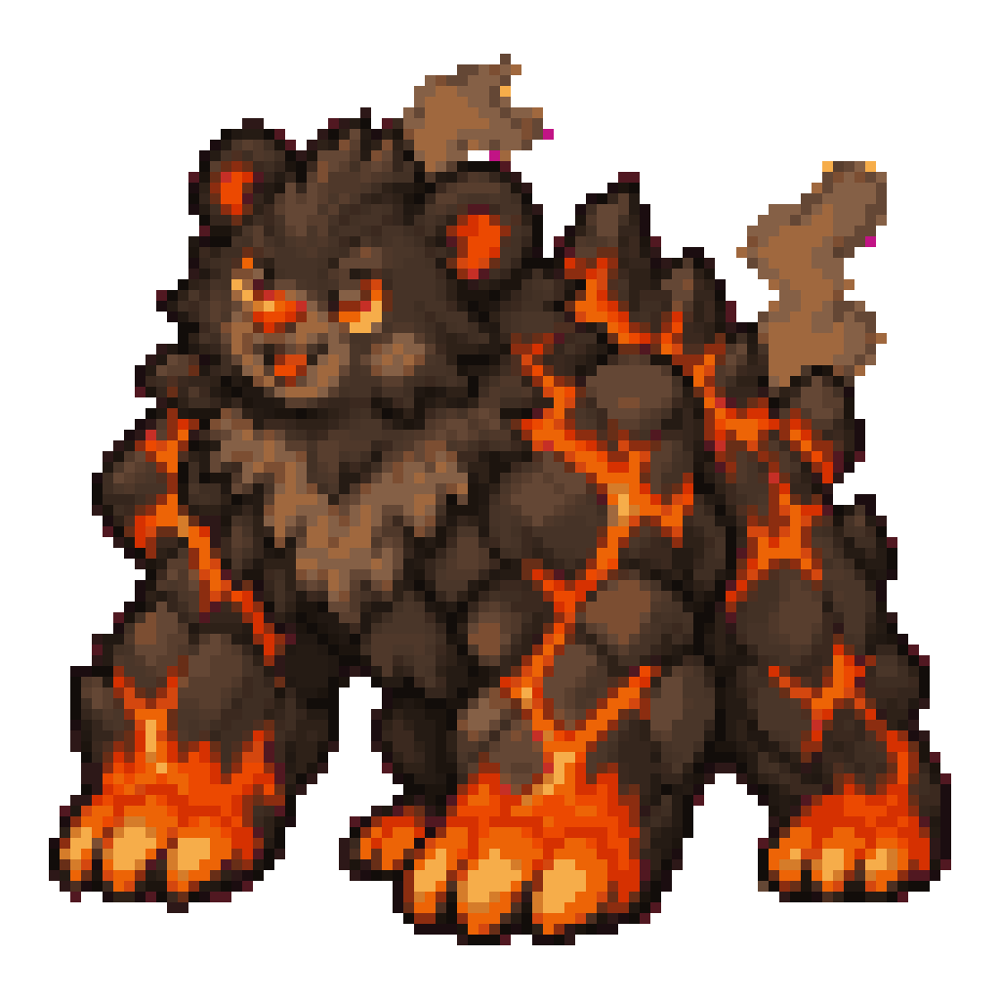

# Creature Catch: 3D model sheets

Turning the 2D Creature Catch creatures into 3D models, one at a time. Each creature gets a character
sheet (front, back, both sides, top, 3/4) and a depth map from an image generator. Those images then go
into a 3D tool.

Sprites come from `creature-catch/art/creatures/` on the `claude/vigilant-maxwell-dxhrgy` branch
(the 2D art version). The `reference/` folder has each sprite enlarged to 1024 x 1024 on white, so you
can attach it to the image generator.

---

## The first creature: Coalossus



**Coalossus** · Fire / Earth · #98 · evolves from Coalcub at Lv 30 · found in Glimmer Mine

> "Its body has hardened into glowing coal rock. Miners once used its warmth to keep the whole mine
> cozy through the winter."

**Why this one**

- **It looks great in 3D.** Glowing lava cracks between dark rock plates are an emissive material, so in
  a lit 3D scene the cracks actually glow and catch bloom. A flat sprite can't show that.
- **It's not too complicated.** It's one solid, chunky body: no wings, no thin floaty parts, no cloth,
  no see-through materials, no long fur strands. Image-to-3D tools handle that kind of shape well, and it
  rigs like an ordinary four-legged animal.
- **It's not one of the simplest.** It mixes two materials (shaggy fur on the head and chest, faceted
  rock plates on the body). It has a jagged crag ridge on its back and lava-dipped paws, plus a separate
  glow map. That's a good first test of texturing.
- **It's a payoff creature.** It's the grown-up form of the little Coalcub, so Coalcub would be an easy
  second model that shares its materials.

**Design decisions in the prompt** (things the sprite doesn't show, or that change for 3D):

- **Smoke removed.** The sprite has smoke rising from its back. That becomes a game effect later, so the
  model gets small glowing vents on the tips of the back crags instead.
- **Tail added.** The sprite doesn't show one, so the prompt adds a short stubby coal-chunk tail.
- **Neutral pose.** The prompt asks for a symmetrical standing pose, which makes rigging and animation
  easier.

---

### Prompt 1: Character sheet

Attach `reference/coalossus-sprite-reference.png` to the message, then paste this:

```text
Create a professional character turnaround sheet for 3D modeling of an original creature called Coalossus. The attached image is the original pixel-art sprite. Keep the same design, colors and personality, but redraw it as clean, high-definition concept art, not pixel art.

THE CREATURE
Coalossus is a huge, friendly bear whose body has hardened into coal rock. It is the grown-up form of a little coal-bear cub.
- Head: a round bear head covered in shaggy, dark chocolate-brown fur (fur, not rock). Small round ears with glowing orange inner ears. Warm glowing amber-orange eyes, a short muzzle with a dark nose, and a small gentle smile. Its expression is gentle but powerful.
- Chest: a thick shaggy ruff of lighter cocoa-brown fur from the chin down over the chest, like a bib.
- Body and legs: massive and chunky, covered in rounded, slightly faceted plates of matte charcoal-black coal rock that fit together like cobblestones. Thin cracks of glowing molten lava run between every plate. The cracks are orange-red, and brighter yellow-orange where they are widest.
- Back: the shoulders and spine rise into a ridge of jagged coal-rock crags. The tallest crags are over the shoulders and they get smaller toward the hips. A few crags have small glowing vent openings at their tips.
- Paws: very large, round paws with four thick toes each and no sharp claws. The paws glow as if dipped in lava: bright orange fading to yellow at the toe tips, with the glow fading up into the cracks of the legs.
- Tail: a short stubby bear tail made of one rounded coal chunk with a glowing crack.
- Build: heavy, low and powerful. Gorilla-like shoulders bigger than the hips, short thick legs, and a head about one quarter of its total height. Cute-but-mighty creature-game proportions.

POSE
Standing on all four legs in a neutral, symmetrical rest pose. Legs straight and slightly apart, head facing straight ahead, mouth closed in a slight smile. No smoke, no sparks, no flying embers, no ground effects. Same pose and same scale in every view.

LAYOUT
One wide 3:2 image with 3 columns and 2 rows, each view in its own area. Every view is orthographic with no perspective distortion. The creature is the same size in every view, and the feet in each row rest on the same horizontal line.
Top row, left to right: FRONT view | LEFT SIDE view (facing left) | BACK view
Bottom row, left to right: RIGHT SIDE view (facing right) | TOP view (looking straight down, head pointing to the top of the image) | 3/4 FRONT view (turned 45 degrees and seen slightly from above, the hero shot)
Every view must match the others exactly: same plate layout, same crag shapes, same crack pattern, same proportions.

STYLE
Clean, high-definition 3D-modeling reference sheet. Crisp sharp edges and consistent anatomy between views. Soft, even studio lighting from the front with very light shadows, so the shapes of the forms and plates are easy to read. The lava cracks glow, but they stay sharp lines with no blur or haze. Plain flat light-gray background (#D9D9D9), no floor shadow, no scenery, no text, no labels, no watermark, no borders or dividing lines.
```

### Prompt 2: Depth map

Send this in the same chat, right after the character sheet comes back:

```text
Now make a depth map of that exact character sheet. Keep the identical layout, views, poses, sizes and positions so it lines up exactly with the color sheet when laid on top of it. Render it as a grayscale depth map only. In each view, the parts of the creature closest to the viewer are pure white, fading smoothly to dark gray for the parts farthest away. The background is pure black. No color, no lava glow, no texture, no outlines, no lighting and no shadows: only smooth depth gradients that show the 3D shape (the rounded body, the bulging rock plates, the muzzle sticking out, the crags on the back).
```

An image generator's depth map is an artistic guess. It's fine for a quick look or a displacement
preview. For a real, measured depth map, run each view through a depth-estimation model instead
(Depth Anything V2 or Marigold, both free on Hugging Face). Most image-to-3D tools don't need a depth map
at all: they work from the views alone.

### Prompt 3 (optional): One view at full resolution

A 6-view sheet only gives each view about a sixth of the image. Many image-to-3D tools want separate,
large front, side and back images. Ask for them one at a time in the same chat, changing the word in
capitals:

```text
Using the exact same Coalossus from the character sheet, draw only the FRONT view, large and centered, filling most of a square 1:1 image. Same pose, same design, same even lighting, same plain light-gray background, orthographic, no text.
```

Swap `FRONT` for `LEFT SIDE`, `RIGHT SIDE`, `BACK`, `TOP`, or `3/4 FRONT`.

### Prompt 4 (optional): Material close-ups

Useful later for texturing:

```text
Using the exact same Coalossus, make a material reference sheet with 3 large close-up squares side by side: (1) a patch of the coal-rock body plates with the glowing lava cracks between them, (2) one front paw seen from the front, showing the lava-dipped toes, (3) the shaggy brown chest fur where it meets the rock plates. Same colors and lighting, plain light-gray background, no text.
```

---

## Checking the sheet before you use it

Image generators often get these wrong. Re-roll or ask for a fix if you see:

- The back view showing a face, or the side views facing the wrong way.
- The top view drawn from an angle instead of straight down.
- A different number of toes, crags or ears between views.
- Smoke, sparks or a floor shadow that crept back in.
- The creature drawn at different sizes in different views.
- The lava glow so bright it hides the plate shapes.

---

## The bench: next creatures, ready to go

Each of these has an enlarged sprite in `reference/`. To make a sheet for one, reuse Prompt 1: swap the
name, replace the **THE CREATURE** section with the description below, and adjust **POSE** if the note
says so. Ordered from easiest to hardest.

### Coalcub (easy, a natural follow-up)
Same materials as Coalossus, so the shaders carry straight over. Pose: sitting upright, as in the sprite.
```text
- A small, round, fluffy bear cub with fur as black as coal and lighter cocoa-brown fur on the chest and cheeks.
- Round ears with glowing red-orange inner ears, big warm amber eyes, a small ember-red nose, a happy open-mouthed smile, and a smudge of soot on one cheek.
- All four paws glow like warm embers: red-orange fading to yellow at the toe pads.
- Chubby baby proportions: a big head (about 40% of its height), a round body and short legs.
```

### Furnadillo (easy-medium)
Very readable shape with a fun brick-and-glow shell. Pose: standing on all fours, not curled up.
```text
- An armadillo with tan fur on its face and belly, large upright ears with orange inner ears, warm amber eyes and dark brown claws.
- Its whole shell is made of rounded terracotta-orange kiln bricks in curved bands. The seams between the bricks glow bright yellow-orange like molten mortar.
- A short round brick chimney rises from the top of the shell.
- Low, wide and heavy, with the shell covering the back, sides and top of the head.
```

### Clocktoise (medium)
Organic plus brass hard-surface, and the top view would be stunning. The fine detail (numerals, small
gears) is harder for image-to-3D tools, and you'll need to choose where the clock face sits: on top of
the dome, or tilted to one side as in the sprite.
```text
- An ancient, friendly olive-green tortoise with a cream beak-like face, sleepy kind eyes, a cream underside and stubby legs with pale toenails.
- Its shell is a domed brass clock case: a polished gold-brass rim with gear teeth all around its edge, and small brass gears set into the sides of the shell.
- The top of the shell is a large cream-colored clock face with dark numerals and two ornate brass clock hands, under a slightly domed glass cover.
```

### Gemonitor (medium)
Faceted gems look amazing in a 3D render (refraction and sparkle). It has lots of repeated pieces, but
they're simple shapes.
```text
- A cheerful green monitor lizard with a cream belly, a wide happy smile and pale yellow claws.
- It is covered from nose to tail in faceted gems: magenta, pink, ruby-red and teal crystals of different sizes, the biggest along the spine and the smallest on the legs and tail.
- A long thick tail that tapers to a point, held off the ground in a gentle curve.
```

### Drizzlon (medium)
A classic baby dragon. The thin wing membranes and the see-through water droplet are the tricky parts.
```text
- A small, friendly baby water dragon with smooth deep-blue skin, a pale teal belly with soft segmented plates, and big round shiny blue eyes.
- Two short pale-blue horns, and fin-like ear frills in teal.
- Two small fin-shaped wings with translucent teal membranes.
- A long tail that ends in a curl, with a clear, glossy water droplet at the very tip.
- Small white claws, and an open happy smile.
```

### Scrapcoon (medium-hard, the stretch goal)
Full of character, but it's really a raccoon plus a pile of separate props. Pose: standing upright on
its hind legs, as in the sprite.
```text
- A raccoon standing upright on its hind legs, with gray-brown fur, a dark eye mask, a cream muzzle and chest, and a big ringed tail in rust-orange and gray.
- On its head it wears a dented copper cooking pot as a helmet, with a small loop handle on top.
- Homemade armor made of copper pots, pan lids, brass gears and bottle caps, strapped over its chest, shoulders and arms.
- A lumpy sack overflowing with shiny copper junk slung on its back.
- A clever, proud grin.
```
