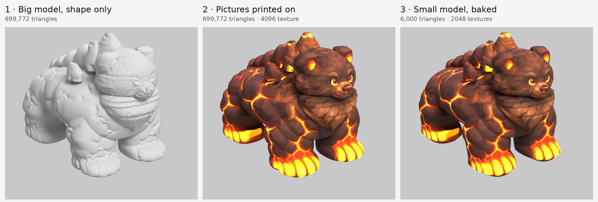
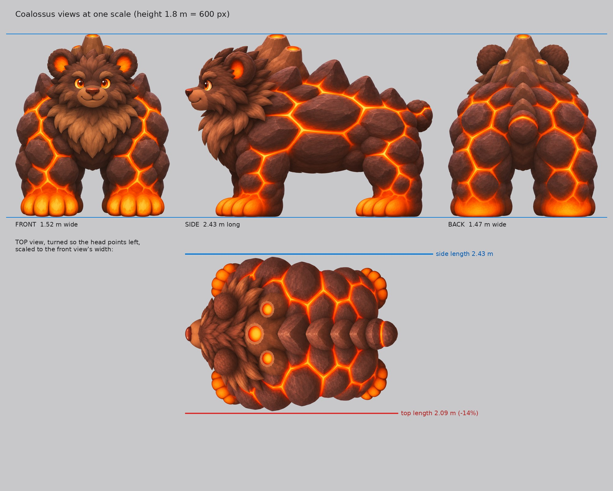

# Creature Catch: 3D models (paint-and-bake)

Turning the 2D Creature Catch creatures into 3D models, one at a time, with the **Paint-and-Bake Modeling
Method** (the one used for Ironhowl 4). In short: copy the shape from the pictures, model only the shape,
print the pictures on as paint, then bake that paint onto a light model for the game.

The pictures are **measurements, not illustrations**. Claude traces their outlines to get the shape, then
paints them onto the model, so the requests below follow the method's strict rules: dead-on views, no
outlines, no shadows, one fixed background grey.

Sprites come from `creature-catch/art/creatures/` on the `claude/vigilant-maxwell-dxhrgy` branch (the 2D
art version). The `reference/` folder has each sprite enlarged to 1024 x 1024 on white, ready to attach
to the first request.

---

## The first creature: Coalossus


**Coalossus** · Fire / Earth · #98 · evolves from Coalcub at Lv 30 · found in Glimmer Mine

> "Its body has hardened into glowing coal rock. Miners once used its warmth to keep the whole mine
> cozy through the winter."

**Why this one**

- **Its outline is easy to trace.** It's one solid, chunky body with legs, head and tail that read
  clearly from the front, side and top. It has no wings, cloth, see-through parts or thin floaty pieces.
- **It's a perfect fit for printed paint.** The detail people notice (lava cracks, rock plates, fur
  tufts) is paint, not shape. That's exactly what the method prints on instead of modelling.
- **The glow sells it.** The cracks, eyes, inner ears and paws can glow in 3D, which a flat sprite can't
  show.
- **It's not one of the simplest.** It has two materials (fur and rock), a crag ridge on its back,
  lava-dipped paws and four legs to rig and walk-test. That's a good first test of the whole method.

### Status: models built (8 Nov 2026)

The big model (699,772 triangles, pictures printed on) and the small game model (6,000 triangles, baked)
are done, both with a skeleton and 14 battle animations from the game (Coal Swipe, Quake Stomp, Flare
Burst and the rest). They're in `coalossus/models/`, with the boards, the phone screenshot and the full write-up in
[`coalossus/README.md`](coalossus/README.md).



### Pictures received (7 Nov 2026)

All five pictures are in `coalossus/source/`: the sheet plus front, side, back and top views, along with
the prompts and notes from the chat that made them. `coalossus/previews/coalossus_lineup.jpg` shows the
four views at one scale.



**The check list passes:**
- The side view faces left, and the top view is straight down with the head at the top.
- There's no face in the back view, and no outlines, floor shadow, smoke or sparks.
- It has 4 toes per paw, 2 ears and 3 vents in every view that shows them. The vents are one tall
  centre vent with two smaller ones behind it, and they sit in the same places in every view.

**Line-up numbers** (scaled so it stands 1.8 m tall):

| | Front | Side | Back | Top |
| --- | --- | --- | --- | --- |
| Height on the canvas | 953 px | 953 px | 959 px | – |
| Ground row (bottom of the paws) | 978 | 967 | 977 | – |
| Size | 1.52 m wide | 2.43 m long | 1.47 m wide | 2.09 m long at the front's width |

- **Heights:** front, side and back agree within 1%. The ground rows are within 11 px. Both get
  corrected automatically.
- **Size:** it came out a little chunkier than asked: **1.5 × 2.4 × 1.8 m** instead of 1.4 × 2.2 × 1.8.
  The method takes widths from the front view and lengths from the side view, so the model will be that
  size. That's fine for a big bear.
- **Top view:** about 14% shorter from nose to tail than the side view, and its back paws sit a bit
  further back. It gets stretched to the side view's length before printing. It only paints the top of
  the back (the paws get their paint from the front and side), so no re-roll is needed.
- **Background:** a slightly darker grey (193 to 197) than #C8C8CA, but flat (it varies by 5 at most).
  It gets replaced with the exact grey when the views are cut out.
- **Lighting:** a little more shading underneath than "shadowless". Acceptable; it reads as a slightly
  darker belly.
- **Sharpening:** not needed. The creature is about 950 px tall in each view and the detail is already
  crisp.

### The four decisions (proposed)

The method asks for these before starting. Change any of them.

| Decision | Proposal for Coalossus |
| --- | --- |
| The look | The **Creature Catch look** block below. It goes into every request, for every creature, so they all match. |
| Real size | **1.4 m wide × 2.2 m long × 1.8 m tall** (to the top of the shoulder crags). The game doesn't give sizes; this makes it a big bear, a bit taller than a person's shoulder. |
| Budget | The "Mid enemy (2–4 m)" row: **big model about 700,000 triangles, small model about 6,000, texture 2048**. |
| Joints | Hips (root), spine, chest, neck, head, tail, and three per leg (upper, lower, paw). That's enough for stand, walk and run. |
| Where it's shown | The big model for close-up screens (the Field Guide page, catching or evolving). The small model in battles and the overworld. |

### Changes from the sprite

- **No black outlines.** The sprite has them, but they would get printed onto the model as black lines.
- **No smoke.** Smoke can't be traced or printed, so it becomes a game effect later. The back crags get
  small glowing vents where it will come from.
- **Bigger, chunkier details.** The fur is drawn as chunky tufts and the rock as big plates, with nothing
  thinner than 5 cm. That keeps the outline traceable and the paint the same in every view.
- **A tail.** The sprite doesn't show one, so the request adds a short stubby coal-chunk tail.
- **A neutral pose.** It stands square on all four legs with daylight between them, so the legs trace
  cleanly and rig easily.
- **No depth map.** The method gets the shape by tracing the outline from two views, so a depth map
  isn't used.

---

## The Creature Catch look

This paragraph is already inside Prompts 1 and 2. For a new creature, paste it into those two requests
unchanged:

```text
THE LOOK (the same for every creature in this game): a friendly creature-collecting game. Chunky, rounded, cute-but-mighty proportions, big warm expressive eyes and simple shapes that read clearly. Stylised hand-painted surfaces with clear blocks of colour and gentle texture, not photoreal. Colours true to the original sprite. No black outlines around the creature or any of its parts. Soft, even, shadowless studio light with only small highlights. Glowing parts glow, with no halo onto the background. Plain flat light-grey background, exactly #C8C8CA, with no floor, shadow, reflection, border or watermark.
```

---

## The picture request for Coalossus

Do every request in **one ChatGPT chat** so the style matches, and use the same chat later for the other
creatures. You'll end up with five pictures: the sheet and four views.

### Prompt 1: Character sheet

Attach `reference/coalossus-sprite-reference.png`, then paste:

```text
Make a character design sheet for an original creature called Coalossus, for a creature-collecting game. The attached image is the original pixel-art sprite. Keep the same design, colours and personality, but redraw it as clean, high-definition painted concept art, not pixel art.

THE PAGE
Landscape, 1536 x 1024. On the left, a large three-quarter hero view. On the right, small front, side and back views in a row, all the same size and standing on the same ground line, with the side view facing left. Below them, four close-ups: the face, one front paw, a patch of rock plates with the lava cracks, and the place where the chest fur meets the rock. Next to the small views, a size bar in metres showing it stands 1.8 m tall and is 2.2 m long. The name "COALOSSUS" at the top. No other text.

THE CREATURE
Coalossus is a huge, friendly bear whose body has hardened into coal rock. It is 1.4 m wide across the shoulders, 2.2 m long from nose to tail, and 1.8 m tall to the top of its shoulder crags.
- Head: a round bear head covered in dark chocolate-brown fur, drawn as chunky clumped tufts (each tuft at least 5 cm wide, no thin strands). Small round ears with glowing orange inner ears. Warm glowing amber-orange eyes, a short muzzle with a dark nose, and a closed-mouth gentle smile. Its expression is gentle but powerful.
- Chest: a thick ruff of lighter cocoa-brown fur in big chunky tufts, from the chin down over the chest like a bib.
- Body and legs: massive and chunky, covered in big rounded plates of matte charcoal-black coal rock, each about 25 to 40 cm across, fitting together like cobblestones. A simple, bold network of glowing lava cracks runs between the plates: orange-red, brighter yellow-orange where the cracks are widest.
- Back: the shoulders and spine rise into a ridge of solid, chunky coal-rock crags (no thin spikes). The tallest crags are over the shoulders and they get smaller toward the hips. A few crags have small glowing vent openings at their tips. No smoke.
- Paws: very large, round paws with four thick toes each and no sharp claws. They glow as if dipped in lava: bright orange fading to yellow at the toe tips, with the glow fading up into the cracks of the legs.
- Tail: a short stubby bear tail made of one rounded coal chunk with a glowing crack.
- Build: heavy and powerful. Gorilla-like shoulders bigger than the hips, short thick legs, and a head about one quarter of its total height.

POSE
Standing square on all four legs in a neutral, symmetrical pose. Legs straight down and slightly apart, with clear gaps of background between them. Head facing straight ahead, mouth closed. The same pose in every view. No smoke, sparks or embers anywhere.

THE LOOK (the same for every creature in this game): a friendly creature-collecting game. Chunky, rounded, cute-but-mighty proportions, big warm expressive eyes and simple shapes that read clearly. Stylised hand-painted surfaces with clear blocks of colour and gentle texture, not photoreal. Colours true to the original sprite. No black outlines around the creature or any of its parts. Soft, even, shadowless studio light with only small highlights. Glowing parts glow, with no halo onto the background. Plain flat light-grey background, exactly #C8C8CA, with no floor, shadow, reflection, border or watermark.
```

If the sheet looks wrong, fix it here before moving on: every view after this copies it.

### Prompt 2: HD front view

Same chat, right after the sheet:

```text
Now make the HD views of Coalossus from this sheet, one picture per view. Start with the FRONT view.

Rules for every view:
- True orthographic, like a technical drawing: no perspective and no tilt. For this one, the camera looks dead at its front from mid-height.
- Landscape, 1536 x 1024. The whole creature in frame with about a 5% margin, centred left to right, nothing cut off. In every view, at the same scale: the bottoms of its paws on the same pixel row, and the tops of its crags on the same pixel row.
- Exactly the same creature as the sheet: same plates, same crack pattern, same crags, same fur tufts and the same colours on the same parts in every view. Its left and right halves mirror each other.
- The same neutral pose in every view, standing square on all four legs with clear gaps of background between the legs.
- Nothing hair-thin: every part, tuft and crag at least 5 cm across. Nothing see-through, smoky, blurred or flashing. No smoke, sparks or embers.
- No text.

THE LOOK (the same for every creature in this game): a friendly creature-collecting game. Chunky, rounded, cute-but-mighty proportions, big warm expressive eyes and simple shapes that read clearly. Stylised hand-painted surfaces with clear blocks of colour and gentle texture, not photoreal. Colours true to the original sprite. No black outlines around the creature or any of its parts. Soft, even, shadowless studio light with only small highlights. Glowing parts glow, with no halo onto the background. Plain flat light-grey background, exactly #C8C8CA, with no floor, shadow, reflection, border or watermark.
```

### Prompts 3 to 5: The other views

One at a time, in the same chat:

```text
Same again for the SIDE view: the camera dead at its side, the creature facing LEFT (its nose toward the left edge of the picture). Same scale, same ground line and same top line as the front view, same paint and detail. All the same rules.
```

```text
Same again for the BACK view: the camera dead behind it, looking at its rear, back crags and tail. Same scale, same ground line and same top line as the front view, same paint and detail. All the same rules.
```

```text
Same again for the TOP view: the camera straight down from above, with its head at the TOP of the picture and its tail at the bottom. Make this one portrait, 1024 x 1536, so its whole length fits. Same scale as the side view, same paint and detail. All the same rules.
```

The top view is portrait so the creature isn't shrunk. At the side view's scale, its 2.2 m length won't
fit across the short side of a landscape picture.

### Optional: Sharpen a view

Only if a view comes back soft or low on detail. If you're not sure, send the views first and I'll say
which ones need it. Upload the view to the same chat with this prompt (from the method):

```text
Make a sharper, higher-detail version of this exact image. Same object, same pose, same position and size on the canvas, same camera, same colours, markings and numbers, same plain light-grey background. Do not move, resize, add, remove or redesign any part, and keep its outline exactly the same. Only make it crisper and add fine surface detail on the existing surfaces: panel lines, bolts, small scratches and wear. Soft, even studio light.
```

For a creature, "panel lines, bolts" just means fine detail in the rock and fur. If ChatGPT adds actual
bolts, add this line to the end: "This is a creature, so the fine detail is rock grain, small cracks and
fur clumps, not panel lines or bolts."

### What to bring back

Five pictures, named like this if you can (any names are fine):

| File | What |
| --- | --- |
| `coalossus_sheet.png` | The character sheet |
| `coalossus_front.png` | HD front view |
| `coalossus_side.png` | HD side view, facing left |
| `coalossus_back.png` | HD back view |
| `coalossus_top.png` | HD top view, head at the top |

### Check before you send

ChatGPT often gets these wrong. Re-roll that one view if you see:

- **The side view facing right.** It must face left.
- **The top view drawn at an angle.** It must be straight down, head at the top.
- **A face or eyes showing in the back view.**
- **Perspective.** For example, the near legs bigger than the far legs, or the top of the back showing
  in the front view.
- **Black outlines, a floor shadow, smoke or sparks** that crept back in.
- **A different number of toes, crags or ears** than the other views, or the creature noticeably bigger
  or smaller than in the other views.
- **Lava glow so bright it hides the plate shapes, or haloes onto the grey.**

Small shifts in size or position are fine: Claude measures them and corrects for them before printing.

---

## The bench: next creatures, ready to go

Each of these has an enlarged sprite in `reference/`. To make a creature's pictures, run the same five
prompts. In Prompt 1:

- Change the name.
- Replace **THE CREATURE** with the description below.
- Update the sizes in **THE PAGE** to match.
- Change **POSE** where the note says so.

In Prompts 2 to 5, change the name and anything that names Coalossus's parts (crags, paws). Ordered from
easiest to hardest. The sizes are suggestions.

### Coalcub (easy, the natural follow-up)
Same materials as Coalossus, so it reuses the same look. About 0.5 m wide × 0.6 m long × 0.6 m tall,
which is the "Small creature" budget row. Pose: sitting upright, front paws on the ground, as in the
sprite.
```text
- A small, round, fluffy bear cub with fur as black as coal, drawn as chunky clumped tufts, with lighter cocoa-brown fur on the chest and cheeks.
- Round ears with glowing red-orange inner ears, big warm amber eyes, a small ember-red nose, a happy closed-mouth smile, and a smudge of soot on one cheek.
- All four paws glow like warm embers: red-orange fading to yellow at the toe pads.
- Chubby baby proportions: a big head (about 40% of its height), a round body and short legs.
```

### Furnadillo (easy-medium)
Very readable shape with a fun brick-and-glow shell. About 1.0 m wide × 1.6 m long × 1.0 m tall. Pose:
standing on all fours, not curled up.
```text
- An armadillo with tan fur on its face and belly, large upright ears with orange inner ears, warm amber eyes and short dark brown claws.
- Its whole shell is made of big rounded terracotta-orange kiln bricks in curved bands. The seams between the bricks glow bright yellow-orange like molten mortar.
- A short round brick chimney rises from the top of the shell.
- Low, wide and heavy, with the shell covering the back, sides and top of the head.
```

### Clocktoise (medium)
Organic plus brass hard-surface, and the top view really matters. Printed paint suits the numerals and
small gears well, but you'll need to choose where the clock face sits. The prompt puts it on top of the
dome; the sprite tilts it to one side. About 1.0 m wide × 1.3 m long × 0.8 m tall.
```text
- An ancient, friendly olive-green tortoise with a cream beak-like face, sleepy kind eyes, a cream underside and stubby legs with pale toenails.
- Its shell is a domed brass clock case: a polished gold-brass rim with chunky gear teeth all around its edge, and brass gears set into the sides of the shell.
- The top of the shell is a large cream-coloured clock face with dark numerals and two thick ornate brass clock hands. Paint the clock face directly on the shell; no glass cover.
```

### Gemonitor (medium)
Faceted gems look great on a 3D model. It has lots of repeated pieces, but they're simple shapes. About
0.8 m wide × 2.4 m long × 0.8 m tall.
```text
- A cheerful green monitor lizard with a cream belly, a wide happy smile and pale yellow claws.
- It is covered from nose to tail in solid, opaque faceted gems: magenta, pink, ruby-red and teal crystals, the biggest along the spine and the smallest on the legs and tail.
- A long thick tail that tapers to a blunt point, held just off the ground in a gentle curve.
```

### Drizzlon (medium)
A classic baby dragon. The method needs nothing hair-thin or see-through, so the wings are solid fins
and the tail droplet is solid. About 1.2 m wide (wings out) × 1.2 m long × 0.9 m tall.
```text
- A small, friendly baby water dragon with smooth deep-blue skin, a pale teal belly with soft segmented plates, and big round shiny blue eyes.
- Two short pale-blue horns, and thick fin-like ear frills in teal.
- Two small fin-shaped wings, folded half open, made of thick solid teal fin (not see-through).
- A long tail that ends in a curl, with a solid, glossy blue water droplet at the very tip.
- Small white claws and a happy closed-mouth smile.
```

### Scrapcoon (medium-hard, the stretch goal)
Full of character, but it's really a raccoon plus a pile of separate props, each its own traced part.
About 0.8 m wide × 0.7 m long × 1.3 m tall. Pose: standing upright on its hind legs, arms slightly away
from the body, as in the sprite.
```text
- A raccoon standing upright on its hind legs, with gray-brown fur in chunky tufts, a dark eye mask, a cream muzzle and chest, and a big ringed tail in rust-orange and gray.
- On its head it wears a dented copper cooking pot as a helmet, with a thick loop handle on top.
- Homemade armour made of copper pots, pan lids, chunky brass gears and bottle caps, strapped over its chest, shoulders and arms.
- A lumpy sack overflowing with shiny copper junk slung on its back.
- A clever, proud grin.
```
