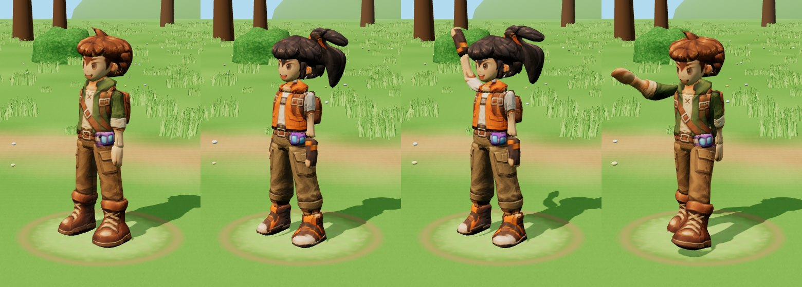
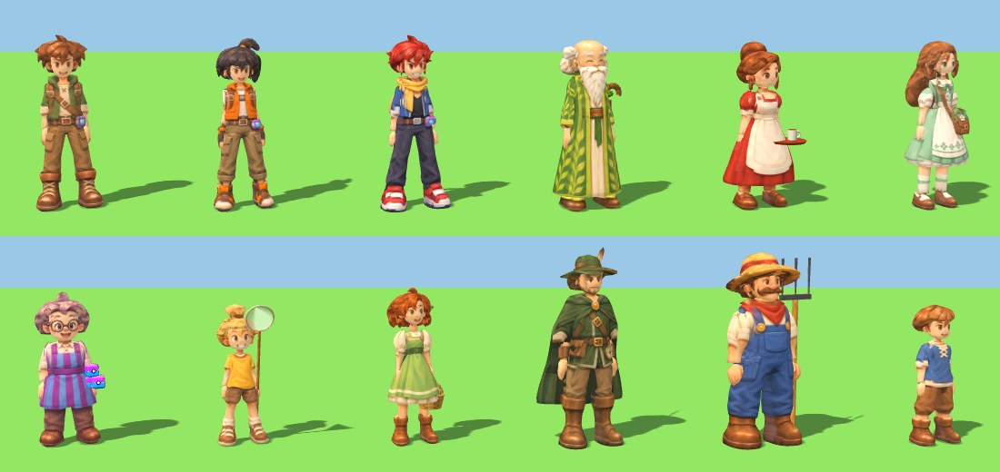
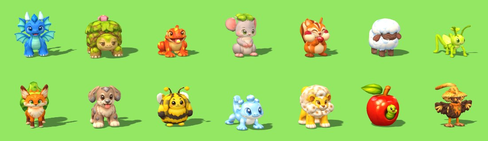
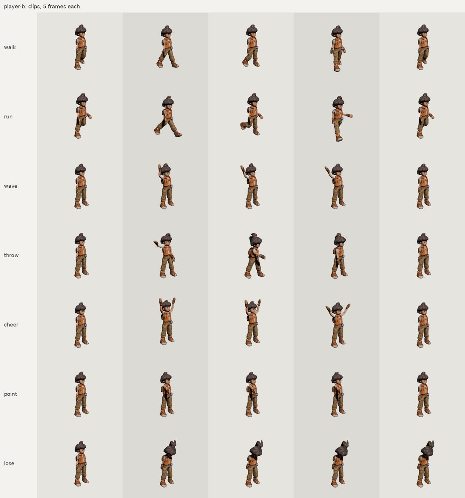

# Chapter 1 in 3D: the people and creatures

The plan for the playable Chapter 1 demo:
- **The game:** the earlier demo's game (branch `first-3d-demo`), with every model replaced by a painted
  paint-and-bake model.
- **Towns:** the diorama look, with the 2D game's own ground.
- **Battles:** the 2D game's own painted backgrounds.
- **Buildings, furniture and props:** modelled from the game's art and covered with painted texture
  sheets.

The full list is in `../CHAPTER1_MODEL_LIST.md`.

## The two heroes: the first people made with paint-and-bake

*The boy and the girl standing, the girl waving, and the boy throwing a capture cube.*

| Hero | Triangles | Outline overlap front / side / back | Texture seen by a picture | Build time |
| --- | --- | --- | --- | --- |
| Boy (`player-a`) | 7,000 (44% on the head and hair) | 92.3 / 88.9 / 89.3% | 60% | about 60 min |
| Girl (`player-b`) | 6,952 (54% on the head, hair and ponytail) | 91.9 / 91.4 / 88.5% | 65% | about 40 min |

**How well people work:**
- **Faces:** very well. They're clean, with no ghost eyes, and from the front three-quarter view each
  reads like its sheet's hero view.
- **Clothes:** very well. The four pictures agreed closely, so the jacket, vest, straps, belt, pockets
  and boots print cleanly.
- **Hair:** the weak point. Spiky or loose hair is almost all outline, and smooth parts carry only part of
  it. Both heroes' hair is a rounder, puffier mass with the spikes and strands painted on, and over the
  temples it looks a little like a helmet. The girl's is the more noticeable.
- **Hands:** soft mittens with the fingers painted on, as planned, which keeps them simple to animate.

**Usage:** one helper built both heroes, using about 394,000 tokens in all, or about 197,000 per person.
That's in line with the creatures.

## Everyone else: the whole Chapter 1 cast

After the heroes, five helpers built the other 10 people and the 8 new wild creatures the same way. They're animated
and in the playable game (`game/`).

| Person | Triangles | Outline overlap front / side / back | Texture seen by a picture |
| --- | --- | --- | --- |
| Rosa | 6,974 | 93.7 / 91.3 / 91.7% | 57% |
| Hazel | 6,992 | 90.3 / 88.6 / 88.9% | 54% |
| Fern | 6,984 | 88.6 / 89.8 / 85.8% | 60% |
| Elder Willow | 6,984 | 95.5 / 95.1 / 94.1% | 60% |
| Ranger Oakley | 7,000 | 93.1 / 89.6 / 88.3% | 54% |
| Farmer Bramble | 6,990 | 94.1 / 93.7 / 93.6% | 52% |
| Juniper | 6,976 | 89.0 / 85.7 / 88.8% | 60% |
| Pip | 6,956 | 91.9 / 91.0 / 90.5% | 60% |
| Tinker | 6,954 | 87.5 / 85.1 / 85.1% | 68% |
| The farm kid | 6,988 | 91.8 / 88.6 / 85.3% | 64% |

| Creature | Skeleton | Triangles | Outline overlap front / side / back | Texture seen by a picture |
| --- | --- | --- | --- | --- |
| Dewt | four-legged | 6,996 | 93.0 / 94.6 / 82.7% | 77% |
| Dandylion | four-legged | 6,956 | 92.8 / 91.7 / 87.7% | 69% |
| Wormapple | round (the worm is the head) | 6,954 | 95.4 / 94.3 / 95.9% | 86% |
| Scarecrowl | bird | 7,000 | 88.7 / 85.4 / 82.8% | 71% |
| Tuftail | four-legged | 6,990 | 88.0 / 84.5 / 86.9% | 71% |
| Pebblepup | four-legged | 6,990 | 93.2 / 91.1 / 93.5% | 70% |
| Bumblop | round, with buzzing wings | 6,976 | 91.5 / 90.6 / 91.3% | 76% |
| Hopsprout | four-legged with middle legs, hopping | 6,958 | 86.7 / 78.5 / 77.8% | 77% |

**How they came out:**
- **Faces and clothes** are as clean as the heroes' on every person. Willow, Bramble and Rosa are the best of them:
  the robe, the overalls and the dress print very cleanly, and hats and buns suit smooth parts.
- **Hair** is still the weak point. Long, curly or spiky hair (Hazel, Fern, Tinker, Juniper) is a rounded mass with
  the strands painted on.
- **Creatures:** Wormapple, Pebblepup and Bumblop are as good as round 3's best. Dewt, Dandylion and Tuftail are close.
  Scarecrowl is a step below: the straw and feathers are smooth shapes with the detail painted on.
- **Hopsprout** is the weakest. Its pictures disagree with each other (the legs are drawn differently from the side,
  and the top view is another pose), and its shiny highlights printed as blotches. New pictures with less shine and
  the same pose from every side would help it most.

**Usage:** the five model helpers used about 2.55 million tokens for the 18 models, about 142,000 per model:

| Helper | Built | Tokens |
| --- | --- | --- |
| People 1 | Rosa, Hazel, Fern | about 500,000 |
| People 2 | Willow, Oakley, Bramble, Juniper | about 528,000 |
| People 3 | Pip, Tinker, the farm kid | about 440,000 |
| Creatures 1 | Dewt, Dandylion, Wormapple, Scarecrowl | about 555,000 |
| Creatures 2 | Tuftail, Pebblepup, Bumblop, Hopsprout | about 531,000 |

The game helper, which put the chapter together, used about 502,000 more.

**Lessons for next time** (from the builders' notes):
- **The machine was shared by five builders,** so each route run took 6 to 15 minutes instead of about 2. Three
  builders at a time would finish almost as soon.
- **Skin-colour skipping** (which stops face paint printing onto hair) left blotches on lavender and white hair,
  whose shading counts as skin. The builders turned it off there, or used a stricter pale-skin colour.
- **Fringes** work well as a band wrapped round the forehead, sliced side to side, with its lower edge following the
  drawn hairline.
- **Legs under skirts** should be full length, not stubs, so the skeleton puts the hips and knees in the right place.
- **Pictures that disagree** (the farm kid's back view, Hopsprout's legs, Hazel's bow) cost the most outline overlap.

## The two-legged skeleton

Both heroes are animated with the new two-legged skeleton (`../pipeline/ANIMATION.md`, "People"):
- **Actions:** stand, walk, run, talk, wave, throw a cube, point, cheer and lose.
- **The ponytail:** the girl's has its own two bones, so it sways.

## In the Battle Bay

The heroes are the first two picks in the Creature Battle Bay. People get action buttons instead of
moves. "Throw a cube" launches a capture cube made in code: a purple lid, a blue base, a glowing seam and
a white button. It lands on the battle pad and pops open with a flash. This is the first object made the
new way, from the game's own art with no reference picture.

## What the next people should know

From the builder's notes (`player-a/NOTES.md` and `player-b/NOTES.md`):
- **Trace by hand:** trace people with hand-drawn smooth outlines, not the picture's own outline. Folds in
  the clothes otherwise turn into rings.
- **Hair:** use one hair mass sliced upward, whose front edge steps back from the forehead to behind the
  ears. Add a separate fringe part. Give only the 4 to 6 biggest spikes, locks or curls their own flat
  parts.
- **Paint on the wrong part:** watch for one part's paint printing onto another. Here, the side picture's
  fingers printed onto the thigh, the cube printed on both hips, and skin printed onto the hair. The
  builder added options to switch these off.
- **The top pictures:** for people they show a different pose (arms stretched out), so use them only to
  paint the crown of the hair.
- **Ideas to try for better hair:**
  - more hair parts, with a bigger triangle share
  - asking the picture prompts for simpler, chunkier hair shapes (a few big locks, not many thin strands)

## Files

- `source/<id>/`: the five pictures per person or creature.
- `<id>/`, each holding:
  - the game model (`<id>.glb`)
  - the animated model (`<id>_animated.glb`)
  - the textures, `parts.json`, `views.json` and `rig.json`
  - the boards and `closeups.jpg`
  - `animation_manifest.json`
  - `NOTES.md`
  - `tools/`
- `animation/`: pose sheets for everyone.
- The picture requests:
  - `picture-request-main-characters.html`: the two heroes.
  - `picture-request-chapter1.html`: the 8 creatures, the 10 other people and the 8 texture sheets.
  - `make_picture_requests.py` makes both, from the reference images in `reference/`.
- Briefs: `BRIEF_PEOPLE.md` (the heroes), `BRIEF_PEOPLE_2.md` (the other people), `BRIEF_CREATURES.md` (the wild
  creatures) and `BRIEF_GAME.md` (putting the game together).
- `textures/`: the painted texture sheets, cut into seamless tiles and see-through stickers for buildings and props.
- `game/`: the playable Chapter 1, with its own `README.md`.
