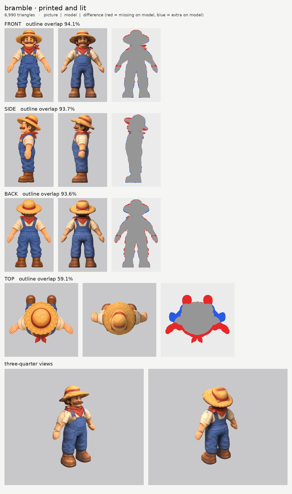
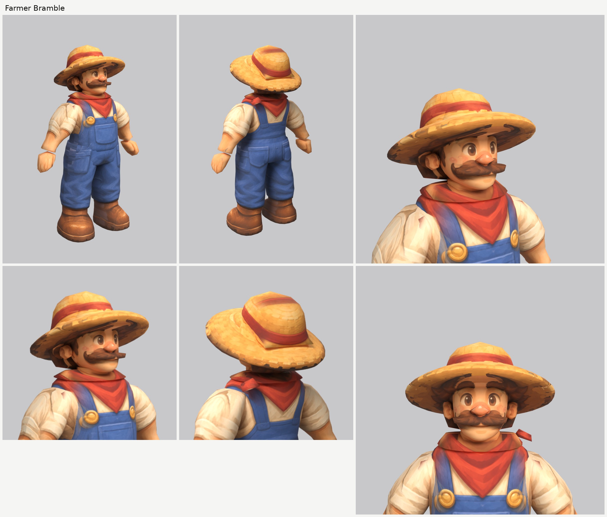

# Farmer Bramble (bramble): small-model-only route (Opus 5.5)

**Result:** a 6,990-triangle game model (`bramble.glb`, 3.2 MB) with one colour texture (2048), a normal
map (gentle grain on the cloth, straw, hair, moustache and boots, nothing on the skin) and an all-black
glow map (nothing glows). From the front and the front three-quarter view he reads as the farmer on the
sheet: brown eyes and thick brows, the big round nose and rosy cheeks, the bushy handlebar moustache,
curly brown hair under the wide straw hat with its red band, the red bandana knotted at his left, the
cream shirt with rolled sleeves, the blue overalls with gold buttons, bib pocket and side pockets, and
the big brown boots. From behind: the hat, the bandana's point, the overall straps and back pockets.

The final game model's Blender file (the lead animates from it):
`/tmp/claude-0/-home-user-atoms-games-/95c47fc1-cd5e-5362-b776-c463cbad3789/scratchpad/chapter1/bramble/out2/model.blend`

## Numbers

| | Front | Side | Back | Top |
| --- | --- | --- | --- | --- |
| Blockout (60,000 triangles), outline overlap (`blockout.jpg`, before the fixes in 4 and 6) | 93.9% | 92.9% | 93.2% | 59.4% |
| Game model (6,990 triangles), outline overlap | 94.1% | 93.7% | 93.6% | 59.1% |

- **Texture seen by a picture:** 51.7%. The rest (the inner sides of the arms and legs, the soles,
  the underside of the brim, hidden ends) is coloured from the nearest painted spot of the same part.
- **Why the top number is low:** the top picture is another pose (arms out, boots far in front). It
  paints only the hat: its scale is set so its round brim matches the brim in the front and side
  pictures (`set_view_map.py`).
- **Parts (16 kinds, 22 pieces), all named for the two-legged skeleton:**

  | Skeleton job | Pieces |
  | --- | --- |
  | head | `head`, `nose`, `moustache`, `ear_L/R`, `hair`, `hat`, `hat_brim` |
  | neck | `neck` |
  | upper chest | `collar_bandana`, `collar_knot` |
  | chest and spine | `torso` (the shirt and the overalls' bib; the straps, buttons and pocket are paint) |
  | hips | `hips` (the overalls below the waist; the side pockets are paint) |
  | arm (shoulder to wrist, the rolled sleeve included) | `arm_L`, `arm_R` |
  | hand | `hand_L`, `hand_R` |
  | leg (hip to boot, the baggy trouser leg included) | `leg_L`, `leg_R` |
  | foot | `boot_L`, `boot_R` |

  Arms, hands, legs and boots are mirrored pairs. Each arm starts inside the torso at the shoulder and
  each leg 16 cm up inside the hips. The elbow is just under the rolled sleeve and the knee where the
  overalls bunch, as the pictures put them.
- **Triangle budget:** head, hair and hat 3,336 (48%: head 1,188, brim 832, hair 432, crown 368,
  moustache 256, ears 100 each, nose 60); torso 648, legs 456 each, arms 384 each, boots 266 each,
  hips 260, hands 144 each, bandana 126, knot 60, neck 60. (The first run gave the brim 1,216 and the
  moustache 84; I moved triangles to the head and the moustache.)
- **Time:** about 40 minutes of my own work (01:24 to 03:00 by the clock, interleaved with Oakley while
  the shared machine ran each job): 1 blockout and 2 route runs.

## What I did and the problems I hit

1. **Pictures checked.** The front, side and top agree that the bandana's knot is at the back of his
   left side; the back picture also puts its loose ends on his left. What the generator got wrong:
   - **the top picture is another pose** (see above);
   - **the bandana's point hangs at the front in the front picture and at the back in the back
     picture.** It can't be both, so the bandana is a band round the neck and each picture paints its
     own point (front on the chest, back on the back), which reads well from either side.
2. **Views on one scale:** `make_views.py ... 1.75`; the top picture's scale is set by hand to the brim.
3. **Ghost face:** the side picture's eye and eyebrow are painted out of a print-only copy with skin
   colour only (`inpaint_skin.py`; the copy is `side_print_repaired.png`). The nose and moustache are
   their own parts, so the side picture paints them onto the right parts.
4. **The tilted straw hat** is built like Oakley's: the brim is sliced front to back (`axis: y`) from a
   thin slanted band in the side picture and a round top outline, with the sides bent down (`droop`),
   and the crown is its own part. The first blockout's crown floated above the brim at the back,
   because the front outline cut the crown off flat at the brim's front height; the front outline now
   reaches down into the brim, so the crown follows the brim's tilt.
5. **The moustache** is its own part, a thick bar sliced upward that sits in front of the upper lip;
   its curled ends tuck into the cheeks. The nose is a ball in front of it.
6. **Broad build:** the torso's side outline follows his round belly, the hips are their own part (the
   overalls below the waist) and the legs are wide baggy tubes. The first blockout's sleeves were too
   wide at the shoulder; they now follow the picture.
7. **Red on the brim, blue on the sleeves.** The top picture's red hat band is a ring at the crown's
   base; the model's crown sits a little further back (the side picture tips it back), so the ring
   printed a red arc on the brim. And the side picture's overall strap runs over the shoulder where
   the model's sleeve is, so it printed blue smears on the sleeves. My copy of `print_tex.py` adds two
   colours to the girl's `paint_color_skip`: `red` (the brim skips it) and `blue` (the arms skip it).
8. **The side picture's hand** hangs in front of the side pocket. The side picture is switched off on
   the torso, hips and legs behind the arm (`paint_box_skip`), so the fingers don't print onto the
   overalls.
9. **Relief:** none on the face, nose, ears and hands; a gentle `grain` on everything else.
10. **Glow map:** all black. Checked: the exported glow texture is black.

## Changed tool copies (in `tools/`)

The heroes' set (see `../player-b/NOTES.md`), unchanged except `print_tex.py`, which adds the `red` and
`blue` colours to `paint_color_skip` (see 7). New for Bramble: `mkparts.py` writes this
`parts.json`; `redo_views.sh` rebuilds the views, sets the top picture's scale and makes the repaired
side picture.

Rebuild (from the work folder): `bash tools/redo_views.sh`, then `python -I tools/mkparts.py parts.json`,
then `PY=... bash tools/route_small.sh parts.json views/views.json OUT 7000 bramble`.

## What still looks wrong

- **The moustache's curled tips stick out sideways** a little from the three-quarter view, as thin
  points past the cheeks; from the front it matches the picture.
- **The hair is a smooth mass** under the brim with the curls painted on; the brim hides most of it.
- **A faint blue smudge** on the bandana's left edge where the strap meets it, and dark patches on the
  brim's edge where the hair's colour reached it.
- **A thin pale line at each wrist** where the hand's rounded top shows out of the forearm.
- **The hands are mittens** with painted fingers, as the brief asks.
- The top view doesn't match the top picture (a different pose).

## Compared with the heroes

About as good. The face is clean (no ghost features; from the front three-quarter view it reads like
the sheet, nose and moustache included), the overalls, buttons, pockets and bandana print cleanly, and
the outline match is better than the heroes' (94.1 / 93.7 / 93.6% against about 92 / 89 / 89%) because
his clothes are simple, round shapes and the pictures agree closely. The hat hides the hair, which was
the heroes' weak spot; the moustache tips are his.

## What the next people should know

- **A crown on a tilted brim:** let the crown's front outline reach down into the brim, so the side
  outline alone sets where its bottom is, or it floats.
- **A moustache, a nose or a beard as its own part** keeps the side picture's copy of it on the right
  part; only the side picture's eye and brows need painting out.
