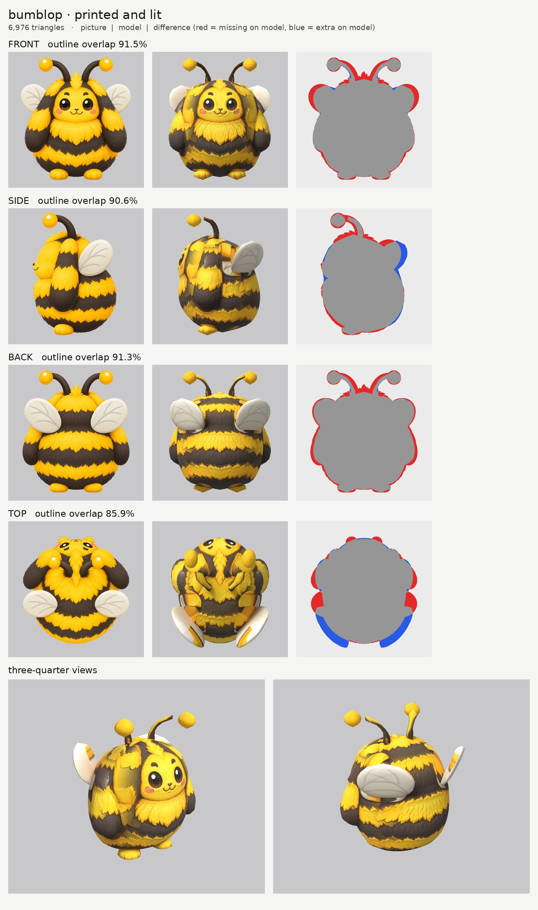
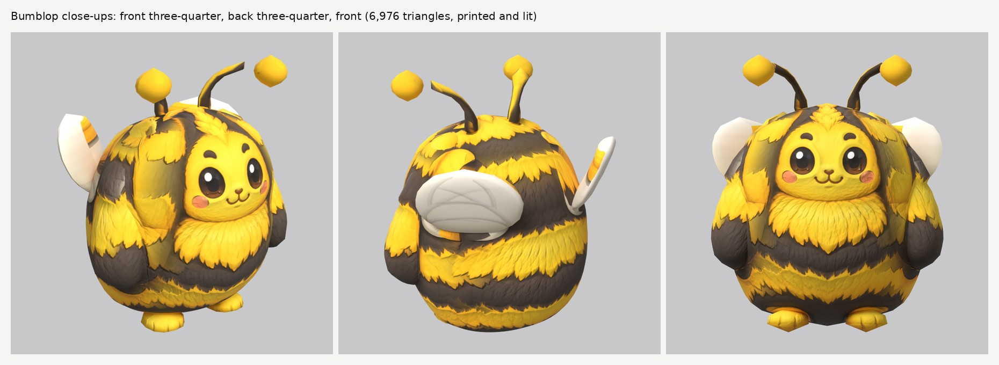

# Bumblop: small-model-only route

**Result:** a 6,976-triangle game model (`bumblop.glb`, 4.2 MB) with one colour texture (2048), a
soft-fur normal map and an all-black glow map (nothing glows, so the yellow stripes and antenna balls are
not lit up). It reads as the bee-bunny in the pictures: a round striped fluff ball with the face on the
front (big shiny eyes, rosy cheeks, tiny smile), long floppy ears hanging at its sides, black antennae
with yellow balls, two solid cream wings with grey veins standing out behind, and two tiny yellow feet.

The final game model's Blender file (the lead animates from it):
`/tmp/claude-0/-home-user-atoms-games-/95c47fc1-cd5e-5362-b776-c463cbad3789/scratchpad/chapter1/bumblop/out5/model.blend`

## Numbers

| | Front | Side | Back | Top |
| --- | --- | --- | --- | --- |
| Blockout (60,000 triangles), outline overlap (`blockout.jpg`) | 91.7% | 92.6% | 91.5% | 86.6% |
| Game model (6,976 triangles), outline overlap | 91.5% | 90.6% | 91.3% | 85.9% |

The blockout board is the first one; after it the ball's top was widened under the head tufts and the
wings were made a little bigger and turned (below).

- **Texture seen by a picture:** 76.1%. The rest (the underside, the hidden backs of the ears, the body
  behind the wings, the soles) is coloured from the nearest painted spot of the same part.
- **Parts (11 pieces):** `body` (the ball, with the face), `ear` pair, `head_antenna` pair,
  `head_antenna_tip` pair (the yellow balls), `wing` pair, `foot` pair. Budget: ball 3,720 (it carries the
  face), ears 756 each, wings 420 each, antenna balls 196 each, antennae 160 each, feet 96 each.
- **Skeleton words (round plan with wings):** `body` is the ball and carries the face (as on Mushling);
  `ear`, `head_antenna`, `head_antenna_tip` ride the head bone on top of the ball; `wing` is the pair to
  flutter; `foot` the feet.
- **Glow:** 0% (black map, checked in `emissive.jpg` and on the lit board).
- **Time:** about 45 minutes of my own work (tracing from about 01:25, blockout, first run at 02:45, then
  four more runs after the break, ending about 12:20), 5 route runs (3 full, 2 that only re-printed the
  paint) and 1 blockout. That is the brief's limit of five runs.

## What I did and the problems I hit

1. **Pictures checked.** The views are square (1254 x 1254); side faces left, top has the head at the
   top, front and back agree. What the generator got wrong:
   - **The wings face the camera in the back, side and top pictures** (a big oval in all three), which a
     flat wing can't do. Each wing is a thick turned plate (`slab`, 3 cm) that fits the back and side
     outlines: it sweeps out and back from the upper back, so the front three-quarter view sees its front
     face (painted by the side picture) and the back view sees its back face. From straight above it is
     narrower than the top picture draws it (the low top score at the wings).
   - The front picture draws the wings 1 cm wider than the back picture; the model is between.
   - **The top picture is drawn half from the front** (the face shows), so it is used only for the top of
     the ball, with the face and the antennae switched off in it.
2. **Ghost face.** The side picture's eye, eyebrow and cheek blush are painted out of a print-only copy
   (`side_print_repaired.png`); the face comes from the front picture only. The side picture's nose and
   smile are kept: they sit on the very front of the ball where the front picture's are.
3. **Wings sinking into the ball.** At first each wing ran from its root forward on the back out to a tip
   further back. Its root half was then inside the round back, so from behind the ball covered it and
   the wings looked half-black. Now each wing runs from its root high on the back out and slightly
   forward to its tip beside the ear (`slab` turned the other way), and sits 3 cm further back
   (`offset`, with the side picture read shifted the same amount, `paint_shift`). From behind the whole
   wing shows, and from the front the tips peek out beside the ears, as both pictures draw them.
4. **Wing paint on the ball and ears.** The back, side and top pictures draw the wings over the ball, so
   those pictures are switched off on the ball inside the wing areas (`paint_ellipse_skip`); the back
   picture's wings also cover the tops of the ears, so it is switched off there too. In the other
   direction, the front picture's ears and the top picture's ears and fur printed yellow stripes on the
   wings, and the back picture's ear fur printed on the wing tips, so the wings take only the side
   picture and the back picture's wing area.
5. **The antenna balls** are their own parts (`head_antenna_tip`) with extra triangles, so they are round,
   and one yellow lightly shaded by the pictures (`paint_solid`): each picture's white highlight sat in a
   different place, which made them look like lumpy nuggets.
6. **Smooth ball.** The ball's outline is hand-traced and smoothed (`nomask`, `smooth` 14), so the fluffy
   edge doesn't become rings; the fur tufts are paint.
7. **Relief:** `fur_soft` on the fur (ball, ears, feet), `none` on the wings, antennae and balls.

## Changed tool copies (in `tools/`)

The same set as Tuftail's (see `../tuftail/NOTES.md`). `mkparts.py` writes `parts.json`; `closeups.py`
makes `closeups.jpg`.

Rebuild: `make_views.py WORK/views 0.5 front side back top`, then
`tools/inpaint_view.py views.json side "341,472,50,68" "364,550,38,33" "362,368,31,18" "x:540,620,150,340" --grain 0 --sigma 14`,
then `tools/mkparts.py parts.json` and `PY=... bash tools/route_small.sh parts.json views.json OUT 7000 bumblop`.

## What still looks wrong

- **The ears print a little onto the ball beside them** (dark bands at the edges of the face from the
  front): the front picture draws the ears wrapping further forward than the side picture puts them.
- **The wings are seen almost edge-on from the front three-quarter view** (thin cream plates); from the
  back three-quarter view they are full ovals with veins. Their front faces are plain cream (no picture
  could print there), with a thin yellow line along the root.
- **From straight above the wings point forward-out,** while the top picture draws them straight out to the
  sides (the top score's blue and red at the wings).
- The ball has a soft lighter patch on the upper back where the wing areas were switched off.
- The small yellow tuft on top of the head in the pictures is paint only.

## Compared with round 3

Close to round 3's. The face is as clean as Clovermouse's, the stripes wrap all the way round, and the
outline scores (91.5 / 90.6 / 91.3%) are at round 3's level. The wings took the most work, because the
pictures draw them face-on from three sides; they read well from behind and from the side, and only as thin
plates from the front three-quarter view.
