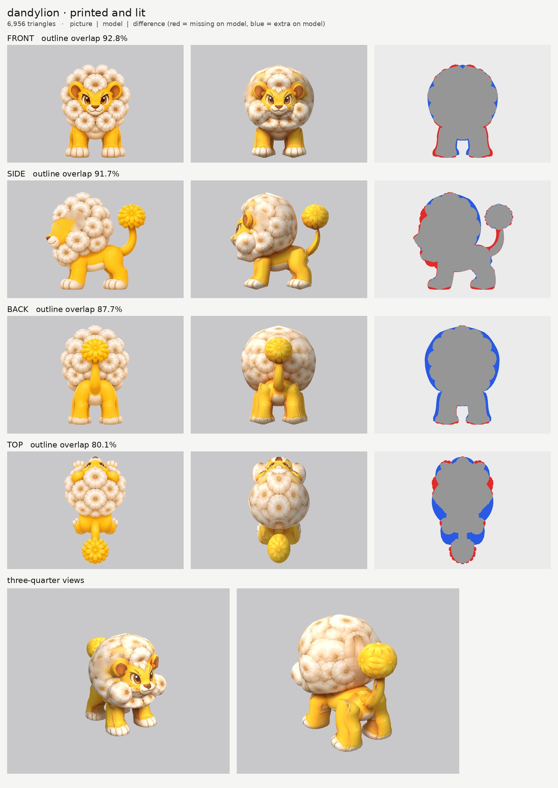
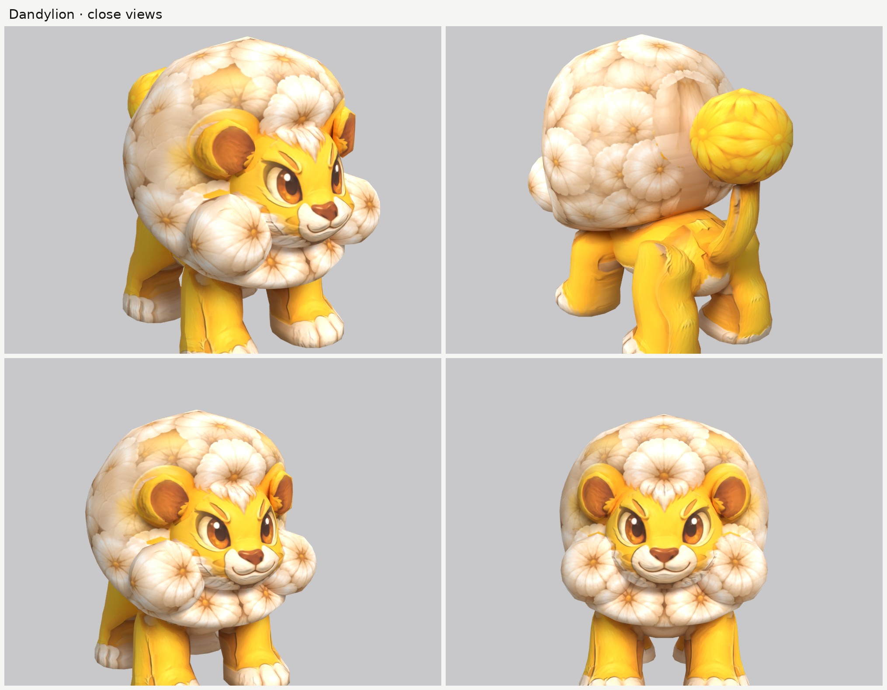

# Dandylion: small-model-only route

**Result:** a 6,956-triangle game model (`dandylion.glb`, 2.4 MB) with one colour texture (2048), a
normal map (soft fur on the face, body, legs and tail; none on the mane and the flower) and an all-black
glow map: nothing glows, so the yellow fur stays dark on the glow map. From the front three-quarter view
it reads as the picture: the golden cub face with its brown eyes, nose and smile, round ears standing in
front of a big round mane of white seed puffs, puffs framing the cheeks, cream paws, and the tail rising
behind to a yellow dandelion flower.

The final game model's Blender file (the lead animates from it):
`/tmp/claude-0/-home-user-atoms-games-/95c47fc1-cd5e-5362-b776-c463cbad3789/scratchpad/chapter1/dandylion/r3/model.blend`

## Numbers

| | Front | Side | Back | Top |
| --- | --- | --- | --- | --- |
| Blockout (60,000 triangles), outline overlap (`blockout.jpg`, before the cheek puffs) | 91.8% | 92.9% | 89.2% | 76.2% |
| Game model (6,956 triangles), outline overlap | 92.8% | 91.7% | 87.7% | 80.1% |

- **Texture seen by a picture:** 68.9%. The rest (the underside of the mane, the inside of the legs, the
  soles, the backs of the ears) is coloured from the nearest painted spot of the same part.
- **Size:** 0.49 m wide, 0.67 m long, 0.65 m tall. The picture request says 0.95 m long with the tail;
  the pictures draw it shorter (0.67 m at the brief's 0.65 m height). I kept the brief's height.
- **Parts (13 pieces):** `head` (the face), `head_ear` pair, `head_puffs` (the mane), `head_puffs_cheek`
  pair, `body`, `front_leg` pair, `rear_leg` pair, `tail`, `tail_tuft`. Budget: mane 2,156, face 1,120,
  body 608, legs 352 (front) and 416 (rear) each, tail flower 420, cheek puffs 324 each, tail 160,
  ears 154 each.
- **Skeleton words:** `head*` head (the mane is `head_puffs`, not "mane", so it isn't tied to the
  chest); `tail` and `tail_tuft` tail; `body`; `front_leg`, `rear_leg` mirrored pairs.
- **Glow:** 0% (black map, checked: `emissive.jpg` is black and the lit board shows no glowing yellow).
- **Time:** about 35 minutes of work spread over 01:20 to 02:30 by the clock (shared with the other
  creatures while route runs rendered), with 1 blockout and 3 route runs.

## Why back and top are lower

- **Back (88%):** the back picture draws the mane narrower and higher than the front picture (the blue
  ring round the mane on the back board). The front picture wins for widths.
- **Top (80%):** the top picture is drawn tilted, half from the front: the face shows, the front paws
  stick out ahead of the mane, and the mane is about 8 cm shorter front to back than in the side picture.

## What I did and the problems I hit

1. **Pictures checked.** Side faces left, top has the head at the top, front and back agree with the
   side. What the generator got wrong: the length (above), the tilted top picture (above), and the ears
   drawn on the side of the mane in the side picture but in front of it in the front picture.
2. **The mane is one smooth ball** (`head_puffs`), with the paint carrying the puffs, so it doesn't turn
   into stacked rings. Its outline is set back at face height and comes forward above and below the
   face, so the face stands out in front of it instead of being swallowed.
3. **A face like a snout in a hood.** In the first route run the face stuck out of the ball like a long
   muzzle. A pair of cheek puffs (`head_puffs_cheek`) now sits beside the face, coming forward so it is
   framed as in the front picture; they take their paint from the side picture's own cheek puff
   (`paint_shift`).
4. **Buried ears and ghost ears.** Where the side picture draws them, the ears were inside the mane, so
   only their paint showed, as see-through orange smudges on the puffs. The ears are now thin turned
   discs (`slab`) set 7 cm further forward, standing in front of the mane, and the side picture's ear is
   painted out of a print-only copy (`side_print_repaired.png`) so it no longer prints a ghost ear on
   the mane's side. The ears take their paint from the front picture.
5. **Ghost eye.** The side picture's eye is painted out of the same print-only copy, with the muzzle and
   cheek puff kept out of the fill colour. The top picture isn't printed on the face.
6. **The back of the mane.** The top picture's mane is shorter than the model's, so its yellow body
   printed on the back of the mane. My `print_tex.py` copy now has Mossback's `view_warp`, and the top
   picture is read squeezed onto the mane, so its puffs cover the whole top.
7. **Legs:** the front picture isn't printed on the back legs, nor the back and top pictures on the
   front legs. The back legs take their heights from the side picture (`remap`).
8. **Relief:** `fur_soft` on the face, body, legs and tail (gentle fur, no carved eye lines); `none` on
   the mane and the flower, which stay soft.

## Changed tool copies (in `tools/`)

The same merged set as Dewt's (see `../dewt/NOTES.md`), plus:
- `print_tex.py`: Mossback's `view_warp` added (read a picture somewhere else for one part).
- `closeups.py`: frames the whole-body views by the creature's biggest size, in a 2 x 2 sheet.
- `mkparts.py` writes `parts.json`.

Rebuild (from the work folder): `make_views.py views 0.65 front side back top`, then
`tools/inpaint_view.py views/views.json side "450,435,54,62" "x:395,540,62,58" "x:615,525,105,100" "x:590,350,80,85" --grain 0 --sigma 22`,
then `tools/inpaint_view.py views/views.json side "592,350,86,90" "x:450,435,60,70" --grain 0.5 --sigma 24`,
then `python3 -I tools/mkparts.py parts.json` and
`PY=... bash tools/route_small.sh parts.json views/views.json OUT 7000 dandylion`.

## What still looks wrong

- **The mane is a smooth ball** with painted puffs; its outline doesn't have the puffs' bumps.
- From behind at an angle, a pale smooth patch shows on each side of the mane where the side picture's
  ear was painted out, and a soft seam where the side and back pictures meet.
- **The ears are flat discs** standing in front of the mane; their backs are coloured from their rims.
- The legs show some cream streaks from the paws' paint on their inner sides, and the tail is thin and a
  little faceted (160 triangles).
- The tail flower is a ball with the petals painted on.

## Compared with round 3

About Fleecling's level: the face is clean, with no ghost eyes or ears left, and the mane reads as a
puff ball the way Fleecling's wool reads as cloud. The outline match (93 / 92%) is round 3's; the paint
on the back of the mane is a little patchier than round 3's best.
