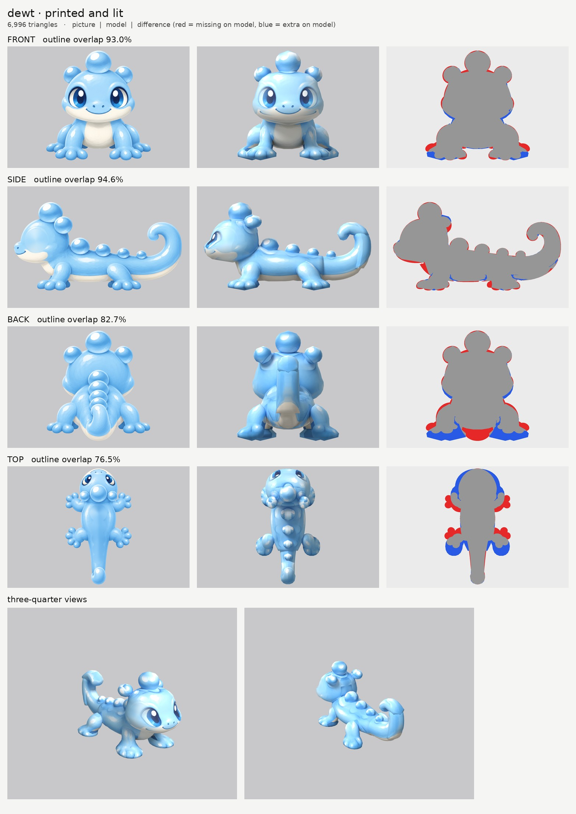
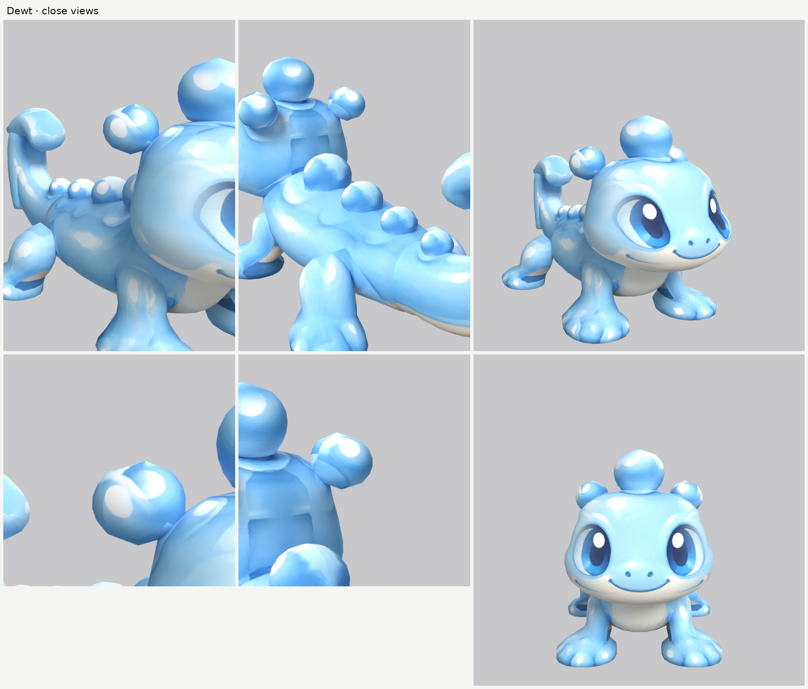

# Dewt: small-model-only route

**Result:** a 6,996-triangle game model (`dewt.glb`, 0.7 MB) with one colour texture (2048) and a flat
normal map (glossy skin, no relief). The glow map is all black: nothing on Dewt glows. From the front
three-quarter view it reads as the picture: big blue eyes with one pupil each, the little nostrils and
smile, the cream jaw and belly, the bubble on top of the head and the two at its corners, the row of
bubbles down the back, four splayed legs with round toes painted on the pads, and the tail lying back and
curling up at the tip.

The final game model's Blender file (the lead animates from it):
`/tmp/claude-0/-home-user-atoms-games-/95c47fc1-cd5e-5362-b776-c463cbad3789/scratchpad/chapter1/dewt/r3/model.blend`

## Numbers

| | Front | Side | Back | Top |
| --- | --- | --- | --- | --- |
| Blockout (60,000 triangles), outline overlap (`blockout.jpg`) | 93.3% | 96.1% | 82.5% | 76.2% |
| Game model (6,996 triangles), outline overlap | 93.0% | 94.6% | 82.7% | 76.5% |

- **Texture seen by a picture:** 77.1%. The rest (the soles, the undersides of the bubbles, the leg
  tops inside the body) is coloured from the nearest painted spot of the same part.
- **Size:** 0.24 m wide, 0.47 m long, 0.25 m tall. The brief and the picture request say 0.75 m long,
  but all the pictures draw a shorter newt: at 0.25 m tall the side picture is 0.47 m long and the top
  picture agrees. I kept the height the brief gives, so the length follows the pictures.
- **Parts (17 pieces):** `head`, `head_bubble`, `head_bubble_side` pair, `body`, `body_bubble_a`,
  `body_bubble_b`, `body_bubble_c`, `tail_bubble`, `tail_a`, `tail_b`, `tail_c`, `front_leg` pair,
  `rear_leg` pair. Budget: head 1,260, body 1,100, tail 1,162 in three pieces, legs 396 each, head
  bubbles 396 + 288 + 288, back bubbles 272 / 240 / 210 / 196.
- **Skeleton words:** `head*` head; `body*` body; `tail*` (the three pieces and the last bubble) tail;
  `front_leg`, `rear_leg` mirrored pairs. No part name holds another word by accident.
- **Glow:** 0% (black map, checked in `emissive.jpg` and on the lit board).
- **Time:** about 40 minutes of work spread over an hour by the clock (00:55 to 01:52; the shared
  machine was busy, so each route run took 12 to 14 minutes), with 2 blockouts and 3 route runs.

## Why back and top are low

- **Back (83%):** the back picture is drawn from above and behind, not dead on. Its tail hangs down
  towards the camera to the ground (the red patch at the bottom of the back board), and its back feet sit
  higher than the side picture's (the blue under the feet). The side picture, which wins for heights,
  has the tail lying back and curling up, and all four feet on the ground.
- **Top (77%):** the top picture is tilted too: it shows the eyes and nose, the head drawn narrower
  than the front picture and the feet splayed further out. The front picture wins for widths.

## What I did and the problems I hit

1. **Pictures checked.** Side faces left, top has the head at the top, front and back agree with the
   side. What the generator got wrong:
   - the length (above);
   - the back and top pictures are drawn at a slant (above);
   - **the bubbles along the back:** the side picture has four, the top picture five, in other places;
   - **the head's corner bubbles** sit 2.6 cm further forward in the top picture than in the side one.
2. **Bubbles are their own round parts.** Three on the head (sliced upward, front + side pictures) and
   four along the back (sliced front to back: the side picture gives their place and height, a circle
   of the same size gives their width). The side picture wins for where they are.
3. **Ghost bubbles on the back.** Printing the top picture's five bubbles over the model's four drew
   rings between them, and switching the top picture off let the side picture's bubble rims smear onto
   the back. The fix: a print-only copy of the top picture with its back bubbles painted over in plain
   skin blue (`top_print_repaired.png`, `tools/inpaint_view.py`). It now paints the back and tail
   cleanly, and the bubbles take their colour from the side picture.
4. **Ghost eye.** The side picture's eye would have printed a second eye on each side of the head; it is
   painted out of a print-only copy (`side_print_repaired.png`), keeping the cream jaw below it out of the
   fill colour. The top picture isn't printed on the face (it shows the eyes from above).
5. **A belt round the head.** The first blockout's head had a ring round it at cheek height (the front
   outline's cheek bumps went all the way round). The cheek bumps are smoothed out and the head is
   smoothed more; the head now takes its heights from the side picture, so the jaw comes down to where
   the side picture has it.
6. **Back feet cut off.** The back picture's raised feet cut the bottom off the back legs. The back legs
   now take their heights from the side picture, with the back picture stretched to fit (`remap`).
7. **The curling tail** is three pieces: lying back (sliced front to back), rising (sliced upward) and the
   curl with its hooked tip (sliced front to back). The back picture's hanging tail isn't printed on any
   of them.
8. **Legs:** the front picture isn't printed on the back legs (it draws them in the wrong place), and
   neither the back nor the top picture on the front legs.
9. **Relief: `none` everywhere** (glossy jelly skin), so the normal map is flat.

## Changed tool copies (in `tools/`)

Started from round 3's improved copies, merged into one set:
- `parts.py` (Clovermouse: `slab`, `droop`, `offset`, `n_scale`, `k_scale`) and `build.py` (Puffmunk).
- `print_tex.py`: Puffmunk's (`paint_shift`, `side_far`, `paint_solid`) plus Mossback's
  `paint_ellipse_skip`.
- `relief.py`: Puffmunk's (`fur_soft`) plus Mossback's `grain` and `relief_gain`.
- `emissive.py`: Embroak's (black unless a part asks for `glow`).
- `inpaint_view.py`: Embroak's (`x:` ellipses kept out of the fill colour, `--flat`).
- `board.py`, `fix_mask.py`, `set_view_map.py`, `fill_under.py`: Puffmunk's, unchanged.
- `closeups.py`: the heroes' close-view tool (`chapter1/player-a/tools/`), changed to frame the whole-body
  views by the creature's length or width as well as its height, in a 2 x 2 sheet.
- `route_small.sh`: Puffmunk's, with Embroak's glow step and `BOARD_SAMPLES` / `BLANK_SAMPLES` /
  `SKIP_BLANK` switches for quicker test runs.
- `mkparts.py` writes `parts.json`.

Rebuild (from the work folder): `make_views.py views 0.25 front side back top`, then
`tools/inpaint_view.py views/views.json side "243,458,97,100" "x:220,612,200,58" --grain 0 --sigma 30`,
then `tools/inpaint_view.py views/views.json top "768,392,72,72" "768,507,63,63" "768,608,57,57" "768,698,52,52" "768,776,46,46" --grain 0 --sigma 26`,
then `python3 -I tools/mkparts.py parts.json` and
`PY=... bash tools/route_small.sh parts.json views/views.json OUT 7000 dewt`.

## What still looks wrong

- **The bubbles are a little faceted** up close (200 to 400 triangles each), and their tops carry soft
  white streaks where the side picture's highlights were stretched over them.
- **The toes are paint** on round foot pads, not modelled balls.
- From behind, the rising part of the tail shows the cream underside running up its outer curve (the
  side picture paints it there) and a soft seam where the tail pieces meet.
- A faint lighter disc remains on each side of the head where the side picture's eye was painted out.
- The back of the head, just behind the corner bubbles, is coloured from nearby paint (no picture sees
  it) and is a little flat in colour.

## Compared with round 3

Close to round 3's Embroak and Fleecling: a clean face with no ghost features and the bubble look
carried by real shapes. The outline match from the front and side (93 / 95%) is as good as round 3's;
the back and top numbers are lower only because those two pictures were drawn at a slant.
