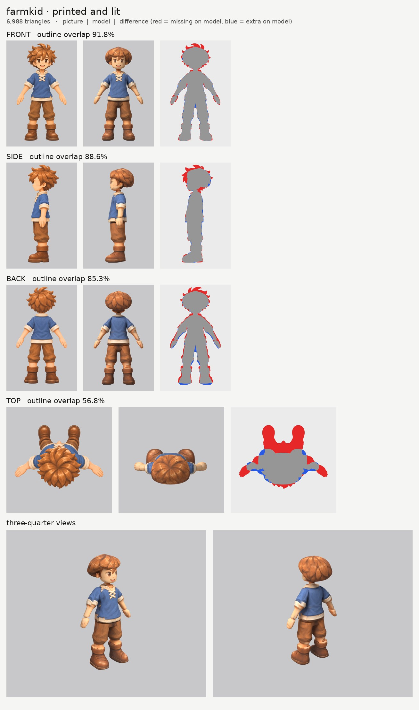
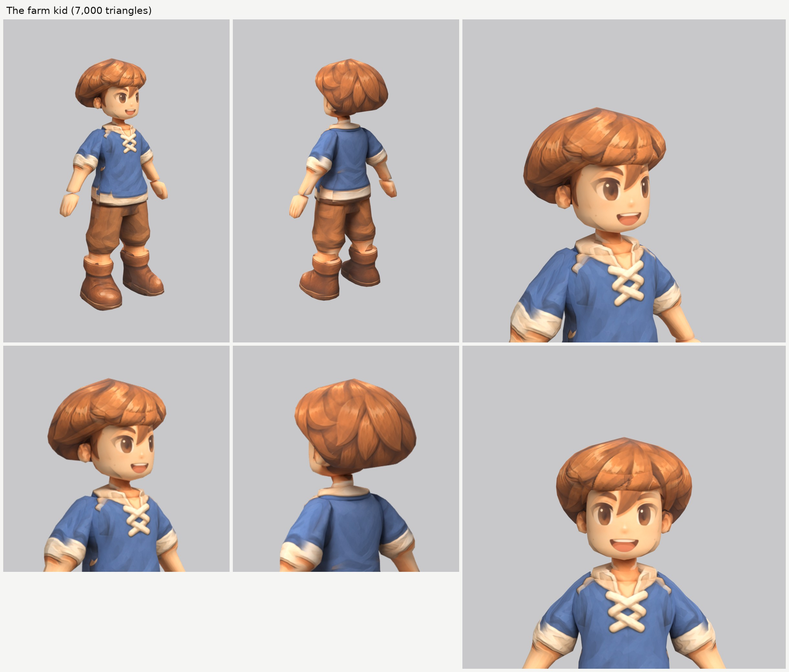

# The farm kid (farmkid): small-model-only route (Opus 5.5)

**Result:** a 6,988-triangle game model (`farmkid.glb`, 3.3 MB) with one colour texture (2048), a normal map
(gentle cloth and hair grain, nothing on the skin) and an all-black glow map (nothing glows). From the front
and the front three-quarter view the kid reads like the sheet: big brown eyes, the open smile, messy
light-brown hair with the lock between the eyes, the blue tunic with the cream stand-up collar and the
crossed laces, cream rolled cuffs and the cream shirt hem below the tunic, baggy brown trousers gathered
below the knee, bare shins and the brown cuffed boots.

The final game model's Blender file (the lead animates from it):
`/tmp/claude-0/-home-user-atoms-games-/95c47fc1-cd5e-5362-b776-c463cbad3789/scratchpad/chapter1/farmkid/out3/model.blend`

## Numbers

| | Front | Side | Back | Top |
| --- | --- | --- | --- | --- |
| Blockout (60,000 triangles), outline overlap (`blockout.jpg`) | 92.9% | 90.7% | 85.9% | 57.2% |
| Game model (6,988 triangles), outline overlap | 91.8% | 88.6% | 85.3% | 56.8% |

- **Texture seen by a picture:** 64.1%. The rest (the inner sides of the arms and legs, the soles, the
  underside of the hair, hidden ends) is coloured from the nearest painted spot of the same part.
- **Why the back is lower:** the back picture disagrees with the front picture by itself: laid over each
  other (mirrored, at the same scale), the two pictures' bodies overlap only 88%, because the back
  picture's arms hang at another angle and its boots are drawn shorter and 3 cm higher. The front picture
  wins for widths.
- **Why the top number is low:** the top picture is another pose (arms out, boots far in front). It paints
  only the crown of the hair.
- **Parts (12 kinds, 17 pieces), all named for the two-legged skeleton:**

  | Skeleton job | Pieces |
  | --- | --- |
  | head | `head`, `ear_L/R`, `hair`, `hair_bangs` |
  | neck | `neck` |
  | upper chest | `collar` (the cream stand-up collar) |
  | chest and spine | `torso` (the tunic and the cream shirt hem below it; the laces are paint) |
  | hips | `hips` (the top of the trousers) |
  | arm (shoulder to wrist, sleeve and cuff included) | `arm_L`, `arm_R` |
  | hand | `hand_L`, `hand_R` |
  | leg (hip to ankle: trouser leg and bare shin) | `leg_L`, `leg_R` |
  | foot | `boot_L`, `boot_R` (the whole tall boot) |

  Arms, hands, legs and boots are mirrored pairs. Each arm runs a few cm into the torso at the shoulder and
  each leg about 8 cm up inside the hips. The knee falls where the trousers are gathered, about 33 cm up,
  where the pictures draw it. The legs reach 5 cm down inside the boots.
- **Triangle budget:** head and hair 3,076 (44%: head 1,224, hair 1,200, fringe 300, ears 176 each); torso
  750, arms 510 each, legs 416 each, boots 324 each, hips 176, hands 168 each, collar 90, neck 60.
- **Time:** about 65 minutes by the clock for the farm kid's own work (views and tracing while Pip's and
  Tinker's runs rendered, then one blockout and three route runs). The shared machine made a route run
  take 7 to 14 minutes.

## What I did and the problems I hit

1. **Pictures checked.** The front and side agree closely. What the generator got wrong:
   - **The front picture draws the face 1.2 cm to the kid's left** of the body's centre line (the hair,
     neck and body are centred; the right ear sticks out further than the left). The head and ears are
     traced centred and read the front picture 13 pixels to the right (`paint_shift`), so the face sits in
     the middle of the head and the ears match.
   - **The back picture's boots are shorter and start 3 cm higher**, and its arms hang at another angle.
     The back picture uses the front picture's scale (the bodies line up row for row), is switched off on
     the shins where its boot tops are drawn (`paint_box_skip`), and is read 22 pixels higher on the boots
     (`paint_shift`).
   - **The top picture is another pose.**
2. **Ghost eye, brow and mouth:** painted out of a print-only copy of the side picture with skin colour
   only (`inpaint_skin.py`; the copy is `side_print_repaired.png`).
3. **The face was a long egg** in the blockout: my jaw was too narrow. Measured from the picture's outline,
   the jaw is wider and rounder now.
4. **The hair.** One upward-sliced mass through the spikes' bases, stepping back from the forehead to
   behind the ear, and a fringe pad built the way Tinker's ended up (about 1 cm out from the forehead, the
   lower edge sloping up toward the front, `skin_pale` skipped), so it has no brim and no skin line.
   The big swept spike on top was its own part in the first two runs, but it read as a tied topknot; the
   hair's own top now rises to a gentle peak there and the spike is paint. The hair's lower sides now narrow
   toward the bottom, so the hair flares out less below the ears.
5. **Cream marks on the sides of the chest.** In the side picture the laces stick out in front of the chest,
   and the side picture (and its mirrored copy) printed them as cream squiggles on the chest's sides. The
   side picture is switched off on the torso there (`paint_box_skip`).
6. **The side picture's hand** hangs in front of the shirt hem and the trousers; the side picture is
   switched off on the torso, hips and legs there.
7. **Tunic too wide** in the first blockout (it filled the gap between the arms and the body): retraced
   from the picture's outline.
8. **Relief:** none on the skin, face and hands; a gentle `grain` on the cloth, hair and boots.
9. **Glow map:** all black. Checked: the exported glow texture is black.

## Changed tool copies (in `tools/`)

The girl's set (`../player-b/tools/`), unchanged except:
- `print_tex.py`: Tinker's copy, with the colour rule `skin_pale`.
- `mkparts.py` (writes `parts.json`) and `redo_views.sh` (the views, the back picture on the front's scale,
  and the repaired side picture).

Rebuild (from the work folder): `bash tools/redo_views.sh`, then `python -I tools/mkparts.py parts.json`,
then `PY=... bash tools/route_small.sh parts.json views/views.json OUT 7000 farmkid`.

## What still looks wrong

- **The hair is a rounded mass with the spikes painted on**, a little like a mushroom cap from the
  three-quarter views. The picture's hair is messy separate spikes; the outline misses their tips.
- **A light patch on the side of each cheek**, where the side picture's eye and mouth were painted over.
- **A small blue patch on the cream hem** at the front, by the tunic's side slit.
- **Pale patches on the shins just above the boots** from behind (where the back picture is switched off).
- The arms and legs are a little faceted; the hands are mittens with painted fingers, as planned.

## Compared with the heroes

Close to them. The face is as clean as theirs and reads like the sheet from the front three-quarter view,
and the outfit (collar, laces, cuffs, hem, trousers, boots) prints cleanly. The hair has the same rounded,
helmet-like look as the heroes' hair. Its outline match (91.8 / 88.6% front and side) is close to theirs;
the back is lower only because the back picture disagrees with the front.

## For the next people

- **Check that the face is centred in the front picture** (compare the eye centres with the body's centre
  line). If not, trace the head centred and use `paint_shift` on the head and ears.
- **A big single spike on top reads as a topknot** when it is its own rounded part; let the hair mass's top
  peak gently instead.
- **Laces, buttons or bows drawn sticking out in front of the chest in the side picture** print on the
  chest's sides; switch the side picture off there.
