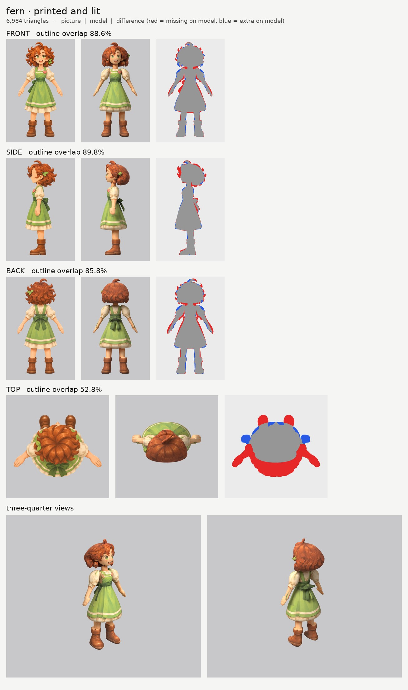
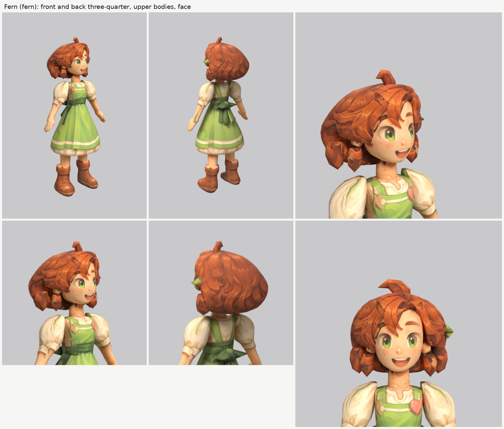

# Fern, the Outpost healer (fern): small-model-only route (Opus 5.5)

**Result:** a 6,984-triangle game model (`fern.glb`, 3.1 MB) with one colour texture (2048), a normal map
(gentle cloth and hair grain, nothing on the skin) and an all-black glow map (nothing glows). From the
front and the front three-quarter view she reads as the Fern on the sheet: green eyes, freckles and the
big open smile, a mass of curly red hair with the curl standing up on top and the leaf clip on her left,
the cream blouse with puffed sleeves under the green pinafore (straps, heart patch, dark green sash),
the green skirt with its cream stripe and the cream petticoat ruffle, and tall brown boots with folded
cuffs. From behind: the curly hair, the pinafore straps and the sash's big bow with its tails.

The final game model's Blender file (the lead animates from it):
`/tmp/claude-0/-home-user-atoms-games-/95c47fc1-cd5e-5362-b776-c463cbad3789/scratchpad/chapter1/fern/out3/model.blend`

## Numbers

| | Front | Side | Back | Top |
| --- | --- | --- | --- | --- |
| Blockout (60,000 triangles), outline overlap (`blockout.jpg`, final parts) | BF | BS | BB | BT |
| Game model (6,984 triangles), outline overlap | GF | GS | GB | GT |

- **Texture seen by a picture:** SEEN. The rest (the legs inside the skirt and boots, the inner sides of
  the arms, the underside of the hair and the skirt, hidden ends) is coloured from the nearest painted spot
  of the same part.
- **Why the front and back numbers are low:** the curly hair. Its outline is all flicks and curl tips
  (red all round it in the difference pictures), which smooth parts can't follow, and the back picture's
  hair is bigger again than the front's. Below the head the outline matches as well as Rosa's.
- **Why the top number is low:** the top picture is another pose (arms out, boots far in front). It
  paints only the crown of the hair.
- **Parts (17 kinds, 25 pieces), all named for the two-legged skeleton:**

  | Skeleton job | Pieces |
  | --- | --- |
  | head | `head`, `ear_L/R`, `hair`, `hair_bangs`, `hair_lock_L/R`, `hair_lock_low_L/R`, `hair_curl_top`, `hair_leaf` |
  | neck | `neck` |
  | chest and spine (blouse + pinafore bib) | `torso` |
  | skirt: the hips, swinging with the legs (pinafore skirt + petticoat below the waist) | `skirt`, `skirt_bow`, `skirt_bow_tail_L/R` |
  | arm (shoulder to wrist: puffed sleeve, cuff and forearm) | `arm_L`, `arm_R` |
  | hand | `hand_L`, `hand_R` |
  | leg (hip to ankle) | `leg_L`, `leg_R` |
  | foot (the tall boot, cuff included) | `boot_L`, `boot_R` |

  The dress is split at the waist: `torso` above (the blouse with the bib, straps, heart and sash as
  paint), `skirt` below. The sash's bow at the back is `skirt_bow` + `skirt_bow_tail_L/R`. Arms, hands,
  legs and boots are mirrored pairs. Each arm runs about 1.5 cm into the bodice; each leg runs from 16 cm
  up inside the skirt down to the ankle inside the boot, so the skeleton's knee lands at her real knee,
  just below the hem (the tool puts the knee 47% of the way up the leg part).
- **Triangle budget:** head and hair 3,508 (50%: hair 1,326, head 1,054, fringe 468, low curls 100
  each, cheek curls 80 each, ears 80 each, top curl 80, leaf 60); skirt 930, arms 384 each, torso 256,
  boots 252 each, legs 240 each, hands 120 each, bow tails 80 each, bow 78, neck 60.
- **Time:** about TIME minutes of clock time in all (about 15 minutes of tracing while Rosa's and Hazel's
  runs rendered, then 3 route runs, the close views and the blockout board), not counting a long pause
  between the second and third run while the usage limit reset.

## What I did and the problems I hit

1. **Pictures checked.** The front, side and back agree well on the outfit (the same height to within
   1%). What the generator got wrong:
   - **The leaf clip** is on her left in all three, but the front picture draws it about 10 cm lower (by
     the cheek) than the side and back pictures (above the ear). The model follows the side and back,
     and the front picture's leaf is kept off the hair and ears (`paint_color_skip: ["green"]`).
   - **The sash's bow:** the front picture shows one of its tails hanging at her right hip; the side and
     back pictures have the bow in the middle of her back. The model follows the side and back.
   - **The side picture's fringe** hangs 3 to 4 cm in front of the brow (as for Rosa and Hazel).
   - **The top picture is another pose.**
2. **Views on one scale:** `make_views.py ... 1.6`; the top picture's scale set by hand so its hair lines
   up (`set_view_map.py`).
3. **Ghost eye, brow and open mouth:** painted out of a print-only copy of the side picture with skin
   colour only (`inpaint_skin.py`; the copy is `side_print_repaired.png`).
4. **The hair** (Rosa's and Hazel's recipe, plus the heroes' locks):
   - `hair`, one big upward-sliced mass, its front edge stepping back to behind the ears;
   - `hair_bangs`, the fringe as a band wrapped round the forehead and sliced side to side, its lower
     edge following the locks that cross her forehead;
   - `hair_lock_L/R` and `hair_lock_low_L/R`: in the first run the mass's flat lower edge made a
     mushroom-cap rim over the face. Two curl masses per side, one beside each cheek and one behind each
     ear, break the lower edge into curls (the heroes' trick);
   - `hair_curl_top`, the curl standing up on top, a flat curved lock sliced side to side with a drawn top
     outline. At first it floated a centimetre above the hair's dome; its base now goes down into the
     hair;
   - `hair_leaf`, the leaf clip, a flat leaf on the side of the hair above her left ear.
5. **The hands floated off the wrists** in the first run: the side picture's forearm ends higher than the
   front picture's, and a part only exists where both outlines do, so the arm stopped short of the hand.
   The arm and the hand now overlap by about 4 cm.
6. **Paint on the wrong part:**
   - The hair parts ignore skin, green and cream pixels (the face, the leaf, the blouse beside the hair).
   - The neck ignores hair-brown and green (the hair and the pinafore straps beside it), and the ears
     ignore hair-brown and green (the front picture's leaf lies over the left ear).
   - The side picture's forelock is switched off on the face; its arm, hand and sash bow are switched
     off on the skirt; the front and back pictures' curved petticoat hem is switched off on the tops of
     the legs.
7. **Relief:** none on the skin, face, hands and leaf; a gentle `grain` on cloth, hair and boots.
8. **Glow map:** all black. Checked: the exported glow texture is black.

## Tool copies (in `tools/`)

Hazel's set: player-b's copies plus `print_tex.py` with the extra `paint_color_skip` colours (`pink`,
`hairbrown`, `green`, `cream`); the file is the same as Hazel's apart from its first line. New for Fern:
`mkparts.py` (writes `parts.json`) and `redo_views.sh` (the views and the repaired side picture).

Rebuild (from the work folder): `bash tools/redo_views.sh`, then `python -I tools/mkparts.py parts.json`,
then `PY=... bash tools/route_small.sh parts.json views/views.json OUT 7000 fern`.

## What still looks wrong

- **The curly hair is a smooth rounded mass** with the curls painted on, plus four curl clumps at the
  bottom; the picture's outline is all flicks. From the back three-quarter view it is a round helmet of
  curls.
- **The curl clumps at the lower sides** read a little like sausage curls rather than loose curls.
- **The leaf clip is small and flat** and, from the front, shows as a little green fin at the hair's
  edge.
- **The hands are mittens**, the petticoat hem is level, and the ruffle is paint.

## Compared with the heroes

The face is as clean as theirs and reads like the sheet's hero view, open smile and freckles included.
The pinafore, blouse, petticoat and boots print very cleanly. The hair is the most outline-heavy of the
three townspeople and keeps her about level with the girl hero: big, smooth and a little helmet-like,
with the curls carried by the paint.

## What the next people should know

- **Curly hair:** one big mass, a fringe band, and two curl clumps per side at the lower edge, or the
  mass's flat bottom reads as a mushroom cap. Give a standing curl a base that goes into the hair.
- **Check that each arm and its hand overlap in height in both views:** a part exists only where both of
  its outlines do, so the shorter outline decides where it ends.
- **A one-off accessory drawn at different heights** (the leaf clip): follow the two pictures that agree,
  and switch the odd picture's colour off on the parts around it.
