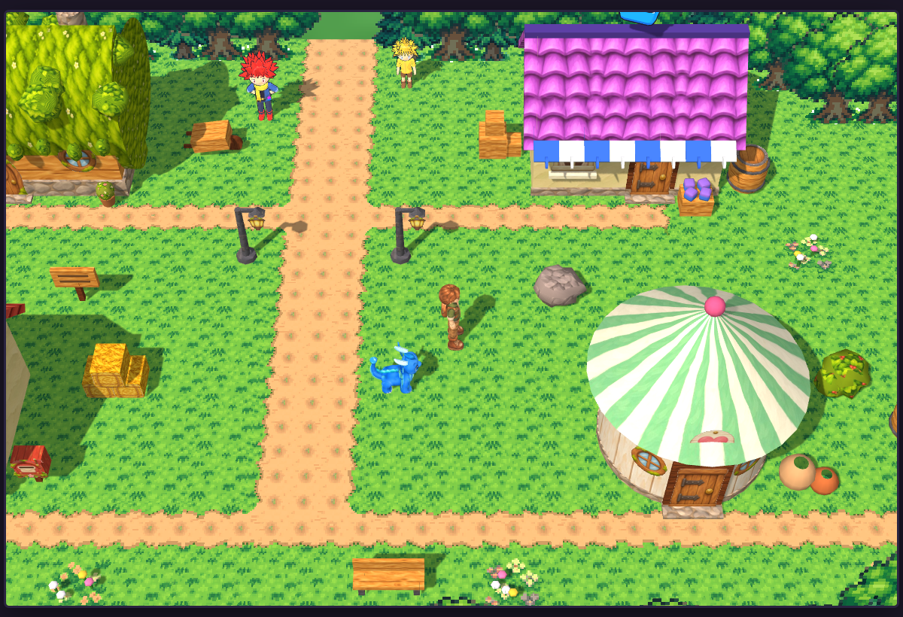

# Creature Catch 3D: Chapter 1

This is the earlier 3D demo's game with our painted, animated models in it. The town uses the diorama look (the 2D
game's painted ground with 3D houses, props and characters on it). Battles use the 2D game's painted backgrounds.
Houses, furniture and props are covered with our painted texture tiles.

You can play the whole chapter. The one thing left out on purpose is evolving.

## How to run it

The finished game is in `dist/`: the page `index.html` and its `assets/` folder (our models, their textures and the
painted tiles).

1. Open a terminal in the `dist/` folder.
2. Run `python3 -m http.server 8000`.
3. Open `http://localhost:8000` in a browser. A phone on the same network works too.

Run it from a web server like this. Opening `index.html` straight from the disk won't load our models. The game
still plays then, but with all the old models.

**Controls:**

| Key | What it does |
| --- | --- |
| Arrow keys or WASD | walk |
| hold X | run |
| Z or Space | A: talk, choose |
| X or Esc | B: back |
| Enter | MENU: your creatures, bag, Looks |

On a phone, the buttons appear under the screen.

**The Looks menu** is on the title screen and in MENU. It still switches the town to the 3D world and battles to the
3D clearing.

### Adding models that finish later

When a new model is ready (for example `chapter1/willow/willow_animated.glb` with its `animation_manifest.json`):

1. Run `python3 game/tools/pack_models.py`. It packs every model it can find and skips the ones already packed.
   `--list` shows what it finds without packing.
2. Run `python3 game/source/tools/build.py`. It rebuilds `dist/`.

The packer looks in `chapter1/<id>/`, `round3/<id>/`, `round2/opus/<id>/` and `round2/sonnet/<id>/`. It uses the Creature
Battle Bay's own packer, which needs the gltf-transform tools. Set `NODE_DIR` to a folder holding them (see the top of
`pack_models.py`).

The person ids match the game's names: `player-a`, `player-b`, `juniper`, `willow`, `tinker`, `rosa`, `hazel`, `pip`,
`fern`, `oakley`, `bramble` and `farmkid`. Creature ids are the game's creature names in lower case.

## What was changed

- **Default looks.** A new game starts in the diorama town with painted battles.
- **Our models load at boot.** A progress bar shows while they load. The whole chapter needs about 7 MB, and each model
  is about 0.6 to 0.9 MB. Textures are made phone-sized: colour 1024 px, glow 512 px, normal maps 512 px. Empty glow and
  flat normal maps are left out.
- **Creatures with a model use it everywhere:** the town, battles, the starter table, the title screen and the creature
  card.
  - The game's body actions play our clips. Attacks play the physical clip, spits and casts the special clip, roars the
    boost clip, being hit the hit clip, fainting the faint clip and coming out of the cube the send-out clip.
  - Each clip is sped up or slowed down so its blow lands when the move's hit lands.
  - Moves with no clip of their own (hops, spins, rolls, shakes) keep the old whole-body motion, on top of the idle
    clip.
- **People with a model use it.** Right now that's the player, both looks. They walk, run, wave, cheer, point, talk and
  throw with our clips. The cube leaves the hand at 0.5 s into the throw, as the model's notes say, and the game waits
  for that.
- **The things people carry are ready** for when their models arrive. They're built in code from the painted tiles
  and put in a hand:
  - Elder Willow's bark staff
  - Farmer Bramble's pitchfork
  - Tinker's bug net
  - Rosa's tray with a mug
  - Fern's basket
  - Pip's three cubes
- **Our models look painted.** They have no ink outlines and use soft, even light that shows the paint.
- **Re-skinned buildings.** Every building, piece of furniture and prop is covered with the painted tiles. Each house
  keeps the earlier demo's colours:

  | Building | Walls | Roof |
  | --- | --- | --- |
  | Your house | cream plaster | red tiles |
  | Pip's shop | cream plaster | purple tiles |
  | Rosa's Inn | cream plaster | orange tiles |
  | Farmer Bramble's barn | red boards | barn shingles |
  | Healing Hut | white boards | mint stripes |
  | Elder Willow's house | planks | moss |

  - Chimneys are brick and footings are cobblestone.
  - Rooms have floorboards (or the hut's mint checker), a plaster wall over dark wood panels, rugs, a doormat and a
    quilt on the beds.
- **Painted stickers on flat panels:** doors, windows, the inn and hut signs, the bookshelf, clock, notice board, piano,
  stove, herb shelf, healing machine, Cube Vault, mailbox, lamps, hay-bale ends and barrel tops.
- **Ink outlines are gone** from the buildings, props and trees. The see-through hole around the player is kept.
- **The capture cube** is still made in code, as before.
- **No evolving.** It's switched off for Chapter 1. Add `?evolve` to the address to turn it back on.

## What's still the old model

Every creature and person you meet in Chapter 1 now has a painted model: all 12 people (both player looks,
Juniper, Elder Willow, Tinker, Rosa, Hazel, Pip, Fern, Ranger Oakley, Farmer Bramble and the Farm Kid) and all 14
creatures (Drizzlon, Mossback, Embroak, Clovermouse, Puffmunk, Fleecling, Hopsprout, Tuftail, Pebblepup, Bumblop,
Dewt, Dandylion, Wormapple and Scarecrowl).

Only the **evolved forms** keep the earlier demo's model built in code. Chapter 1 has evolving switched off, so you
only see them with `?evolve`.

## What doesn't work yet, or could be better

- **The carried things** (Willow's staff, Bramble's pitchfork, Tinker's net, Rosa's tray, Fern's basket, Pip's cubes)
  are placed on each person's standing pose, so they sit level while the person stands. They swing with the hand
  when the person walks or waves.
- **Rosa's tray is held at hip height.** Our people have no carrying pose, so the tray sits where the hand hangs.
- **Shared clips.** Our creatures share clips by body type, so a spin, roll or shake is still the old whole-body
  motion over the idle clip. It reads fine but isn't hand-made.
- **Eyes.** Blinking and the sleeping look don't change our models' eyes. A sleeping creature breathes slowly
  instead.
- **Afterimages** (the ghost copies left by fast moves) are frozen copies of the model, not animated.
- **Painted battles** still don't show the player. You only see the cube fly in from the left, as in the earlier demo.
- **Only tested in a headless browser.** I checked it with software rendering, not on a real phone, so I don't know
  the speed on an actual phone yet.
- **The test run boosted levels.** In my automatic playthrough I raised the party to level 14 before Farmer Bramble's
  trial so it finished in one go. The trial itself played normally, and at normal levels it's a fair fight that you
  may lose and retry.

## Screenshots

The shots are in `screenshots/`. The `phone_*` shots are phone-shaped (390 x 844) and the `wide_*` shots come from a
wider window.

| Screenshot | What it shows |
| --- | --- |
| `phone_01_title` | the title |
| `phone_02_choose_explorer` | choosing your explorer (our two player models) |
| `phone_03_village` | the village, diorama look |
| `phone_04_interior_willow` | inside Elder Willow's house |
| `phone_05_choose_starter` | choosing a starter |
| `phone_06_juniper_battle` | Juniper's battle |
| `phone_07_meadow_path` | the Meadow Path |
| `phone_08_wild_battle` | a wild battle, painted |
| `phone_09_cube_throw` | the cube throw |
| `phone_10_grassland` | the Grassland |
| `phone_11_bramble_asks` | Bramble's trial (he asks) |
| `phone_12_bramble_trial` | Bramble's trial (the battle) |
| `phone_13_log_cleared` | the log cleared |
| `phone_14_end_of_chapter` | the end of Chapter 1 |
| `phone_07_juniper_battle_move` | a move in Juniper's battle |
| `wide_01_village` | the village |
| `wide_02_interior_inn` | inside Rosa's Inn |
| `wide_03_juniper_battle` | Juniper's battle |
| `wide_04_wild_battle` | a wild battle |
| `wide_05_meadow_path` | the Meadow Path |
| `wide_06_grassland` | the Grassland |
| `wide_07_all_people` | all 12 people in the game's light, with their carried things |
| `wide_08_all_creatures` | all 14 Chapter 1 creatures in the game's light |

## For testing (dev links)

Add these to the address:

| Link | Where it starts |
| --- | --- |
| `?at=village` | the village |
| `?at=meadow` | the Meadow Path |
| `?at=grassland` | the Grassland |
| `?at=trial` | in front of Farmer Bramble |
| `?at=battle` | a wild battle |
| `?at=rival` | Juniper's battle |
| `?at=moves&who=mossback` | the move demo |

Other options:

| Option | What it does |
| --- | --- |
| `?at=lineup&who=drizzlon,player-a&act=attack` | models up close, playing an action |
| `&glbas=willow:player-a` | shows a person on another person's model, to try the carried things |
| `&town=3d` | the 3D town |
| `&fights=3d` | the 3D battle clearing |
| `?oldmodels` | every model as the earlier demo built it |
| `?evolve` | evolving back on |

**The tools in `tools/`:**

- `pack_models.py` packs our models.
- `pack_tiles.py` makes the painted tiles game-sized.
- `drive.js` and `autopilot.js` played the chapter with real key presses for the screenshots. They run one headless
  browser.

## Where things are

| Path | What's there |
| --- | --- |
| `source/src/` | the game's code |
| `source/src/models.js` | loads our models and drives them (creatures, people, carried things) |
| `source/src/tiles.js` | the painted tiles |
| `source/src/places.js` | the re-skinned buildings |
| `source/vendor/` | three.js r128, plus its GLTFLoader and SkeletonUtils |
| `source/tools/build.py` | builds `dist/` |
| `assets/` | the packed models, their textures and the tiles. `build.py` copies it into `dist/` |
