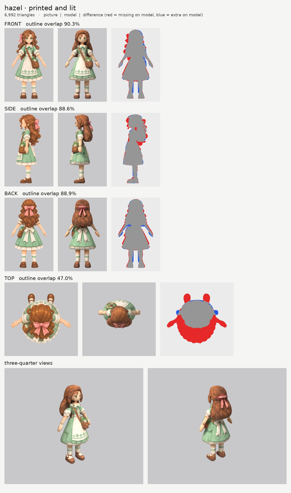
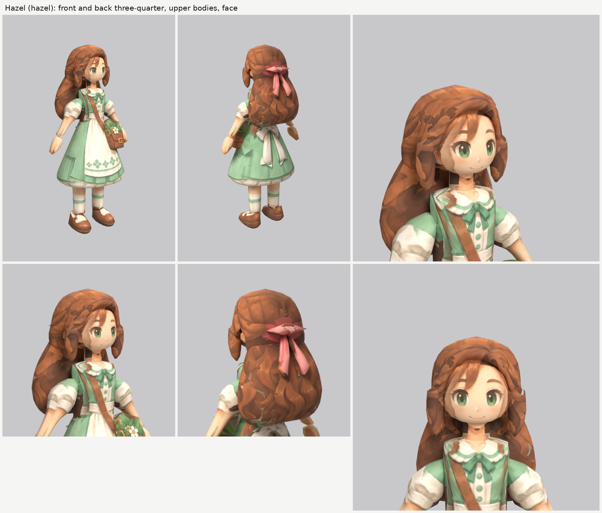

# Hazel, the healer (hazel): small-model-only route (Opus 5.5)

**Result:** a 6,992-triangle game model (`hazel.glb`, 3.1 MB) with one colour texture (2048), a normal map (gentle
cloth and hair grain, nothing on the skin) and an all-black glow map (nothing glows). From the front and
the front three-quarter view she reads as the Hazel on the sheet: green eyes and a soft smile,
centre-parted auburn hair with a wavy lock beside each cheek and the long wavy hair down her back, the
mint dress with its white collar, green bow and buttons, white puffed sleeves, the white apron with the
green clover border, the cream petticoat ruffle, the brown satchel on her left hip with the leaves and
the white flower poking out and its strap across her chest, white socks with green stripes and brown
Mary Janes. From behind: the long hair with the pink bow and its tails, and the apron's big white bow.

The final game model's Blender file (the lead animates from it):
`/tmp/claude-0/-home-user-atoms-games-/95c47fc1-cd5e-5362-b776-c463cbad3789/scratchpad/chapter1/hazel/out3/model.blend`

## Numbers

| | Front | Side | Back | Top |
| --- | --- | --- | --- | --- |
| Blockout (60,000 triangles), outline overlap (`blockout.jpg`, final parts) | 90.7% | 89.1% | 89.0% | 47.2% |
| Game model (6,992 triangles), outline overlap | 90.3% | 88.6% | 88.9% | 47.0% |

- **Texture seen by a picture:** 54.0%. The rest (the legs under the skirt, the inner sides of the arms,
  the front of the long hair against her back, the underside of the skirt, hidden ends) is coloured from
  the nearest painted spot of the same part.
- **Why the outline numbers are lower than Rosa's:** the long wavy hair. Its waves and curl tips make a
  ragged outline that a smooth part can't follow (red and blue fringes all round it in the front, side
  and back views), and the pictures disagree about it (it is about 12 cm wider in the front picture than
  in the back picture). The pink bow also sits in a different place in the front picture (see below).
- **Why the top number is low:** the top picture is another pose (arms out, shoes far in front, the
  satchel behind her hip). It paints only the crown of the hair.
- **Parts (18 kinds, 26 pieces), all named for the two-legged skeleton:**

  | Skeleton job | Pieces |
  | --- | --- |
  | ponytail (a swaying two-bone chain from the head) | `ponytail_long` (the long back hair) |
  | head | `head`, `ear_L/R`, `hair`, `hair_bangs`, `hair_lock_L/R`, `hair_bow`, `hair_bow_tail_L/R` |
  | neck | `neck` |
  | chest and spine (the bodice with the collar, bow and buttons as paint) | `torso` |
  | skirt: the hips, swinging with the legs (dress + apron + petticoat below the waist) | `skirt`, `skirt_bow`, `skirt_bow_tail_L/R` |
  | hips | `satchel` |
  | arm (shoulder to wrist: puffed sleeve and forearm) | `arm_L`, `arm_R` |
  | hand | `hand_L`, `hand_R` |
  | leg (hip to ankle, sock included) | `leg_L`, `leg_R` |
  | foot | `shoe_L`, `shoe_R` |

  The dress is split at the waist: `torso` above, `skirt` below. The apron and the petticoat ruffle
  below the waist are paint on the skirt. The satchel's strap is paint on the bodice and apron. Arms,
  hands, legs and shoes are mirrored pairs. The legs run from 12 cm up inside the skirt down into the
  shoes, so the skeleton puts the hips and knees where they belong (see Rosa's notes).
- **Triangle budget:** head and hair 3,662 (52%: long hair 990, head 952, hair 754, fringe 260, cheek
  locks 140 each, hair-bow tails 100 each, ears 80 each, hair bow 66); skirt 992, torso 270, arms 242
  each, satchel 224, legs 220 each, shoes 160 each, hands 120 each, apron-bow tails 120 each, apron bow
  60, neck 60.
- **Time:** about 60 minutes by the clock (01:40 to 02:41, partly overlapping Rosa's last board), 3 route
  runs, plus the final blockout board (made later, after a pause). Each route run took about 10 to 13 minutes on
  the shared machine, most of it rendering the boards. Over the 30 to 40 minute budget for that reason.

## What I did and the problems I hit

1. **Pictures checked.** What the generator got wrong:
   - **The pink bow:** the front picture draws it at her right temple, sticking out beside the hair;
     the side and back pictures put it in the middle of the back of her head. Two against one, so the
     model's bow is at the back of the head. The front picture's bow is switched off on the hair there
     (`paint_box_skip`), so it leaves no pink smear. From the front three-quarter view you see only the
     bow's edge behind her head, not the big pink bow of the sheet's hero view.
   - **The satchel** hangs at the front of her left hip in the front and side pictures, and further back
     in the top picture. The model follows the front and side.
   - **The long hair** is about 12 cm wider in the front picture than in the back picture. The model is
     in between.
   - **The side picture's face-framing locks** hang far in front of the face (3 to 5 cm in front of the
     brow and chin); the front picture has them against the cheeks. The model keeps them against the
     cheeks, and the side picture's locks are switched off on the face.
   - **The top picture is another pose.**
2. **Views on one scale:** `make_views.py ... 1.62`; the top picture's scale set by hand so its hair lines
   up (`set_view_map.py`).
3. **Ghost eye, brow and mouth:** painted out of a print-only copy of the side picture with skin colour
   only (`inpaint_skin.py`; the copy is `side_print_repaired.png`).
4. **The hair, in five kinds of piece** (Rosa's recipe):
   - `hair`, the upward-sliced mass on the head, its front edge stepping back to behind the ears;
   - `hair_bangs`, the centre-parted fringe as a band wrapped round the forehead and sliced side to side,
     so its lower edge follows the parting and the hairline exactly;
   - `hair_lock_L/R`, a wavy lock hanging beside each cheek;
   - `ponytail_long`, the long hair down her back (the brief's name), from the nape to below the
     shoulder blades, so it sways as a two-bone chain;
   - `hair_bow` + `hair_bow_tail_L/R` on the back of the head.
5. **The long hair looked like a sack** in the first run: as wide as the front picture says, it stuck
   out as a lump beside the cheeks, and as deep as the side picture's curl tips it bulged like a balloon.
   It now starts as narrow as the head hair and widens below the shoulders, and it is 3 to 4 cm flatter
   against her back.
6. **The arm and hand were traced in the wrong place** in the front picture at first (too far in), so
   the forearm was thin and the hand floated off the wrist. Re-traced; they now match.
7. **Paint on the wrong part:**
   - The front picture's pink bow on the hair (above).
   - Cream streaks on the long hair, where the back picture's puffed sleeves and apron lie just beside
     it. New colour `cream` in `paint_color_skip`: the hair parts ignore cream and skin pixels.
   - The side picture's arm, hand, satchel and bow tails are drawn over the skirt; switched off there.
   - The side picture's apron, with its clover border, wraps further round the skirt than the front
     picture's, which printed clovers on the skirt's side; switched off there (as for Rosa).
   - As for Rosa, the curved petticoat hem in the front and back pictures is switched off on the tops of
     the legs, where the model's level hem lets it show.
   - The neck and ears ignore hair-brown pixels (new colour `hairbrown`).
8. **Relief:** none on the skin, face and hands; a gentle `grain` on cloth, hair, satchel and shoes.
9. **Glow map:** all black. Checked: the exported glow texture is black.

## Tool copies (in `tools/`)

The same set as Rosa's (`../player-b/tools/` copies), with one changed file:
- `print_tex.py`: player-b's `paint_color_skip` plus four more colours: `pink` (the hair bow),
  `hairbrown` (auburn and brown hair), `green` (the dresses) and `cream` (puffed sleeves, aprons,
  petticoats).
- New: `mkparts.py` (writes `parts.json`) and `redo_views.sh` (the views and the repaired side picture).

Rebuild (from the work folder): `bash tools/redo_views.sh`, then `python -I tools/mkparts.py parts.json`,
then `PY=... bash tools/route_small.sh parts.json views/views.json OUT 7000 hazel`.

## What still looks wrong

- **The long hair is a smooth rounded mass** with the waves and curls painted on; from the side it is a
  rounded shape behind her back, not loose waves. The heroes' hair weakness, in its strongest form.
- **The pink bow is at the back of her head,** as the side and back pictures draw it, so the front
  three-quarter view doesn't show it the way the sheet's hero view does.
- **The hands are blocky mittens.**
- **The hem of the petticoat** is level and its ruffle is paint.
- A few small light marks remain at the edges of the long hair where the pictures' hair is narrower than
  the model's.

## Compared with the heroes

The face is as clean as theirs, and the outfit (collar, apron, clover border, satchel, socks and shoes)
prints very cleanly. The long hair keeps her a little below the heroes, about level with the girl: it
is the biggest loose-hair shape so far, and from the side and the back it reads as one smooth mass.

## What the next people should know

- **Long loose hair down the back:** one `ponytail_long` part, narrow at the top so it continues the head
  hair, widening below the shoulders, and kept fairly flat against the back. Don't follow the side
  picture's curl tips for its depth, or it bulges like a sack.
- **Check the arm traces with the parts drawn over the picture** (`zoom.py` with `parts.json`) before the
  first run: a diagonal forearm is easy to misplace.
- **Use `paint_color_skip` with `cream` on hair** when a white or cream garment lies beside it.
- **When one picture puts a one-off feature somewhere else** (the bow), follow the two that agree and
  switch the odd one off on the parts around it.
