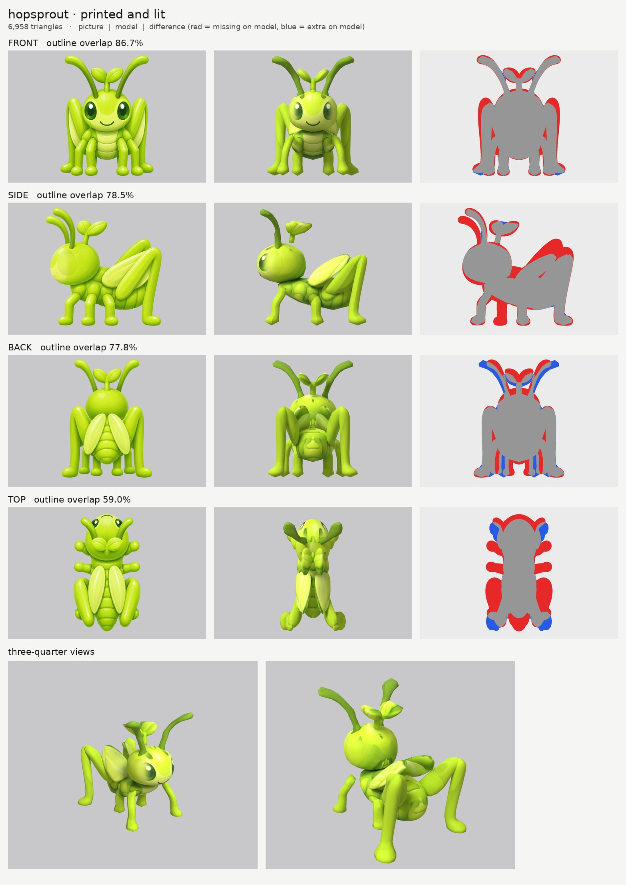
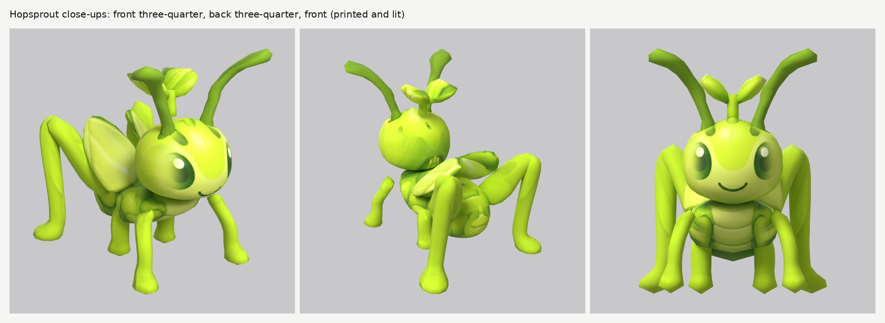

# Hopsprout: small-model-only route

**Result:** a TRIS-triangle game model (`hopsprout.glb`, SIZE) with one colour texture (2048), a flat
normal map (smooth, shiny skin) and an all-black glow map (nothing glows). It reads as the grasshopper in
the pictures: a big round lime head with large green eyes and a small smile, the two-leaf sprout on top,
two thick antennae curving up and out, a segmented body, pale wings folded along the back like a roof,
four short legs and two big folded back legs with the knees up.

The final game model's Blender file (the lead animates from it):
`/tmp/claude-0/-home-user-atoms-games-/95c47fc1-cd5e-5362-b776-c463cbad3789/scratchpad/chapter1/hopsprout/OUT/model.blend`

## Numbers

| | Front | Side | Back | Top |
| --- | --- | --- | --- | --- |
| Blockout (60,000 triangles), outline overlap (`blockout.jpg`) | 87.3% | 79.2% | 77.8% | 58.3% |
| Game model (TRIS triangles), outline overlap | FRONT% | SIDE% | BACK% | TOP% |

The blockout board is the first one; the back thighs were made broader after it (see below), so the
game model's side score is higher than the blockout's.

- **Texture seen by a picture:** SEEN%.
- **Parts (18 pieces):** `head`, `head_sprout` (the stem), `head_sprout_leaf` pair, `head_antenna` pair,
  `body_front` (thorax), `body_back` (abdomen), `body_wing` pair, `front_leg` pair, `mid_leg` pair,
  `rear_leg_thigh` pair, `rear_leg` pair (shin and foot). BUDGET
- **Skeleton words (bug plan):** `head`, `head_sprout*`, `head_antenna` ride the head; `body_front`,
  `body_back` and `body_wing` the body; `front_leg`, `mid_leg` and the big back legs `rear_leg` (two
  pieces each side, `rear_leg_thigh` and `rear_leg`, both with the word `rear_leg`) are mirrored pairs.
- **Glow:** 0% (black map, checked in `emissive.jpg` and on the lit board).
- **Time:** TIME

## Why the scores are low

- **Side:** the side picture draws four short legs on the near side (a far leg peeks through) and the far
  back thigh higher and further forward than the near one (a perspective slip). Legs are mirrored pairs,
  so the model has one of each. Those two account for most of the red.
- **Back:** the back picture draws the antennae closer together than the front picture (front wins), and
  its middle legs in other places.
- **Top (about 59%):** the top picture is a different drawing: the legs stick straight out sideways like
  a bug pinned flat, and the face shows. It is used only for the wings and the top of the body.

## What I did and the problems I hit

1. **Pictures checked.** Side faces left, top has the head at the top. What the generator got wrong:
   see above, plus: the sprout's two leaves point left and right in the front picture but forward and
   back in the side picture, and the top picture draws the sprout 6 cm further forward. Each leaf is a
   chunky round blob on the stem; the top picture is read shifted for them (`paint_shift`).
2. **Ghost eye.** The side picture's eye, its pale ring and the smile are painted out of a print-only
   copy (`side_print_repaired.png`; a wide blur, so no dark dot is left in the middle).
3. **Folded wings** (`body_wing`): each is a thick plate (`slab`) sliced front to back, tilted like a
   roof (high at the spine, low at the sides), rising toward the back as in the side picture.
4. **The big back legs** are two pieces each side: a broad flat thigh rising from the body to the knee
   (as a grasshopper's is; the side picture fills the space between thigh and shin) and the shin with its
   foot coming down. One piece would have filled the whole triangle between them.
5. **Shiny highlights.** The pictures are glossy, and each draws its white highlight streaks along the
   legs and antennae in a different place, so they printed as pale blotches. The legs, thighs, stem and
   antennae now take one lime (or dark green) colour, only lightly shaded by the pictures
   (`paint_solid`), and the head, body and wings take each spot's colour from the most head-on picture
   (`paint_power` 5 to 6).
6. **Wing paint on the head and abdomen.** The back and top pictures draw the wings over the abdomen and
   the head; those pictures are switched off there (`paint_ellipse_skip`).
7. **Relief:** `none` everywhere (smooth, shiny skin).

## Changed tool copies (in `tools/`)

The same set as Tuftail's (see `../tuftail/NOTES.md`). `mkparts.py` writes `parts.json`; `closeups.py`
makes `closeups.jpg`.

Rebuild: `make_views.py WORK/views 0.45 front side back top`, then
`tools/inpaint_view.py views.json side "460,468,78,96" --grain 0 --sigma 34` and
`tools/inpaint_view.py views.json side "362,558,26,22" --grain 0 --sigma 12`, then
`tools/mkparts.py parts.json` and `PY=... bash tools/route_small.sh parts.json views.json OUT 7000 hopsprout`.

## What still looks wrong

REMAINING

## Compared with round 3

COMPARE
