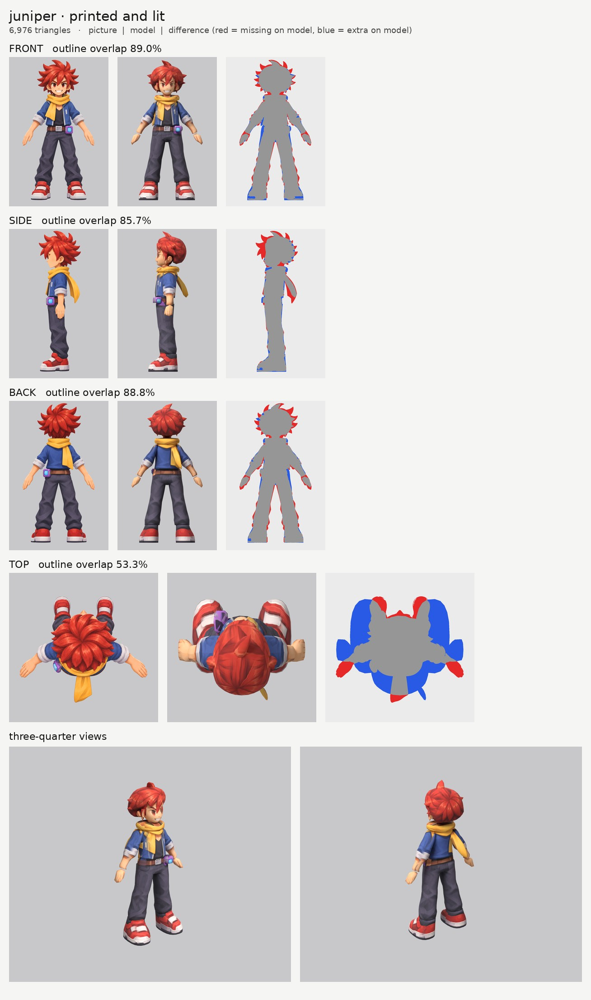
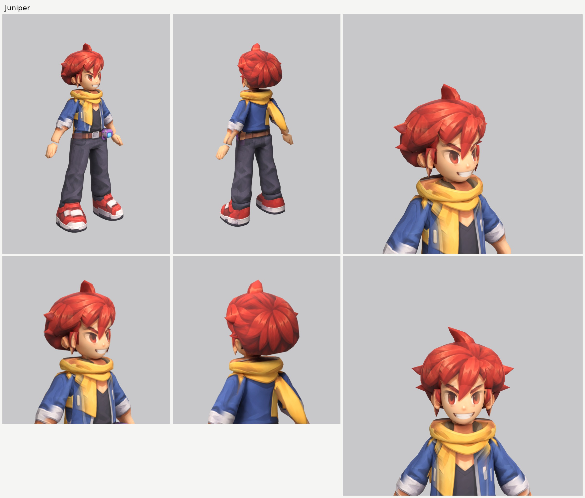

# Juniper, the rival kid (juniper): small-model-only route (Opus 5.5)

**Result:** a 6,976-triangle game model (`juniper.glb`, 3.1 MB) with one colour texture (2048), a normal
map (gentle grain on the cloth, hair and shoes, nothing on the skin) and an all-black glow map (nothing
glows). From the front and the front three-quarter view he reads as the rival on the sheet: the cocky
grin with its white teeth, red eyes under angry brows, the spiky red hair with the big spike on top and
the long lock between the eyes, the yellow scarf with its tail over his right chest, the open blue
jacket with grey rolled cuffs over the black shirt, the brown belt with the silver buckle and the purple
capture cube on his left hip, baggy dark trousers and red-and-white sneakers. From behind: the spiky
back of the hair, the scarf's tail hanging down his back on the right, the cube on his left hip.

The final game model's Blender file (the lead animates from it):
`/tmp/claude-0/-home-user-atoms-games-/95c47fc1-cd5e-5362-b776-c463cbad3789/scratchpad/chapter1/juniper/out2/model.blend`

## Numbers

| | Front | Side | Back | Top |
| --- | --- | --- | --- | --- |
| Blockout 3 (60,000 triangles), outline overlap (`blockout.jpg`) | 89.6% | 86.2% | 89.4% | 52.6% |
| Game model (6,976 triangles), outline overlap | 89.0% | 85.7% | 88.8% | 53.3% |

- **Texture seen by a picture:** 59.5%. The rest (the inner sides of the arms and legs, the soles, the
  underside of the hair, hidden ends) is coloured from the nearest painted spot of the same part.
- **Why the top number is low:** the top picture is another pose (arms out, feet far in front, the
  scarf's tail lying flat behind). No part prints from it.
- **Why the overlaps are under the heroes':** almost all the missing outline is the tips of the hair
  spikes (the red fringe round the head in `board_printed.jpg`). His hair is spikier than the boy's: in
  the side picture the fringe spikes sweep up to 10 cm in front of his face and the back spikes 5 cm
  behind his head. As the brief says, only the biggest spikes are their own parts and the rest are paint
  on a smooth mass, so their tips are lost (about 4% in front and back, 7% in the side view). The body
  matches closely.
- **Parts (18 kinds, 26 pieces), all named for the two-legged skeleton:**

  | Skeleton job | Pieces |
  | --- | --- |
  | head | `head`, `ear_L/R`, `hair`, `hair_bangs`, `hair_spike`, `hair_spike_side_L/R`, `hair_spike_low_L/R`, `hair_lock_L/R` |
  | neck | `neck` |
  | upper chest | `collar_scarf`, `collar_scarf_tail` |
  | chest and spine | `torso` (the open jacket and the black shirt) |
  | hips | `hips` (the belt is paint on it), `hips_cube` (the capture cube on his left hip) |
  | arm (shoulder to wrist, the sleeve and rolled cuff included) | `arm_L`, `arm_R` |
  | hand | `hand_L`, `hand_R` |
  | leg (hip to ankle, the baggy trouser leg included) | `leg_L`, `leg_R` |
  | foot | `shoe_L`, `shoe_R` |

  Arms, hands, legs and shoes are mirrored pairs. Each arm starts inside the torso at the shoulder and
  each leg 11 cm up inside the hips. The elbow is just under the rolled cuff and the knee where the
  trousers bunch, as the pictures put them.
- **Triangle budget:** head and hair 3,058 (44%: head 1,102, hair 896, fringe 240, ears 120 each,
  top spike 100, side spikes 80 and 60 each, locks 100 each); legs 480 each, scarf 450 and its tail 160,
  torso 420, arms 360 each, shoes 294 each, hips 240, hands 120 each, cube 80, neck 60.
- **Time:** about 40 minutes by the clock (11:28 to 12:07): 3 blockouts and 2 route runs.

## What I did and the problems I hit

1. **Pictures checked.** The front, side and back agree that the cube is on his left hip and that the
   scarf's front tail hangs over his right chest and its back tail down his right back (the side
   picture shows the back tail sticking out behind him). What the generator got wrong: the top picture
   is another pose (see above); otherwise the three main views agree closely (the same height to within
   1%).
2. **Views on one scale:** `make_views.py ... 1.55`.
3. **Ghost face:** the side picture's eye, eyebrow and grin are painted out of a print-only copy with
   skin colour only (`inpaint_skin.py`; the copy is `side_print_repaired.png`).
4. **The spiky hair**, the heroes' way:
   - one mass sliced upward, its outline a smooth hull a little outside the spikes' bases, its front
     edge (side picture) stepping back from the forehead to behind the ears;
   - a fringe pad over the forehead, down to the long lock between the eyes;
   - five spikes of their own: the big one on top that curls forward, and the two biggest at each side
     (`hair_spike_side`, `hair_spike_low`), as flat fins that face forward (`cap` keeps them 5 cm thick
     front to back), so they read as locks, not horns;
   - a pointed lock at each temple, in front of the ears, so the lower edge breaks into points.
   On the way: the first blockout's mass stopped at the spikes' bases (front 87.9%); the second went
   through their middles (89.9%) but the first route run showed a smooth round bowl, like a mushroom.
   So the mass came back in a little and the side spikes were added. The first try at them were
   round cones that looked like little horns, and bars from the side; flat fins fixed that.
5. **Too wide at the shoulders.** The first blockout's sleeves and jacket were 2 to 3 cm too wide at
   the shoulder (blue on both sides); they now follow the picture's shoulder line.
6. **The scarf** is a thick soft ring round the neck (`collar_scarf`; the first run's ring had only three
   rings of triangles and came out as a flat plate, so it gets more rows with `n_scale`) plus the tail
   that hangs down his back
   (`collar_scarf_tail`, a thin turned blade so it lies out from the back as the side picture shows).
   The front tail lies flat on his chest, so it is paint on the jacket.
7. **The capture cube** is a small boxy part moved 1.5 cm out from the hip so it isn't buried. The side
   picture is switched off on the right hip, trousers and jacket where it draws the cube (it is used
   mirrored for the right side), and the back picture where it draws the cube on the back of the left
   hip, so there's only one cube. The side picture's hand and the scarf's back tail are switched off on
   the hips, legs and jacket behind them too (`paint_box_skip`).
8. **Relief:** none on the face, ears, hands and cube; a gentle `grain` on everything else.
9. **Glow map:** all black. Checked: the exported glow texture is black.

## Changed tool copies (in `tools/`)

The heroes' set (see `../player-a/NOTES.md` and `../player-b/NOTES.md`), unchanged (`print_tex.py` is
the girl's copy with `paint_color_skip`). New for Juniper: `mkparts.py` writes this `parts.json`;
`redo_views.sh` rebuilds the views and makes the repaired side picture.

Rebuild (from the work folder): `bash tools/redo_views.sh`, then `python -I tools/mkparts.py parts.json`,
then `PY=... bash tools/route_small.sh parts.json views/views.json OUT 7000 juniper`.

## What still looks wrong

- **The hair is rounder than the picture's.** It reads as a thick red mass with five spikes and the
  rest painted on; the picture's crown of long sweeping spikes, especially the ones that sweep forward
  over his face in the side picture, is only paint. From behind it's a little helmet-like.
- **The side spikes are short**, because the mass already reaches most of the way out.
- **The fringe is a smooth pad** with the locks painted on.
- **A thin pale line at each wrist** where the hand's rounded top shows out of the forearm.
- **The hands are mittens** with painted fingers, as the brief asks.
- The top view doesn't match the top picture (a different pose).

## Compared with the heroes

Close to the boy, a little below him. The face is as clean as the heroes' (no ghost features; from the
front three-quarter view the grin, the eyes and the lock between them read like the sheet), and the
scarf, jacket, belt, cube, trousers and sneakers print cleanly. The outline match is a few points under
the heroes' (89.0 / 85.7 / 88.8% against about 92 / 89 / 89%), all of it in the hair spikes: his hair is
spikier than the boy's, and the hair is the weak spot for him as it was for them.

## What the next people should know

- **Spiky hair:** a mass through the middles of the spikes gains outline but reads as a smooth bowl.
  Keep the mass just outside the bases and give the biggest side spikes their own parts as flat fins
  facing forward: slice them upward and limit their front-to-back thickness with `cap` (already in
  `parts.py`). Round cones look like horns.
- **A ring part with only a few rows** (a scarf, a collar) comes out as a flat plate at 7,000 triangles:
  give it more rows with `n_scale`.
- **Check the shoulder line in the first blockout:** a sleeve traced from the cuff up tends to come out
  too wide at the shoulder.
