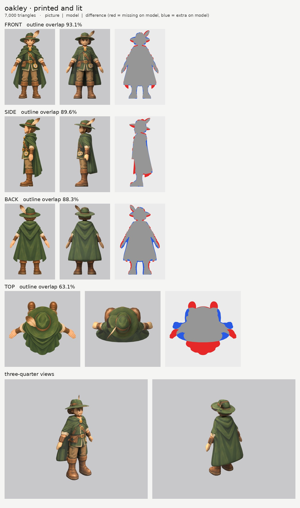
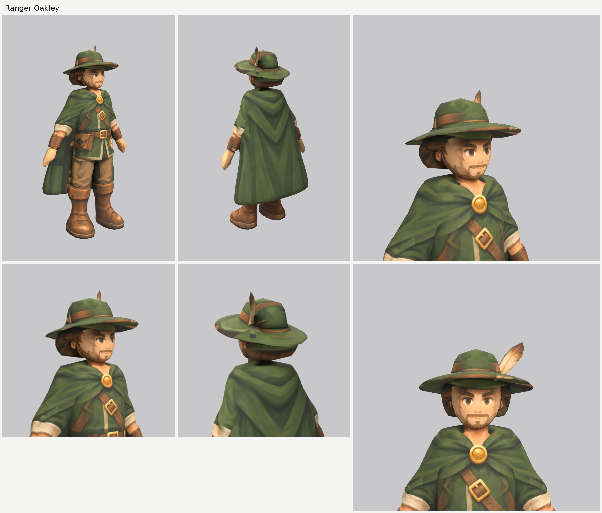

# Ranger Oakley (oakley): small-model-only route (Opus 5.5)

**Result:** a TRIS-triangle game model (`oakley.glb`, SIZE MB) with one colour texture (2048), a normal
map (gentle grain on the cloth, leather, hair and hat, nothing on the skin) and an all-black glow map
(nothing glows). From the front and the front three-quarter view he reads as the ranger on the sheet:
brown eyes and strong brows, the short beard and smile, messy brown hair under the wide green hat with
its brown band and the big brown-and-cream feather on his left, the hooded green cloak held by the gold
brooch, the green tunic with cream trim, the cross strap with its buckle, the belt with the gold
compass on his left hip and the leather pouch on his right, rolled cream sleeves, leather bracers,
khaki trousers and tall cuffed boots. From behind: the hood's point on the cloak's back and the hat
with the feather.

The final game model's Blender file (the lead animates from it):
`/tmp/claude-0/-home-user-atoms-games-/95c47fc1-cd5e-5362-b776-c463cbad3789/scratchpad/chapter1/oakley/out2/model.blend`

## Numbers

| | Front | Side | Back | Top |
| --- | --- | --- | --- | --- |
| Blockout (60,000 triangles), outline overlap (`blockout.jpg`) | 93.0% | 91.0% | 87.1% | 63.3% |
| Game model (TRIS triangles), outline overlap | OVF% | OVS% | OVB% | OVT% |

- **Texture seen by a picture:** SEEN%. The rest (the inside of the cloak, the hat brim's underside at
  the back, the soles, the inner sides of the arms and legs) is coloured from the nearest painted spot
  of the same part.
- **Why the top number is low:** the top picture is another pose (arms out, boots far in front, the
  cloak spread behind). It paints only the hat, the one part it sees properly: its scale is set so its
  round brim matches the brim in the front and side pictures (`set_view_map.py`).
- **Why back is under 90%:** the back picture draws him about 2% bigger than the front does, with the
  cape wider over the shoulders and the arms further out. The front picture wins for widths.
- **Why side is under 92%:** in the side picture the cloak's far edge shows in front of his legs (the
  cloak wraps round to the front at the sides). A solid part can't be open in front, so the model's
  cloak stops behind the middle of the legs (see 5).
- **Parts (15 kinds, 20 pieces), all named for the two-legged skeleton:**

  | Skeleton job | Pieces |
  | --- | --- |
  | head | `head`, `ear_L/R`, `hair`, `hat`, `hat_brim`, `hat_feather` |
  | neck | `neck` |
  | hangs from the shoulders | `cloak` (hood, cape and the long back) |
  | chest and spine | `torso` (the tunic; the strap and belt are paint on it) |
  | hips | `belt_compass`, `belt_pouch` |
  | arm (shoulder to wrist, sleeve, cuff and bracer included) | `arm_L`, `arm_R` |
  | hand | `hand_L`, `hand_R` |
  | leg (hip to boot, trouser leg included) | `leg_L`, `leg_R` |
  | foot | `boot_L`, `boot_R` (the tall boots with their cuffs) |

  Arms, hands, legs and boots are mirrored pairs. Each arm starts inside the cape at the shoulder and
  each leg 10 cm up inside the tunic. The elbow is at the rolled cream cuff and the knee where the
  trousers bunch, as the pictures put them.
- **Triangle budget:** BUDGET
- **Time:** about TIME minutes by the clock: 1 blockout and 2 route runs.

## What I did and the problems I hit

1. **Pictures checked.** The front, side, back and top agree that the feather and the compass are on
   his left and the pouch on his right. What the generator got wrong:
   - **the top picture is another pose** (see above);
   - **the back picture** is about 2% bigger, with a wider cape;
   - **the compass is drawn face-on in both the front and the side picture**, which a flat disc can't
     be (see 7).
2. **Views on one scale:** `make_views.py ... 1.85`; the top picture's scale is set by hand to the brim.
3. **Ghost face:** the side picture's eye, eyebrow and smile are painted out of a print-only copy with
   skin colour only (`inpaint_skin.py`; the copy is `side_print_repaired.png`).
4. **The tilted hat.** The side picture tips the hat back: the brim is high at the front and low at the
   back. An upward-sliced brim would be a thick block, so:
   - the brim is sliced front to back (`axis: y`), with a thin slanted band traced in the side picture
     and a round outline from the top picture, so it's a thin tilted disc;
   - its sides bend down 5 cm (`droop`), as the front picture shows, which also gives the side view's
     thick look at the front;
   - the crown is its own upward-sliced part sitting on the brim;
   - the feather is a thin turned blade (`slab`), so it's flat and reads as a feather from the front
     and from the side.
5. **The cloak is open in front.** One upward-sliced part from the hood to the hem. Over the chest its
   front edge (side picture) is at the brooch, so it covers the shoulders like the picture's cape;
   below the chest its front edge moves back behind the middle of the legs, so the tunic and the
   trousers stay in front and the cloak wraps round the sides and the back. Its widest point is behind
   the arms, so the arms hang in front of it as in the front picture. The arms and hands in the front,
   side and back pictures are switched off on the cloak (`paint_box_skip`), so they don't print onto it.
6. **The feather printed on the hat.** In the top, back and side pictures the feather lies across the
   brim or the crown, and wherever the model's thin feather doesn't cover that spot, its colours printed
   on the hat. Those pictures are now switched off there for the hat and the brim (`paint_box_skip`).
7. **The compass** is a thin disc turned to face forward and out (`slab`), so it matches both the front
   and the side picture's round face, moved 2 to 3 cm out so it sits on the tunic, not inside it. The
   side picture is switched off on the tunic behind it, so the mirrored side picture doesn't print a
   second compass on his right hip. The pouch is a small boxy part on the right hip, printed from the
   front and back pictures only (the side picture shows the other hip).
8. **Dark hands from behind.** The back picture's hands are a little further out than the model's, so
   it printed the bracer and cloak colours onto the backs of the hands. The back picture is now
   switched off on the hands; they're painted from the front and side pictures.
9. **Relief:** none on the face, ears, hands, compass and feather; a gentle `grain` on everything else.
10. **Glow map:** all black. Checked: the exported glow texture is black.

## Changed tool copies (in `tools/`)

The heroes' set (see `../player-b/NOTES.md`), unchanged. New for Oakley: `mkparts.py` writes this
`parts.json`; `redo_views.sh` rebuilds the views, sets the top picture's scale and makes the repaired
side picture.

Rebuild (from the work folder): `bash tools/redo_views.sh`, then `python -I tools/mkparts.py parts.json`,
then `PY=... bash tools/route_small.sh parts.json views/views.json OUT 7000 oakley`.

## What still looks wrong

WRONG

## Compared with the heroes

COMPARE

## What the next people should know

- **Tilted hat brims:** slice the brim front to back (`axis: y`) with a thin slanted band from the side
  picture and a round top outline, add `droop` for the sides, and give the crown its own part. Use the
  top picture for the brim's top surface (set its scale to the brim), and switch it off everywhere else.
- **A one-piece cloak can be open in front:** keep its front edge (side picture) behind the middle of
  the legs below the chest. The far edge the side picture shows in front of the legs is lost.
- **A prop drawn face-on in two views** (a compass, a badge) is a thin `slab` turned between them.
- **Feathers and other things that lie across another part in the top or back picture** print onto that
  part: switch those pictures off there.
