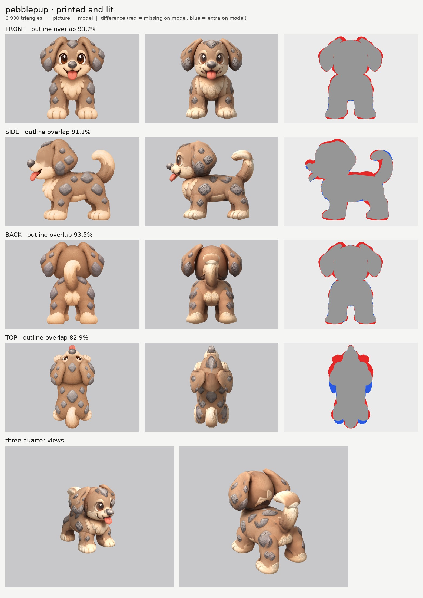
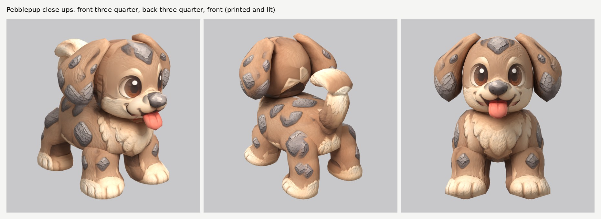

# Pebblepup: small-model-only route

**Result:** a 6,990-triangle game model (`pebblepup.glb`, 4.2 MB) with one colour texture (2048), a soft-fur
normal map and an all-black glow map (nothing glows). It reads as the puppy in the pictures from every
side: big brown eyes, the grey pebble on its nose, the pink tongue out, floppy ears with stone patches,
the cream chest, muzzle and toes, grey stone patches on the back and legs, and the curled tail.

The final game model's Blender file (the lead animates from it):
`/tmp/claude-0/-home-user-atoms-games-/95c47fc1-cd5e-5362-b776-c463cbad3789/scratchpad/chapter1/pebblepup/out2/model.blend`

## Numbers

| | Front | Side | Back | Top |
| --- | --- | --- | --- | --- |
| Blockout (60,000 triangles), outline overlap (`blockout.jpg`) | 94.0% | 92.3% | 94.1% | 83.4% |
| Game model (6,990 triangles), outline overlap | 93.2% | 91.1% | 93.5% | 82.9% |

- **Texture seen by a picture:** 69.8%. The rest (the belly, the insides of the legs and ears, the hidden
  backs of the tongue and pebble, the soles) is coloured from the nearest painted spot of the same part;
  the soles get a cream pad colour.
- **Parts (14 pieces):** `head`, `muzzle`, `head_pebble`, `head_tongue`, `ear` pair, `body`,
  `body_chest`, `front_leg` pair, `rear_leg` pair, `tail_a`, `tail_b`. Budget: head 1,710, body 880, ears
  600 each, rear legs 504 each, front legs 440 each, muzzle 352, tail 494 in two pieces, chest 224, tongue
  132, pebble 110.
- **Skeleton words:** `head`, `muzzle`, `head_pebble`, `head_tongue`, `ear` ride the head; `body`,
  `body_chest` the body; `front_leg`, `rear_leg` mirrored pairs; `tail_a`, `tail_b` the tail chain.
- **Glow:** 0% (black map, checked in `emissive.jpg` and on the lit board).
- **Size:** 0.45 m tall and 0.49 m long by the pictures (the prompt said 0.65 m long; the curled tail
  doesn't reach out behind). The model follows the pictures.
- **Time:** about 35 minutes of my own work (from about 01:20 to 02:45 by the clock, interleaved with
  the others while their boards rendered), 2 route runs and 1 blockout.

## Why the top score is low

The top picture is drawn half from the front (the eyes and the paws under the ears show) and its tail lies
flat behind the body. It is used only to paint the top of the back and the tail.

## What I did and the problems I hit

1. **Pictures checked.** Side faces left, top has the head at the top, and the front and back pictures
   agree very closely with each other. What the generator got wrong:
   - **The snout, pebble and tongue sit higher in the side picture** than in the front picture (the pebble
     by about 1.7 cm). The front picture wins for heights: those three parts take their heights from the
     front picture (`remap`), and the side picture is read shifted up for them (`paint_shift`), so its
     pebble and tongue paint still land on the pebble and tongue.
   - **The tail curls toward the creature's right** in the back picture, but straight forward in the side
     picture. The brief says straight behind, so it is centred.
2. **Ghost eye.** The side picture's eye and its cream eye patch are painted out of a print-only copy
   (`side_print_repaired.png`); the eyes come from the front picture only. The head takes each spot's
   colour from the most head-on picture (`paint_power` 5), so the eyes stay crisp.
3. **Own parts for what sticks out:** the snout (`muzzle`), the pebble (`head_pebble`), the tongue
   (`head_tongue`) and the chest fluff (`body_chest`).
4. **The muzzle at first covered the bottoms of the eyes,** so it printed brown eye paint on top of the
   snout. Its top is now narrower, between the eyes.
5. **The curled tail** is two pieces: `tail_a` rises from the rump (sliced upward) and `tail_b` is the
   curl over the top with its tip (sliced front to back).
6. **The floppy ears** are thick hanging flaps (7.5 cm, `cap`), outside the head, so the side picture's
   ear and stone patches land on the ear and not on the head.
7. **Tail paint on the head.** The back picture draws the tail in front of the back of the head; it is
   switched off there, so the back of the head is plain fur.
8. **Relief:** `fur_soft` on the fur (the stone patches get a gentle bump), `none` on the muzzle,
   pebble and tongue.

## Changed tool copies (in `tools/`)

The same set as Tuftail's (see `../tuftail/NOTES.md`): round 3 Puffmunk's tools plus Mossback's
`paint_ellipse_skip` and `view_warp` in `print_tex.py`, and `LIT_SAMPLES` in `route_small.sh`.
`mkparts.py` writes `parts.json`; `closeups.py` makes `closeups.jpg`.

Rebuild: `make_views.py WORK/views 0.45 front side back top`, then
`tools/inpaint_view.py views.json side "452,250,60,90" "x:400,410,140,70" --grain 0 --sigma 16`, then
`tools/mkparts.py parts.json` and `PY=... bash tools/route_small.sh parts.json views.json OUT 7000 pebblepup`.

## What still looks wrong

- **The back of the head** has a faint lighter patch where the back picture's tail was switched off
  (no picture sees that spot, so it is filled from the fur around it).
- **A small red dot** under the chin, where the front picture's tongue lands on the chest beside the
  3D tongue.
- The two tail pieces show a soft bend where they join, and the curl's tip is a rounded club.
- The ears are thick flaps (as asked: at least 4 cm) and a little blocky from behind.
- The stone patches are paint with a gentle bump, not raised stones.

## Compared with round 3

Close to round 3's best. The outline scores (93 / 91 / 94%) are as good as Fleecling's and
Puffmunk's, the face is clean with one pair of eyes, and the paint has no ghost features from the front
and three-quarter views. The weak spots are small (the back of the head, the tail joint).
