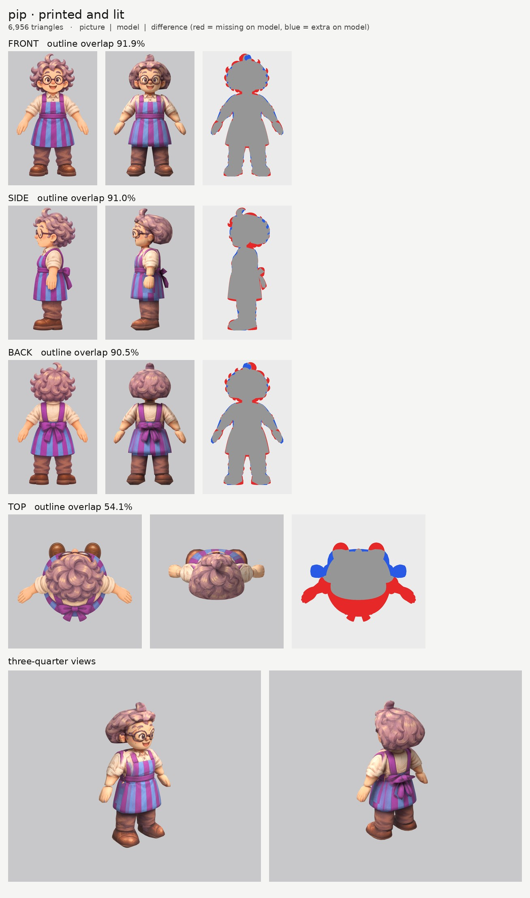
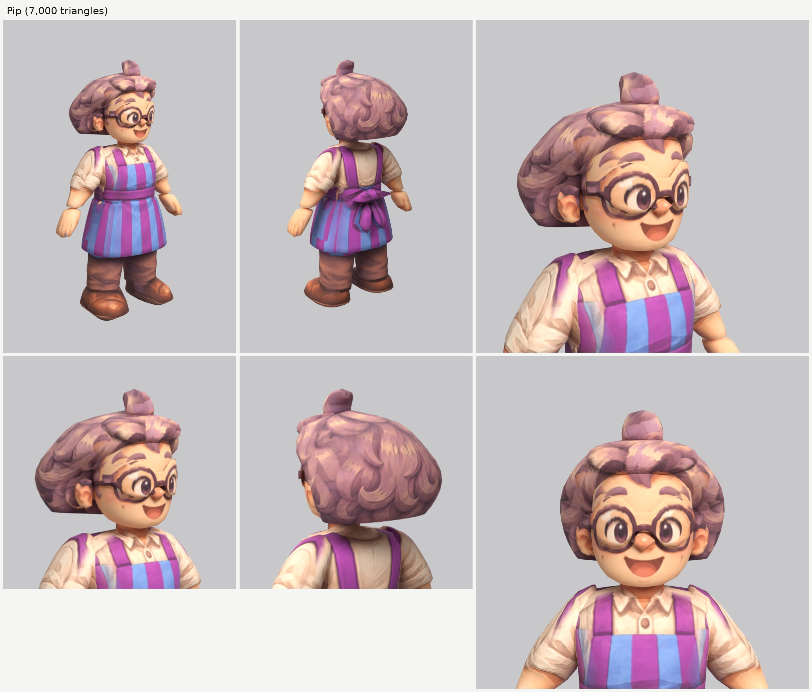

# Pip, the shopkeeper (pip): small-model-only route (Opus 5.5)

**Result:** a 6,956-triangle game model (`pip.glb`, 3.4 MB) with one colour texture (2048), a normal map
(gentle cloth and hair grain, nothing on the skin) and an all-black glow map (nothing glows). From the front
and the front three-quarter view Pip reads like the sheet: the big round face, the round dark glasses with
the eyes behind them, the button nose, the open smile and pink cheeks, the curly lavender hair with the big
hooked curl on top, the cream shirt with its collar, button and rolled sleeves, the purple-and-blue striped
apron with its bib, straps and waistband, brown trousers and boots. From behind: the curly back of the hair
and the purple bow with its two tails.

The final game model's Blender file (the lead animates from it):
`/tmp/claude-0/-home-user-atoms-games-/95c47fc1-cd5e-5362-b776-c463cbad3789/scratchpad/chapter1/pip/out2/model.blend`

## Numbers

| | Front | Side | Back | Top |
| --- | --- | --- | --- | --- |
| Blockout (60,000 triangles), outline overlap (`blockout.jpg`) | 92.9% | 93.0% | 91.4% | 54.3% |
| Game model (6,956 triangles), outline overlap | 91.9% | 91.0% | 90.5% | 54.1% |

- **Texture seen by a picture:** 60.2%. The rest (the inner sides of the arms and legs, the soles, the
  underside of the hair and the skirt, hidden ends inside other parts) is coloured from the nearest
  painted spot of the same part.
- **Why the top number is low:** the top picture is another pose, like the heroes' (arms straight out,
  boots far in front). It paints only the crown of the hair.
- **Parts (16 kinds, 22 pieces), all named for the two-legged skeleton:**

  | Skeleton job | Pieces |
  | --- | --- |
  | head | `head`, `ear_L/R`, `nose`, `glasses`, `hair`, `hair_bangs`, `hair_curl` |
  | neck | `neck` |
  | chest and spine | `torso` (the shirt and the apron bib and waistband; no "skirt" word in it) |
  | skirt (hangs from the hips, swings with the legs) | `skirt_apron` (the apron below the waist) |
  | hips | `belt_bow`, `belt_bow_tail_L/R` (the bow at the back of the waistband) |
  | arm (shoulder to wrist, sleeve and rolled cuff included) | `arm_L`, `arm_R` |
  | hand | `hand_L`, `hand_R` |
  | leg (hip to ankle) | `leg_L`, `leg_R` |
  | foot | `boot_L`, `boot_R` |

  Arms, hands, legs, boots and bow tails are mirrored pairs. Each arm runs 3 to 5 cm into the torso at the
  shoulder. The legs start about 18 cm up inside the skirt (hidden), so the walk never opens a gap under it; the
  knee falls just below the skirt's hem, where the trousers bend in the pictures. The rolled cuff is at the
  elbow, as in all three pictures.
- **Triangle budget:** head, hair and glasses 3,466 (50%: head 1,188, hair 1,120, bangs 252, glasses 240,
  curl 210, ears 198 each, nose 60); skirt 680, torso 432, arms 390 each, legs 330 each, hands 168 each,
  boots 152 each, bow tails 80 each, bow 78, neck 60.
- **Time:** about 40 minutes by the clock (00:52 to 01:32): 2 blockouts and 2 route runs. The machine was
  shared and slow (a route run took 6 to 12 minutes instead of 2).

## What I did and the problems I hit

1. **Pictures checked.** The front, side and back agree closely (the same height and scale to within
   0.1%), and the bow is centred at the back in the back and top pictures. What the generator got wrong:
   - **The top picture is another pose** (arms out), as for the heroes.
   - **The side picture draws the near lens of the glasses as an oval**, as if seen from three-quarter, and
     the far lens as a ring in front of the nose. It can't be both a side view and that.
   - The apron's stripes don't line up between the pictures (they are just stripes, so nobody will see it).
2. **Views on one scale:** `make_views.py ... 1.35`. The top picture's scale is set by hand so its hair
   lines up with the front and side hair (`set_view_map.py`).
3. **Ghost eye, brow and mouth:** painted out of a print-only copy of the side picture with skin colour
   only (`inpaint_skin.py`; the copy is `side_print_repaired.png`).
4. **The glasses (new).** One curved part (`glasses`) in front of the eyes, sliced side to side. Its front
   outline is the two round rims, the bridge and the hinges (drawn as exact circles in `mkparts.py`); a
   drawn top outline makes it a thin band about 2 cm in front of the round face that curves back to the
   hinges at the temples, where the side picture puts them. The front picture paints the frames and the
   eyes onto it, which reads like eyes seen through lenses. The side picture is switched off on the
   glasses (its oval lens would print a second rim inside the lens); its temple arm prints on the side of
   the head and runs back to the ear, which is right. The first try sat the glasses only 1 cm from the face
   and the cheeks poked through the lower rims.
5. **The hair.** One upward-sliced mass whose front edge steps back from the forehead to behind the ear, a
   fringe pad over the forehead, and the big hooked curl on top as its own part, as the heroes' notes say.
   The curls are paint.
6. **Dark blotches all over the hair (new lesson).** The heroes' `paint_color_skip: ["skin"]` (keep skin
   off the hair) wiped out the hair's peach highlights too, because Pip's lavender hair has highlights the
   same colour as skin (about 243,189,161 against 253,202,159), and the gaps were filled with the dark
   colour from the curls' shadows. Without the colour skip the hair is clean, and no skin lines appeared.
7. **The apron.** The bib is paint on the `torso`; the part below the waistband is `skirt_apron`, a flared
   skirt all round (the stripes run round the sides and back in the pictures). The bow at the back is its
   own part, and its two tails are a mirrored pair. My first bow was traced 10 cm off to one side (I misread
   a zoomed picture's grid); it is centred now.
8. **The side picture's hand** hangs in front of the skirt. The side picture is switched off on the skirt
   where the hand is drawn (`paint_box_skip`), as the heroes did for the thigh.
9. **Relief:** none on the skin, face, glasses and hands; a gentle `grain` on the cloth, hair and boots.
10. **Glow map:** all black. Checked: the exported glow texture is black.

## Changed tool copies (in `tools/`)

The girl's set (`../player-b/tools/`), unchanged: `route_small.sh`, `parts.py` (with `ring_ease`),
`build.py`, `print_tex.py` (with `paint_color_skip`), `relief.py`, `board.py`, `emissive.py`,
`set_view_map.py`, `inpaint_skin.py`, `closeups.py`. Pip's own: `mkparts.py` (writes `parts.json`; it draws
the glasses' rims as circles and their curved top band) and `redo_views.sh` (views and the repaired side
picture).

Rebuild (from the work folder): `bash tools/redo_views.sh`, then `python -I tools/mkparts.py parts.json`,
then `PY=... bash tools/route_small.sh parts.json views/views.json OUT 7000 pip`.

## What still looks wrong

- **The hair is a smooth, rounded mass with the curls painted on**, so from the three-quarter views it
  looks a little like a beret or a helmet, with a flat lower edge at the sides. The picture's hair is a
  cloud of separate curls. The same weak point as the heroes.
- **The curl on top is a soft lump**, not an open hook.
- **Purple smudges on the tops of the sleeves**, where the front picture's apron straps print onto the
  tops of the arms at the shoulder.
- **The stripes on the skirt behind the side picture's hand** are blurred (that spot is coloured from the
  nearby paint).
- The glasses are a solid plate: from straight below or from far to the side you can see that they are
  not open rims.
- The hands are mittens with painted fingers, as planned.

## Compared with the heroes

About the same. The face is as clean as theirs and reads like the sheet from the front three-quarter
view; the glasses work well. The clothes print cleanly. The hair has the same helmet look as the heroes'
hair, a little stronger because Pip's hair is a big round cloud of curls.

## For the next people

- **Glasses:** one curved band in front of the eyes (a drawn top outline about 2 cm in front of the face),
  with the front picture painting the eyes onto it and the side picture switched off on it.
- **Don't use `paint_color_skip: ["skin"]` on light or pastel hair.** Check first how many of the hair's
  pixels pass the skin test (Pip's highlights do).
- **Skirts:** `torso` down to the waistband, `skirt…` below, and legs starting hidden inside the skirt.
