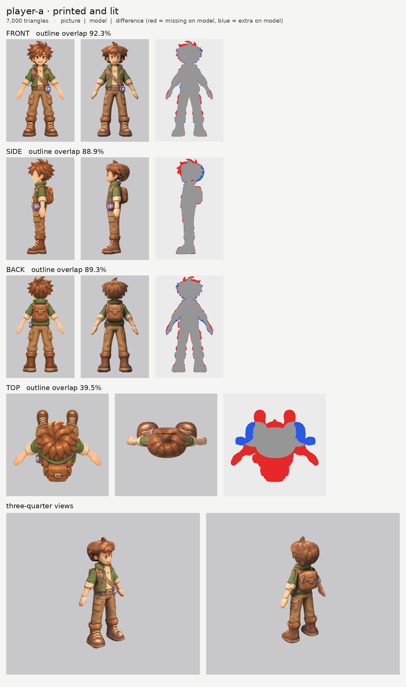
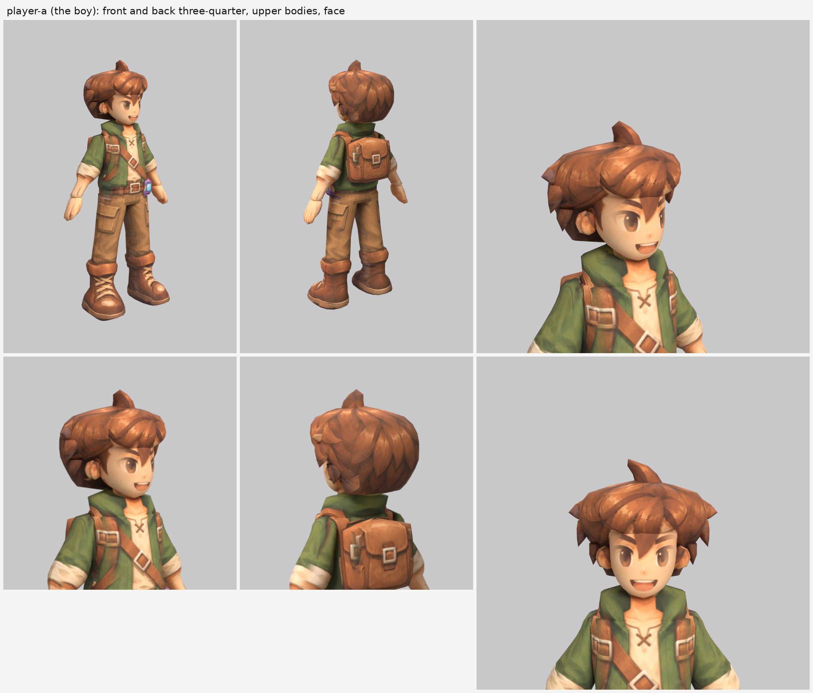

# The boy (player-a): small-model-only route (Opus 5.5)

**Result:** a 7,000-triangle game model (`player-a.glb`, 3.5 MB) with one colour texture (2048), a
normal map (gentle cloth and hair grain, nothing on the skin) and an all-black glow map (nothing glows).
From the front and the front three-quarter view it reads as the boy on the sheet: big brown eyes,
thick brows, open grin, the long lock of hair between the eyes, spiky brown hair with the big swoosh on
top, green jacket open over the cream shirt with the X lacing, the crossed straps and buckles, the belt
with the purple cube on his left hip, cargo trousers and laced boots. From behind: the spiky back of
the hair, the backpack with its buckle, the cube peeking out on the left.

The final game model's Blender file (the lead animates from it):
`/tmp/claude-0/-home-user-atoms-games-/95c47fc1-cd5e-5362-b776-c463cbad3789/scratchpad/chapter1/player-a/out6/model.blend`

## Numbers

| | Front | Side | Back | Top |
| --- | --- | --- | --- | --- |
| Blockout (60,000 triangles), outline overlap (`blockout.jpg`) | 93.1% | 90.2% | 89.5% | 39.9% |
| Game model (7,000 triangles), outline overlap | 92.3% | 88.9% | 89.3% | 39.5% |

- **Texture seen by a picture:** 60.2%. The rest (the inner sides of the arms and legs, the soles,
  the underside of the hair, the hidden ends of parts inside other parts) is coloured from the nearest
  painted spot of the same part.
- **Why the top number is low:** the top picture draws a different pose: the arms stretched out much
  wider (almost a T), the boots far in front of the head and the backpack far behind. It is used only
  to paint the crown of the hair, so I scaled it to fit the hair alone (see below).
- **Why back is a little under 92%:** the back picture's arms hang at a slightly different angle
  from the front picture's (red on one side of each arm, blue on the other), and its hair spikes are
  different from the front's. The front picture wins for widths, so I kept the front's arms.
- **Parts (18 kinds, 26 pieces), all named for the two-legged skeleton:**

  | Skeleton job | Pieces |
  | --- | --- |
  | head | `head`, `ear_L/R`, `hair`, `hair_bangs`, `hair_spike`, `hair_spike_side_L/R`, `hair_lock_L/R`, `hair_lock_low_L/R` |
  | neck | `neck` |
  | upper chest | `collar`, `backpack` |
  | chest and spine | `torso` |
  | hips | `hips` (the belt is paint on it), `cube` |
  | arm (shoulder to wrist, sleeve and cuff included) | `arm_L`, `arm_R` |
  | hand | `hand_L`, `hand_R` |
  | leg (hip to ankle, trouser leg included) | `leg_L`, `leg_R` |
  | foot | `boot_L`, `boot_R` |

  Arms, hands, legs and boots are mirrored pairs. Each arm runs 2.7 cm into the torso at the shoulder
  and each leg runs 8 cm up inside the hips, so nothing opens when they bend. The rolled cuff sits at
  the elbow, where all three pictures put it; the knee is where the trousers narrow, about 40 cm up.
- **Triangle budget:** head and hair 3,110 (44%: head 1,116, hair 806, bangs 240, ears 168 each,
  swoosh 132, side spikes 100 each, locks 80 and 60 each); arms 476 each, torso 484, legs 364 each,
  boots 320 each, backpack 240, hips 190, hands 176 each, collar 144, cube 100, neck 60.
- **Time:** about 60 minutes by the clock (10:58 to about 11:58): 11 blockouts and 5 route runs, plus
  one more route run at 12:30 for the finger fix below (found while building the girl).

## What I did and the problems I hit

1. **Pictures checked.** The front, side and back agree that the cube is on his left hip. What the
   generator got wrong:
   - **The top picture is another pose** (see above).
   - **The back picture** puts the cube about 4 cm further out to the side than the front does, and
     the jacket's hem about 2 cm higher.
   - **The cargo pockets** stick out at the outer side of each thigh in the front picture but at the
     front of the thigh in the side picture.
   - Otherwise the three main views agree very well: the same height and scale to within half a
     percent.
2. **Views on one scale:** `make_views.py ... 1.55`. The top picture's scale is set by hand
   (`set_view_map.py`) so that its hair lines up with the hair in the front and side pictures.
3. **Ghost eye, brow and mouth.** The side picture's eye, eyebrow and open mouth would each have
   printed a second copy on the side of the face. They are painted out of a print-only copy of the
   side picture (`side_print_repaired.png`). The usual tool blended brown hair into the fill and left a
   smear on the temple, so I wrote `inpaint_skin.py`, which only uses skin colour for the fill.
4. **Stacked rings everywhere (the big lesson for people).** The first blockout had ridges across
   the face, torso, arms and legs. The cause: the outline finder follows every fold in the clothes and
   every notch (the open mouth, eyelashes, the gap between arm and jacket), and each one becomes a ring
   around the part. Fix: the head, hair, torso, arms and legs use hand-drawn smooth outlines instead
   (`nomask`), traced along the real edges but leaving out folds, the bunched trouser bottoms and the
   cargo pockets (pockets are paint, as the brief says). The surfaces are now smooth.
5. **The face was a narrow beak.** The head's slices were 29 cm deep and 19 cm wide, so the front of
   each slice was a sharp curve and the face looked long and pointed from three-quarter. The skull's
   back is hidden in the hair, so I made the head 24 cm deep and slightly squarer (`n` 2.2): the face
   is now a broad, smooth curve and the front picture's eyes, brows and mouth print cleanly on it.
6. **The hair, which took most of the time.**
   - **Try 1, one upward-sliced mass:** a mushroom cap with a flat brim sticking out over the face.
   - **Try 2, sliced front to back:** no brim, but the hair stopped at the ear tops (a helmet). Side
     pads to fill it looked like earmuffs.
   - **What worked:** an upward-sliced mass whose front edge steps back gradually from the forehead
     (at the top) to behind the ears (at the bottom), so it frames the face with no brim; a separate
     fringe pad over the forehead, sliced front to back so its lower edge curves up at the temples;
     the outline follows the bases of the spikes, not their tips. Then a few big shapes of their own,
     as the brief suggests: the swoosh on top, one spike sticking out above each ear (a flat lock, so it
     doesn't look like a horn from the side), and two pointed locks hanging down at each side, which
     break the lower edge into points instead of a smooth bowl.
7. **The side picture's arm.** The near arm hangs in front of the jacket in the side picture. The arm
   on the model sits in front of the jacket too, so the side picture's arm paints the arm and the
   jacket behind it is hidden; no repair was needed.
8. **The cube printed on the wrong hip.** The side picture is also used, mirrored, for the right side,
   which printed a purple cube on the right hip. The side picture is now switched off there for the
   hips, jacket and legs (`paint_box_skip`); the left side is covered by the real cube anyway. The back
   picture's cube is switched off on the hips and jacket for the same reason.
9. **Pointy soles and a diamond cube.** With only about 10 rings per part, a rounded end shorter than
   the gap between rings collapsed into a point (V-shaped boot soles, the cube's top and bottom turned
   into pyramids). New option `ring_ease` in `tools/parts.py` moves rings toward both ends of a part;
   the boots and cube now have flat ends.
10. **Relief:** none on the skin, face, hands and cube. A gentle `grain` on cloth, leather and hair,
    which I made fade out across strong painted edges (seams, straps, buckle outlines), so nothing
    looks carved.
11. **Fingers on the thigh.** In the side picture the hand hangs in front of the trouser pocket. The
    model's hand is a little shorter than the picture's fingers, so the picture's fingertips printed on
    the outside of the thigh, just under the pocket. The side picture is now switched off on the legs
    and hips where the hand is drawn (`paint_box_skip`); the front and back pictures paint that spot.
12. **Glow map:** all black (`emissive.py --off`). Checked: the exported glow texture is black.

## Changed tool copies (in `tools/`)

- `route_small.sh`: round 3's route, using this folder's copies.
- `parts.py`: round 3's Clovermouse copy (`slab`, `droop`, `offset`) plus the new `ring_ease`.
- `relief.py`: round 3's Puffmunk copy (`fur_soft`) plus Mossback's `grain` (made gentler, fades out
  at strong painted edges) and `relief_gain`.
- `build.py`, `board.py`, `print_tex.py` (with `paint_shift`, `side_far`, `paint_solid`),
  `emissive.py` (`--off`), `set_view_map.py`: unchanged round 3 copies.
- New: `inpaint_skin.py` (paints a feature out with skin colour only), `closeups.py` (the close views
  sheet), `mkparts.py` (writes `parts.json`), `redo_views.sh` (rebuilds the views and the repaired
  side picture).

Rebuild (from the work folder): `bash tools/redo_views.sh`, then
`python -I tools/mkparts.py parts.json`, then
`PY=... bash tools/route_small.sh parts.json views/views.json OUT 7000 player-a`.

## What still looks wrong

- **The hair is rounder and puffier than the picture.** The picture's hair is a crown of separate
  spikes; the model's is a smooth mass with the spikes painted on, plus five real spikes and four
  locks. From the front three-quarter view it is a touch helmet-like over the ears.
- **The fringe's lower edge is a straight line** across the forehead; in the picture it is a row of
  points. The long lock between the eyes and the side locks are paint on the face.
- **The ears are a little faceted** (168 triangles each).
- **The hands are mittens** with painted fingers, as the brief asks; from below you see their flat
  palms.
- **Small seam** on the back of the right hip where the hips meet the leg (a slightly lighter patch).
- The top view doesn't match the top picture (a different pose).

## Compared with the best creatures

Close to them from the front and front three-quarter: the face is clean, with no ghost features, and
it reads like the sheet's hero view. The clothes print very well because the front, side and back
pictures agree so closely, better than most creature pictures do. The hair keeps it below Clovermouse
and Puffmunk: a creature's round fur suits smooth parts, but spiky hair is all outline, and smooth
parts can only carry part of it.

## What the next ten people should know

- **Trace people with hand-drawn smooth outlines (`nomask`), not the picture's outline.** Clothes have
  folds everywhere, and each fold becomes a ring. Leave out pockets, folds and bunched cuffs.
- **Keep the head round and not too deep**, or the face turns into a beak. The back of the skull is
  under the hair, so it can be any shape you like.
- **Hair is the hard part.** What worked here: one upward-sliced mass whose front edge steps back
  gradually from the forehead to behind the ears, a separate fringe sliced front to back, the outline
  through the spike bases, and only the 4 to 6 biggest spikes and locks as their own parts (flat, not
  cones). Small cones look like horns.
- **Paint out the side picture's eye, brow and mouth** with skin colour only.
- **The side picture's hand prints on the thigh** unless you switch the side picture off there for the
  legs and hips.
- **A one-sided prop (the cube) prints on both sides** from the side picture unless you switch the
  side picture off there for the parts behind it.
- **Use `ring_ease`** (about 0.35) so ends don't collapse into points at 7,000 triangles.
- **Arms and legs come out well:** an A-pose arm sliced upward with the sleeve, cuff and forearm in
  one part prints cleanly from all three pictures.
