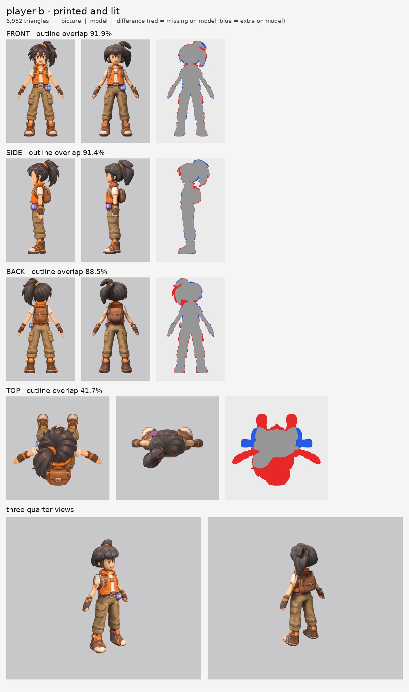
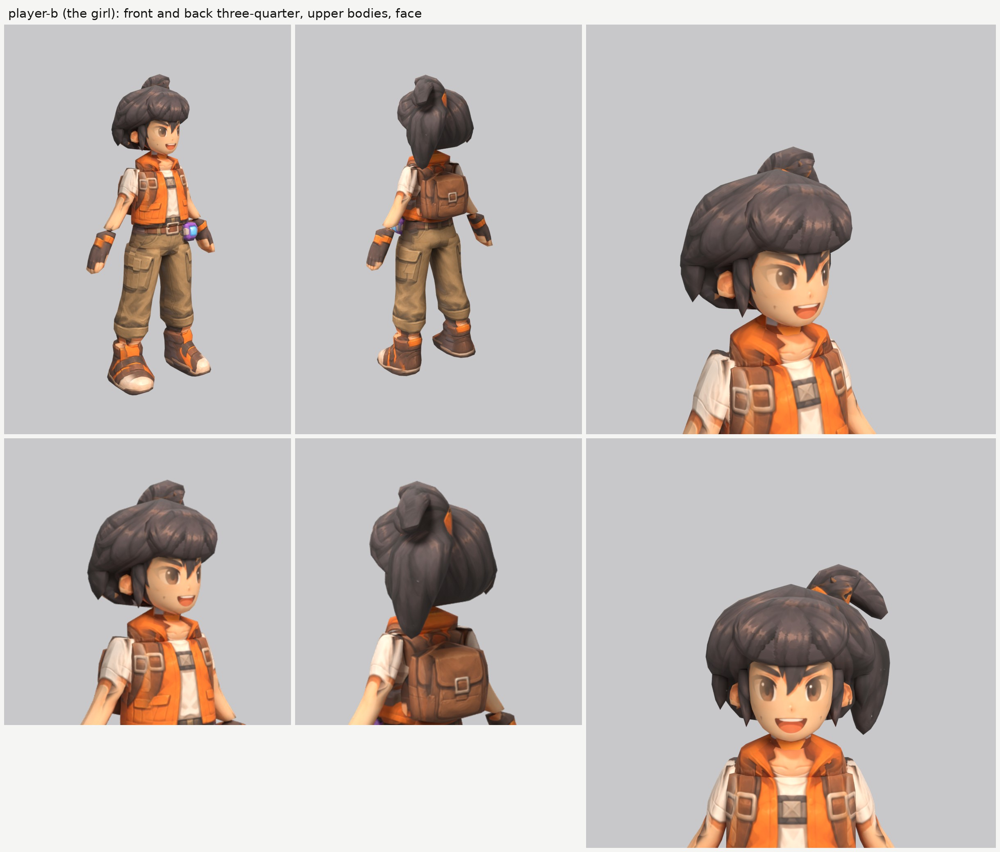

# The girl (player-b): small-model-only route (Opus 5.5)

**Result:** a 6,952-triangle game model (`player-b.glb`, 3.6 MB) with one colour texture (2048), a
normal map (gentle cloth and hair grain, nothing on the skin) and an all-black glow map (nothing glows).
From the front and the front three-quarter view she reads as the girl on the sheet: big brown eyes,
strong brows, the wide open smile, black hair with the lock between the eyes, the high ponytail with
its orange tie and the plume curling over to her left, the orange vest with its high collar over the
white shirt, the chest strap and buckles, the belt with the purple cube on her left hip, fingerless
gloves with orange cuffs, rolled-up cargo trousers and the brown-and-orange boots. From behind: the
backpack and the ponytail hanging down behind her left shoulder.

The final game model's Blender file (the lead animates from it):
`/tmp/claude-0/-home-user-atoms-games-/95c47fc1-cd5e-5362-b776-c463cbad3789/scratchpad/chapter1/player-b/out5/model.blend`

## Numbers

| | Front | Side | Back | Top |
| --- | --- | --- | --- | --- |
| Blockout (60,000 triangles), outline overlap (`blockout.jpg`) | 93.0% | 92.9% | 89.4% | 42.3% |
| Game model (6,952 triangles), outline overlap | 91.9% | 91.4% | 88.5% | 41.7% |

- **Texture seen by a picture:** 65.0%. The rest (the inner sides of the arms and legs, the soles, the
  underside of the hair, hidden ends) is coloured from the nearest painted spot of the same part.
- **Why the top number is low:** the top picture is another pose, like the boy's (arms out almost
  in a T, boots far in front, backpack far behind). It paints only the crown of the hair.
- **Why back is under 92%:** the back picture's hair is bigger than the front's (wider at the sides,
  and the plume on top curls further out), and its arms hang at a slightly different angle. The front
  picture wins for widths.
- **Parts (18 kinds, 25 pieces), all named for the two-legged skeleton:**

  | Skeleton job | Pieces |
  | --- | --- |
  | ponytail (a two-bone chain hanging from the head) | `ponytail`, `ponytail_plume` |
  | head | `head`, `ear_L/R`, `hair`, `hair_bangs`, `hair_lock_L/R`, `hair_lock_low_L/R` |
  | neck | `neck` |
  | upper chest | `collar`, `backpack` |
  | chest and spine | `vest` |
  | hips | `hips` (the belt is paint on it), `cube` |
  | arm (shoulder to wrist, sleeve included) | `arm_L`, `arm_R` |
  | hand (the gloves are paint) | `hand_L`, `hand_R` |
  | leg (hip to ankle, rolled trouser leg included) | `leg_L`, `leg_R` |
  | foot | `boot_L`, `boot_R` |

  Arms, hands, legs and boots are mirrored pairs. Each arm runs about 3 cm into the vest at the
  shoulder and each leg about 7 cm up inside the hips. The sleeve hem sits just above the elbow and
  the knee is where the trousers start to balloon, about 45 cm up, where the pictures put them.
- **Triangle budget:** head, hair and ponytail 3,724 (54%: head 1,020, hair 1,020, ponytail 646,
  bangs 230, plume 168, ears 120 each, locks 120 and 80 each); legs 420 each, vest 360, arms 260 each,
  hands 220 each, hips 216, boots 210 each, backpack 196, collar 96, cube 80, neck 60.
- **Time:** about 40 minutes by the clock (11:58 to about 12:37): 5 blockouts and 5 route runs. It
  went faster than the boy because the boy's lessons carried over.

## What I did and the problems I hit

1. **Pictures checked.** The front, side and back agree that the cube is on her left hip and that the
   ponytail falls to her left. What the generator got wrong:
   - **The top picture is another pose** (see above).
   - **The back picture's hair is bigger** than the front picture's, and its plume curls further out.
   - **The side picture's hand** hangs in front of the cargo pocket (see 6).
   - Otherwise the three main views agree well (the same height to within 1%).
2. **Views on one scale:** `make_views.py ... 1.55`; the top picture's scale is set by hand so its hair
   matches the front and side (`set_view_map.py`).
3. **Ghost eye, brow and mouth:** painted out of a print-only copy of the side picture with skin
   colour only (`inpaint_skin.py`, from the boy; the copy is `side_print_repaired.png`).
4. **Traced like the boy:** smooth hand-drawn outlines for the head, hair, vest, arms and legs, so the
   folds of the baggy trousers and the vest pockets don't turn into rings. The pockets, straps, belt,
   gloves and boot straps are all paint.
5. **The ponytail.** At first it was one part from the tie down, sliced upward. Its top filled a big
   block, because the plume at the top curls over to her left in the front picture and back in the side
   picture, and an upward-sliced part fills the whole box between the two. Now the ponytail part starts
   at the tie and hangs down behind her left shoulder, and the plume is its own part
   (`ponytail_plume`), sliced sideways along a band that runs back and to her left (a drawn outline
   from above). It reads as a curled lock. Both names contain `ponytail`, so both join the sway chain.
6. **Fingers on the thigh.** The side picture's hand is drawn in front of the cargo pocket, and the
   model's hand is a little shorter than the picture's fingers, so the fingers printed on the thigh.
   The side picture is switched off on the legs and hips where the hand is drawn (`paint_box_skip`).
7. **Skin lines and orange spots on the hair.** Where the model's hair is a little bigger than the
   picture's, the pictures print what lies just beside the hair there: skin from the forehead, ears
   and cheeks, and orange from the tie and the collar. New option `paint_color_skip` in
   `tools/print_tex.py`: a part ignores a picture's pixels of the named colours (here, the hair ignores
   skin and orange; the neck and collar ignore dark hair, because the side picture's hair hangs in front
   of them). I also tried it on the head to keep the collar's orange off the chin, but it wiped out
   the open mouth (also orange), so the head doesn't use it.
8. **The hair's lower edge.** As with the boy, the sides of the hair narrow toward the bottom, and two
   pointed locks per side (in front of the ear and behind it) break the edge into points.
9. **The cube** is switched off on the right hip (the side picture, mirrored) and on the back of the
   hips (the back picture), as for the boy.
10. **Relief:** none on skin, face, hands and cube; a gentle `grain` on cloth, hair and boots that
    fades out at strong painted edges.
11. **Glow map:** all black. Checked: the exported glow texture is black.

## Changed tool copies (in `tools/`)

The same set as the boy's (see `../player-a/NOTES.md`): `route_small.sh`, `parts.py` (with
`ring_ease`), `relief.py` (gentle `grain`), `build.py`, `board.py`, `emissive.py`, `set_view_map.py`,
`inpaint_skin.py`, `closeups.py`, plus:
- `print_tex.py`: the new per-part `paint_color_skip` (`skin`, `orange`, `dark`).
- `mkparts.py` writes `parts.json`; `redo_views.sh` rebuilds the views and the repaired side picture.

Rebuild (from the work folder): `bash tools/redo_views.sh`, then `python -I tools/mkparts.py parts.json`,
then `PY=... bash tools/route_small.sh parts.json views/views.json OUT 7000 player-b`.

## What still looks wrong

- **The hair is a rounder, heavier mass than the picture's.** The picture's hair is loose spiky
  strands; on the model it is a smooth mass with the strands painted on and four pointed locks. From
  the front three-quarter view it looks a little like a helmet over the temples.
- **The ponytail is thick and smooth**; the picture's is a bundle of separate pointed strands. The
  plume reads well from the front, less so from straight behind.
- **The sleeves:** a skin-coloured smear on the lower front of each sleeve, where the front and side
  pictures put the sleeve's hem at slightly different heights on the slanted arm.
- **The cargo pockets on the outside of the thighs** look a little blocky where the side picture was
  switched off (under the hand).
- A small grey patch under the chin, at the top of the collar.
- The ears are a little faceted (120 triangles each).

## Compared with the best creatures

The face is as good as the boy's: clean, with no ghost features, and from the front three-quarter
view it reads like the sheet's hero view. The outfit prints well. The hair and ponytail keep her below
Clovermouse and Puffmunk: smooth parts suit round fur, but loose spiky hair is all outline. She is a
little below the boy, because her hair is looser and bigger and the ponytail is a second big hair shape.

## What the next ten people should know (on top of the boy's list)

- **Cut a curled lock (a plume, a curl) into its own part** and slice it along its length with a
  drawn outline from above, or the upward slices fill a box.
- **`paint_color_skip` keeps skin off the hair and hair off the collar.** Don't use it for a colour the
  part really has (the mouth is orange-red, so the head can't skip orange).
- **Check the thighs under the hands** from the back three-quarter view: the side picture's fingers
  print there unless switched off.
