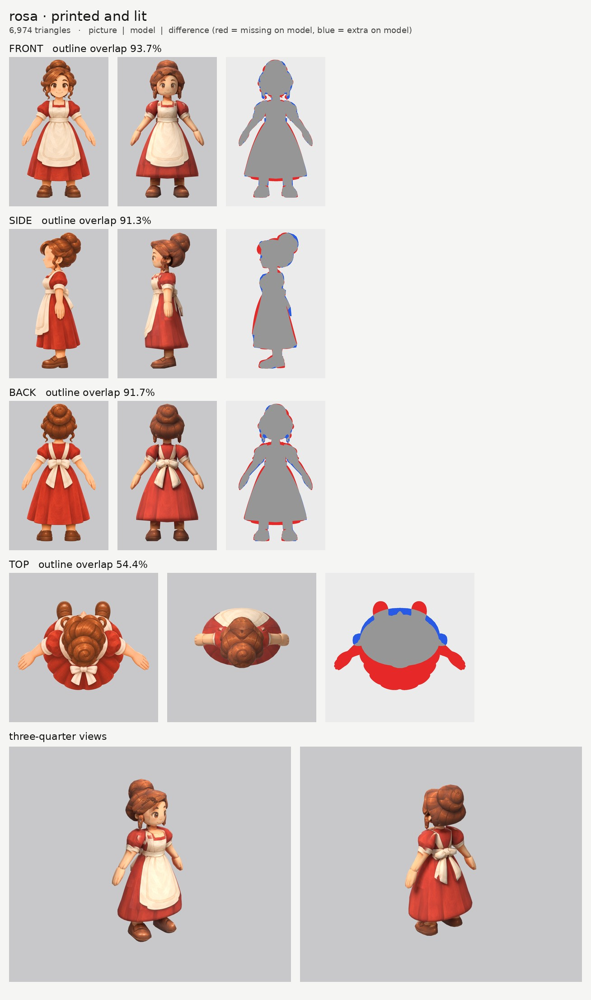
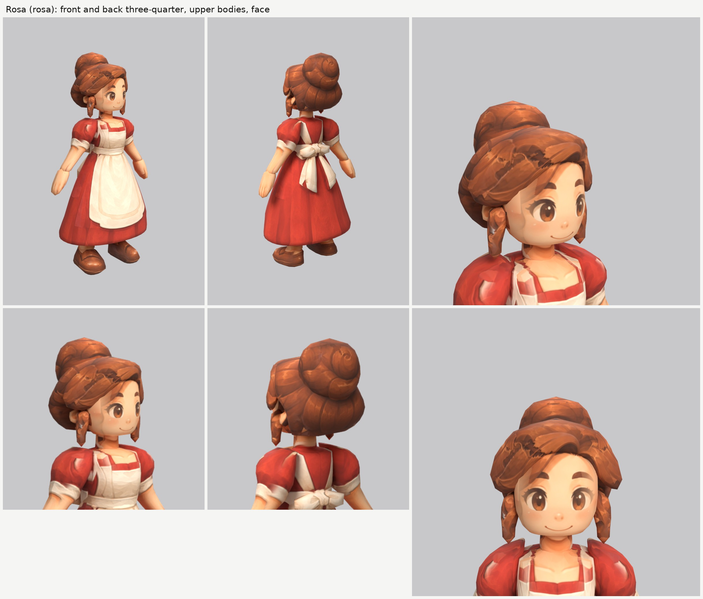

# Rosa, the innkeeper (rosa): small-model-only route (Opus 5.5)

**Result:** a 6,974-triangle game model (`rosa.glb`, 3.1 MB) with one colour texture (2048), a normal map
(gentle cloth and hair grain, nothing on the skin) and an all-black glow map (nothing glows). From the
front and the front three-quarter view she reads as the Rosa on the sheet: big brown eyes, thick brows,
rosy cheeks and the small smile, auburn hair swept across her forehead to her right, the big bun high on
the back of her head, a ringlet hanging beside each cheek, the red dress with puffed sleeves and white
cuffs, the white apron with its square bib, waistband and hem border, and brown loafers. From behind: the
coiled bun (painted from the top picture), the apron straps crossing her back and the big white bow with
its two tails.

The final game model's Blender file (the lead animates from it):
`/tmp/claude-0/-home-user-atoms-games-/95c47fc1-cd5e-5362-b776-c463cbad3789/scratchpad/chapter1/rosa/out3/model.blend`

## Numbers

| | Front | Side | Back | Top |
| --- | --- | --- | --- | --- |
| Blockout (60,000 triangles), outline overlap (`blockout.jpg`, final parts) | 94.1% | 91.4% | 92.4% | 54.6% |
| Game model (6,974 triangles), outline overlap | 93.7% | 91.3% | 91.7% | 54.4% |

- **Texture seen by a picture:** 56.7%. The rest (the hidden legs under the skirt, the inner sides of the
  arms, the underside of the skirt and the hair, hidden ends inside other parts) is coloured from the
  nearest painted spot of the same part. It is lower than the heroes' 60 to 65% mainly because the whole
  legs are modelled inside the skirt (see below) and are never seen.
- **Why the top number is low:** as for the heroes, the top picture is another pose (arms stretched out
  wide, the shoes far in front). It paints only the crown of the hair and the bun.
- **Parts (15 kinds, 22 pieces), all named for the two-legged skeleton:**

  | Skeleton job | Pieces |
  | --- | --- |
  | head | `head`, `ear_L/R`, `hair`, `hair_bangs`, `bun`, `hair_curl_L/R` |
  | neck | `neck` |
  | chest and spine (the bodice with the apron bib) | `torso` |
  | skirt: the hips, swinging with the legs (dress + apron below the waist) | `skirt`, `skirt_bow`, `skirt_bow_tail_L/R` |
  | arm (shoulder to wrist: puffed sleeve, cuff and forearm) | `arm_L`, `arm_R` |
  | hand | `hand_L`, `hand_R` |
  | leg (hip to ankle, hidden under the skirt below the knee-length hem) | `leg_L`, `leg_R` |
  | foot | `shoe_L`, `shoe_R` |

  The dress is split at the waist as the brief asks: `torso` above (no "dress", "robe" or "skirt" in the
  name) and `skirt` below. The apron below the waist is paint on the skirt (in the side picture it lies
  flat on the skirt's front, so it needs no part of its own). The apron's bow is `skirt_bow` (loops and
  knot) plus `skirt_bow_tail_L/R`, so it swings with the skirt behind it and doesn't cut into it. Arms,
  hands, legs and shoes are mirrored pairs. Each arm runs about 1.5 cm into the bodice at the shoulder;
  each leg's top is about 12 cm up inside the skirt.
- **The legs are full length** (hip to ankle), not short stubs. The skeleton tool places the hip joint at
  the top of each leg part and the knee halfway down it, and puts the waist and spine from the hips. With
  stubs that start at the hem, the hips and waist would land at knee height. Hidden, they cost only 180
  triangles each.
- **Triangle budget:** head and hair 3,214 (46%: head 1,024, hair 896, bun 440, fringe 374, curls 140
  each, ears 100 each); skirt 1,296, arms 392 each, torso 304, legs 180 each, hands 160 each, shoes 150
  each, bow tails 120 each, bow 96, neck 60.
- **Time:** about 55 minutes by the clock (00:52 to 01:47), 1 blockout and 3 route runs, plus the final
  blockout board. Over the 30 to 40 minute budget mainly because the machine was shared: each route run
  took 6 to 11 minutes, most of it rendering the boards.

## What I did and the problems I hit

1. **Pictures checked.** The front, side and back agree well (the same height to within 1%). What the
   generator got wrong:
   - **The top picture is another pose** (arms out, shoes far in front).
   - **The side picture's fringe** hangs about 4 cm in front of the brow, further forward than the front
     picture allows (there it lies on the forehead). I kept the fringe on the forehead.
   - **The skirt's hem** is drawn as a curve (lower at the front centre) in the front and back pictures,
     as if seen slightly from above. The model's hem is level.
   - **The bow's tails** reach about 6 cm lower in the back picture than in the side picture; the model
     follows the back picture.
   - **The apron** wraps about 4 cm further round the skirt in the side picture than in the front picture.
2. **Views on one scale:** `make_views.py ... 1.6`; the top picture's scale is set by hand
   (`set_view_map.py`) so its hair and bun line up with the front and side pictures.
3. **Ghost eye, brow and mouth:** painted out of a print-only copy of the side picture with skin colour
   only (`inpaint_skin.py`, from the heroes; the copy is `side_print_repaired.png`).
4. **Traced like the heroes:** smooth hand-drawn outlines for every big part, so the skirt's folds, the
   apron's edges and the hair's coils don't turn into rings. The bodice's square neckline, the apron's
   straps, waistband and hem border, the cuffs and the shoe straps are all paint.
5. **The hair, in five pieces:**
   - **`hair`:** one upward-sliced mass whose front edge steps back from the forehead to behind the ears
     (the heroes' recipe), and whose top comes forward to meet the fringe so there is no ledge.
   - **`hair_bangs`:** Rosa's fringe is a big swoop across her forehead to her right, with the hairline
     high in the middle and low at the temples. A front-to-back pad (the heroes' fringe) can't make that
     shape: its lower edge is lowest in the middle. So the fringe is a **band that wraps round the
     forehead from temple to temple, sliced side to side** (axis x), with the front picture's hairline as
     its outline and a drawn top outline that hugs the head. Its lower edge follows the drawn hairline
     exactly. This is the main new idea for people with a parted or swept fringe.
   - **`bun`:** a round ball high on the back of the head. The first try followed the front picture's
     stacked outline and came out as a box; a round outline in both views fixed it. The top picture
     paints the coil on it.
   - **`hair_curl_L/R`:** the ringlets beside the cheeks. At first they tapered to points like fangs;
     rounder bottoms fixed most of that.
6. **Hair paint on the face.** The front picture's swoop covers the outer edge of her right temple, and the
   side picture's forelock hangs in front of the brow, so both printed light-brown smears on the head.
   The head now ignores those areas of the two pictures (`paint_box_skip`) and takes skin from nearby.
   The hair parts ignore skin-coloured pixels (`paint_color_skip: ["skin"]`, the girl's option). Rosa's
   hair is auburn, which the girl's "orange" rule partly matches, so the hair does not skip orange.
7. **The side picture's arm and hand** hang in front of the skirt, and its bow tails are drawn over the
   skirt's back. Both are switched off on the skirt (`paint_box_skip`); the front and back pictures paint
   those spots.
8. **A second apron edge.** Because the side picture's apron wraps further round than the front's, the
   skirt showed a white strip outside the apron's edge with a red line between. The side picture is now
   switched off on the skirt where it shows the apron, so the front picture alone sets the apron's edge.
9. **Red tops on the shins.** The curved hem in the front and back pictures sits lower than the model's
   level hem where the legs come out, so red printed on the top of each shin. Switched off there.
10. **Apron straps on the sleeves.** The front and back pictures' apron straps, which run over the
    shoulders, printed white streaks on the inside top of each puffed sleeve. Switched off there.
11. **Relief:** none on the skin, face and hands; a gentle `grain` on cloth, hair and shoes that fades out
    at strong painted edges.
12. **Glow map:** all black. Checked: the exported glow texture is black.

## Tool copies (in `tools/`)

Copied unchanged from `../player-b/tools/`: `route_small.sh`, `build.py`, `parts.py` (`ring_ease`),
`print_tex.py` (`paint_color_skip`), `relief.py`, `board.py`, `emissive.py`, `set_view_map.py`,
`inpaint_skin.py`, `closeups.py`. New for Rosa: `mkparts.py` (writes `parts.json`) and `redo_views.sh`
(rebuilds the views and the repaired side picture). No tool needed a code change.

Rebuild (from the work folder): `bash tools/redo_views.sh`, then `python -I tools/mkparts.py parts.json`,
then `PY=... bash tools/route_small.sh parts.json views/views.json OUT 7000 rosa`.

## The dark stripe in the animated poses (checked after the build)

The lead saw a dark brown-black stripe down her right side, from the armpit towards the apron hem, when
the right arm comes forward (point, throw, talk). **It is a cast shadow, not paint.** The colour texture
has no dark paint there: with the arm raised, the side of the bodice and skirt under it is plain red dress
and apron (rendered unlit, texture only). The stripe is the forward arm's shadow from the preview's single
sun. The preview's world light is the default near-black colour (strength 0.45), so shadows come out
almost black. That is also why the legs look black under the skirt in those renders. `shadow_check.jpg`
shows the same pose and light with the sun's shadow on (the stripe appears) and off (the dress is
clean). Repainting can't remove it, so the model is unchanged. A lighter fill (a grey world colour or a
second soft light) in the preview or in the game removes it. Hazel's preview frames show the same shadow
(plus her real satchel strap, which is paint).

## What still looks wrong

- **The hair is smoother and rounder than the picture's** coils and waves, which are paint. Over the
  temples the fringe band is a little thick, like a rolled headband, from the side.
- **The ringlets are simple hanging tubes** that still narrow at the bottom; the picture's are S-curls.
- **The skirt's hem is level and its folds are paint;** the picture's hem curves and ripples.
- **The puffed sleeves are smooth balloons** with a faint pale highlight painted on them from the
  pictures.
- **A thin white line** where the back apron straps meet the top of each sleeve, seen from the back
  three-quarter view.
- The ears are mostly hidden by the ringlets and a little faceted (100 triangles each).
- The top view doesn't match the top picture (another pose).

## Compared with the heroes

About the same as the girl, a touch below the boy. The face is as clean as theirs, with no ghost
features, and from the front three-quarter view it reads like the sheet. The dress and apron print
very cleanly, because the four pictures agree closely and a skirt is a smooth, simple shape. Her hair
reads better than the heroes': an updo is a compact, rounded shape, so it suits smooth parts better than
spiky or loose hair, and the bun is a real round shape with the coil painted on.

## What the next people should know

- **A skirt is easy:** one upward-sliced `skirt` part from the waist to the hem, traced with a smooth
  outline, with the apron as paint. Put the apron's bow on as `skirt_bow` (+ `_tail`) so it moves with
  the skirt.
- **Model the legs full length under a skirt,** or the skeleton puts the hips at the hem.
- **For a swept or parted fringe, slice the fringe side to side** (axis x, front + drawn top outline): its
  lower edge then follows the front picture's hairline exactly.
- **Check the side picture's apron, arm, hand and bow against the skirt;** they print on the skirt's
  sides unless switched off.
- **A curved hem in the pictures** prints red on the top of the legs. Switch it off there.
