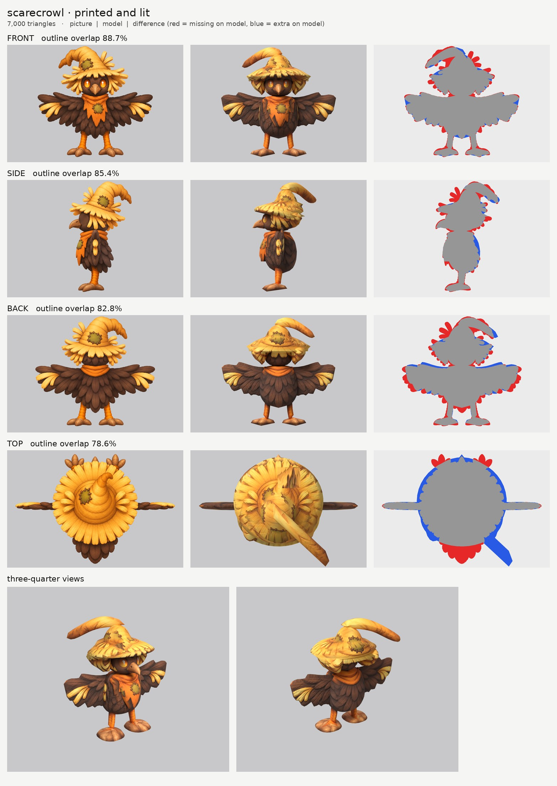
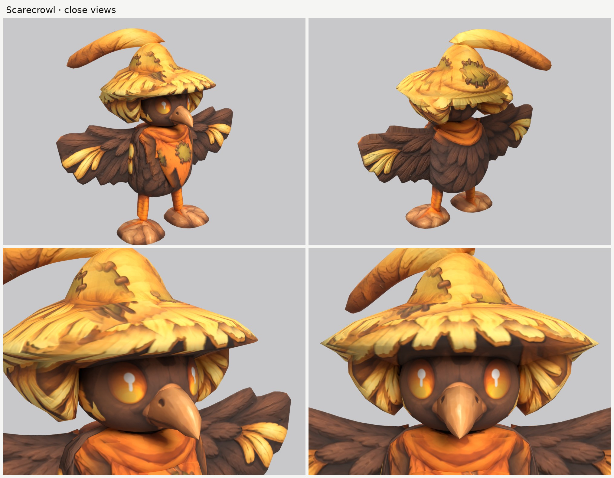

# Scarecrowl: small-model-only route

**Result:** a 7,000-triangle game model (`scarecrowl.glb`, 3.7 MB) with one colour texture (2048), a
normal map (soft feather and straw grain) and a glow map in which **only the orange eyes glow, softly**.
The orange scarf, the orange legs, the beak and the straw stay dark on the glow map. From the front
three-quarter view it reads as the picture: a dark-brown crow with big amber eyes and a short beak, under
a tattered straw hat with stitched patches, straw hanging beside its face and a bent tip; the ragged
orange scarf with its patch; flat wings held straight out with straw tufts at their tips; two orange legs
with three-toed feet.

The final game model's Blender file (the lead animates from it):
`/tmp/claude-0/-home-user-atoms-games-/95c47fc1-cd5e-5362-b776-c463cbad3789/scratchpad/chapter1/scarecrowl/r3/model.blend`

## Numbers

| | Front | Side | Back | Top |
| --- | --- | --- | --- | --- |
| Blockout (60,000 triangles), outline overlap (`blockout.jpg`) | 90.3% | 88.7% | 83.3% | 78.6% |
| Game model (7,000 triangles), outline overlap | 88.7% | 85.4% | 82.8% | 78.6% |

- **Texture seen by a picture:** 70.5%. The rest (the underside of the brim, the inner sides of the straw
  fringe, the undersides of the wings and feet) is coloured from the nearest painted spot of the same part.
- **Size:** 0.78 m from wingtip to wingtip, 0.43 m deep, 0.75 m tall. The picture request says 1.0 m
  wingtip to wingtip; at the brief's 0.75 m height the pictures draw the wings shorter, so the span
  follows the pictures.
- **Parts (15 pieces), named for the new bird skeleton:** `body`, `body_scarf` (the collar),
  `body_scarf_flap` (the ragged flap hanging at the front), `head`, `head_beak`, `head_hat` (brim and
  cone), `head_hat_tip` (the bent tip), `head_hat_fringe` pair (the straw hanging beside the face),
  `wing` pair, `leg` pair (body to ankle), `foot` pair (the three-toed feet). No separate `tail`: the tail
  feathers are part of the body's feather skirt in these pictures. Budget: hat 1,118, body 1,122, wings
  836 each, head 770, fringe 336 each, tip 320, scarf flap 300, scarf 270, feet 168 each, legs 140 each,
  beak 140.
- **Skeleton words:** `body*` body; `head*` head (hat, tip, fringe and beak all start with `head`);
  `wing`, `leg`, `foot` mirrored pairs. No name holds another word by accident ("scarf", "beak" and
  "fringe" hold none).
- **Glow:** only the head part may glow, and only its bright amber paint (a new `eye_orange` rule in my
  `emissive.py`): 0.07% of the texture glows at full strength and 0.2% faintly, all of it the eyes. The
  scarf is its own part with no glow, so its orange stays black on the glow map. Checked in
  `emissive.jpg` and on the lit board.
- **Time:** about 40 minutes of work (tracing before the break, then 11:40 to 12:30 by the clock), with
  1 blockout and 3 route runs.

## Why the scores are lower than the others

- **The straw.** The hat's brim, the hair-like straw beside the face and the wing tips are drawn as many
  separate straw spikes. Following them would make stacked rings, so the brim and fringe are smooth and
  the paint carries the spikes; the gaps and tips count as missing (the red fringe round the hat and
  wings on every board).
- **Back (83%):** the back picture draws the wings longer and the hat narrower than the front picture.
- **Top (79%):** the top picture draws the brim smaller, the feet sticking out in front of it and the
  hat's tip bending forward (the side and front pictures bend it back and to the creature's right).

## What I did and the problems I hit

1. **Pictures checked.** Side faces left, top has the head at the top, front and back agree with the side
   (the hat's tip bends to the creature's right in both). What the generator got wrong: the wingspan
   (above), the top picture's tip and feet (above), and the side picture's eye drawn where the front
   picture's eye wraps round the head.
2. **Wings: flat plates held straight out**, sliced along their span: the front picture gives their height
   at each point, and a thin drawn outline from above (about 3.5 cm, as the top picture shows) their
   thickness. The front picture paints their front faces and the back picture their backs.
3. **The hat** is three kinds of part: the brim and cone as one solid sliced upward; the bent tip sliced
   along its run (it goes sideways and back, which slicing upward would have turned into a flat blob); and
   a pair of straw blocks hanging beside the face, which give the straw-haired look without covering it.
4. **The brim hid the eyes.** In the first route run the brim's flat underside came down over the top of
   the eyes, so they were half-buried and barely glowed. The brim is now higher at the front than at the
   back, as the side picture draws it, and the eyes show whole.
5. **Ghost eye.** The side picture's eye is painted out of a print-only copy (`side_print_repaired.png`),
   keeping the beak, brim and straw out of the fill colour.
6. **The top picture** is printed only on the hat, and not where it draws the tip bending forward; the
   body, scarf, legs and feet don't take paint from it.
7. **Rings on the body.** The feathered outline made stacked rings in the blockout; the body's outlines
   are now used as drawn (`nomask`) and smoothed more, with the paint carrying the feather layers.
8. **Relief:** `fur_soft` on the body and wings (soft feather strokes), a gentle `grain` on the straw
   hat, tip and fringe, `none` on the face, beak, scarf, legs and feet.

## Changed tool copies (in `tools/`)

The same merged set as the other three (see `../dewt/NOTES.md`), plus:
- `emissive.py`: a new `eye_orange` rule (bright saturated amber only: not the straw, the brown feathers
  or the tan beak).
- `print_tex.py` with `view_warp` (from Dandylion's copy), `closeups.py` framed by size.
- `mkparts.py` writes `parts.json`.

Rebuild (from the work folder): `make_views.py views 0.75 front side back top`, then
`tools/inpaint_view.py views/views.json side "668,342,27,47" "x:595,385,62,48" "x:738,335,36,85" "x:660,268,130,32" --grain 0 --sigma 16`,
then `python3 -I tools/mkparts.py parts.json` and
`PY=... bash tools/route_small.sh parts.json views/views.json OUT 7000 scarecrowl`.

## What still looks wrong

- **The straw is smooth.** The brim's ragged edge, the straw beside the face and the straw tufts on the
  wings are paint on smooth shapes; the spiky outline isn't modelled.
- **The hat's tip** is a smooth bent horn; in the pictures it droops more at its end.
- **The wings are flat boards** with the feathers painted on; their lower edge is straight-ish rather
  than a row of feather tips, and edge-on they are thin plates.
- A faint lighter oval remains on each side of the head where the side picture's eye was painted out,
  and a thin light line runs down each side of the body where the wing roots meet it.
- The feet are flat pads with the toes painted on.

## Compared with round 3

A step below round 3's best, about where round 2's Drizzlon and Lunarion were: it reads clearly from the
front three-quarter view (face, glowing eyes, hat, scarf and wings all in the right places), but the
straw spikes and feathered wings are what this method finds hardest, and they are smooth here. The
outline match (89 / 85%) is the lowest of the four for the same reason.
