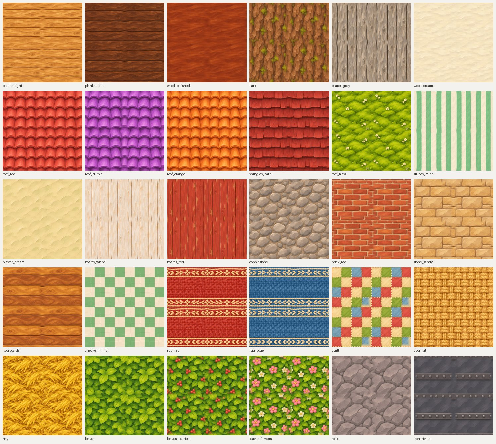
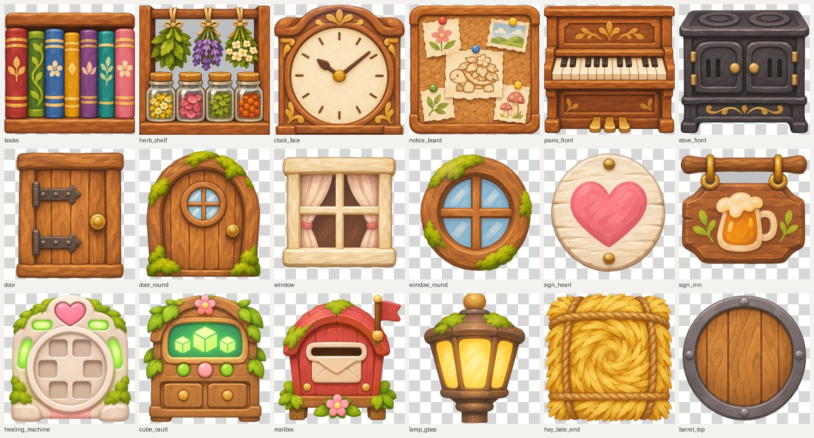

# Chapter 1 texture sheets

Eight painted texture sheets for the buildings, furniture and props. These things are modelled straight
from the game's own art, with no reference picture of each object, and covered with cuts from these sheets.

- `sheets/`: the 8 pictures as they came back. Each is 1536 x 1024: six 512 x 512 squares, read left to
  right across the top row, then the bottom row.
- `tiles/<sheet>/<name>.png`: the 48 cut squares. `tiles/index.json` lists each one and what it's for.
- `make_tiles.py`: cuts the sheets (`python3 -I make_tiles.py`).

**Materials (30 squares):** wood, roofs, walls, floors, fabrics, hay, leaves, rock and iron.
- **Seams:** each square repeats without a seam. The cutting trims each one to its pattern's own repeat
  (so the roof-tile rows line up), then blends away any seam that's left.
- **The rugs** repeat side to side only, because their borders are meant to stop.
- **The checker floor** was rebuilt as an exact checker in the painting's two colours, keeping the
  painting's brush grain, because the painted squares weren't even.

**Details (18 stickers):**
- **What they are:** furniture fronts (books, herb shelf, clock face, notice board, piano, stove), doors,
  windows, signs, and machines (the healing machine, the Cube Vault, the mailbox, a lamp, a hay-bale end,
  a barrel top).
- **Backgrounds:** see-through, so each sticker can go straight onto a modelled box or panel.

