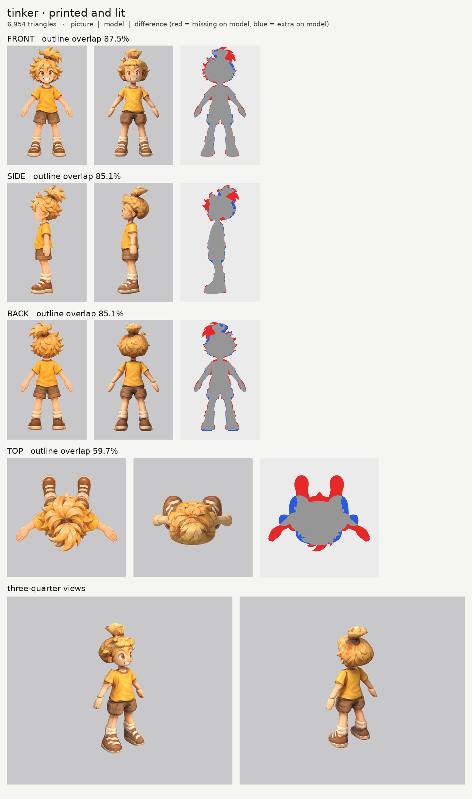
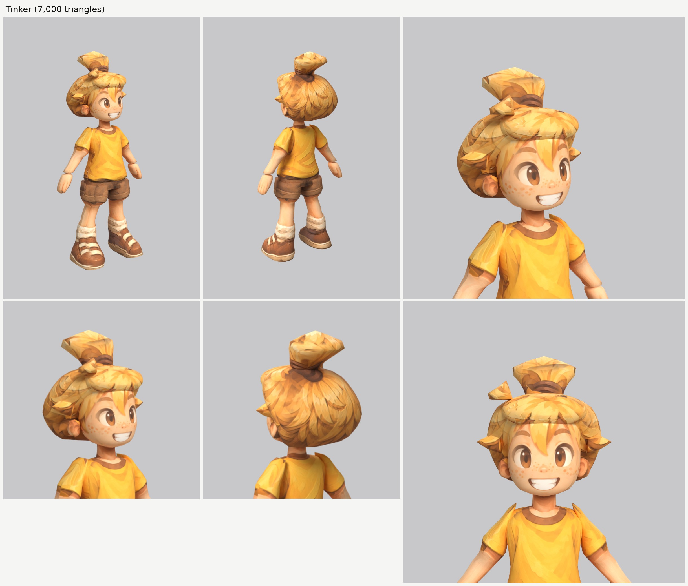

# Tinker, a village kid (tinker): small-model-only route (Opus 5.5)

**Result:** a 6,954-triangle game model (`tinker.glb`, 3.7 MB) with one colour texture (2048), a normal map
(gentle cloth and hair grain, nothing on the skin) and an all-black glow map (nothing glows). From the front
and the front three-quarter view Tinker reads like the sheet: big brown eyes, freckles, the wide toothy
grin, spiky blond hair with the long lock between the eyes, the tuft tied on top with its brown band, the
yellow t-shirt with the brown neckband, brown rolled shorts, scrunched cream socks and brown shoes with
cream straps and soles.

The final game model's Blender file (the lead animates from it):
`/tmp/claude-0/-home-user-atoms-games-/95c47fc1-cd5e-5362-b776-c463cbad3789/scratchpad/chapter1/tinker/out2/model.blend`

## Numbers

| | Front | Side | Back | Top |
| --- | --- | --- | --- | --- |
| Blockout (60,000 triangles), outline overlap (`blockout.jpg`) | 88.5% | 86.4% | 85.4% | 60.1% |
| Game model (6,954 triangles), outline overlap | 87.5% | 85.1% | 85.1% | 59.7% |

- **Texture seen by a picture:** 67.5%. The rest (the inner sides of the arms and legs, the soles, the
  underside of the hair, hidden ends) is coloured from the nearest painted spot of the same part.
- **Why the overlap is below the heroes' 92 / 88%:** almost all of the missing area is the tips of the
  spikes. Tinker's hair is a ring of long separate spikes all round the head, and the tuft on top is a
  fountain of them; the smooth hair parts follow the spikes' bases (as the heroes' notes advise), so every
  tip is missing in every view. The body matches within a few pixels. The back is also lower because the
  back picture's arms hang at a different angle and its shoes are drawn shorter (the soles 20 pixels
  higher).
- **Why the top number is low:** the top picture is another pose (arms out, feet far in front). It paints
  only the crown of the hair and the tuft.
- **Parts (14 kinds, 20 pieces), all named for the two-legged skeleton:**

  | Skeleton job | Pieces |
  | --- | --- |
  | ponytail (a swaying two-bone chain from the head) | `ponytail` (the tuft on top and its band) |
  | head | `head`, `ear_L/R`, `hair`, `hair_bangs`, `hair_spike`, `hair_spike_side_L/R` |
  | neck | `neck` |
  | chest and spine | `torso` (the t-shirt) |
  | hips | `hips` (the seat of the shorts) |
  | arm (shoulder to wrist, sleeve included) | `arm_L`, `arm_R` |
  | hand | `hand_L`, `hand_R` |
  | leg (hip to ankle: shorts leg, bare leg and sock) | `leg_L`, `leg_R` |
  | foot | `shoe_L`, `shoe_R` |

  Arms, hands, legs, shoes and the side spikes are mirrored pairs. Each arm runs a few cm into the torso at
  the shoulder and each leg about 5 cm up inside the hips. The knee falls about 9 cm below the shorts' hem,
  where the pictures draw it.
- **Triangle budget:** head, hair and tuft 3,838 (55%: head 1,330, hair 1,248, tuft 352, fringe 312, ears
  208 each, side spikes 100 each, top spike 80); torso 504, legs 364 each, arms 336 each, shoes 266 each,
  hands 176 each, hips 168, neck 60.
- **Time:** about 55 minutes by the clock (about 01:33 to 02:30, plus some tracing done while Pip's runs
  were rendering): 2 blockouts and 2 route runs. The shared machine made each route run take about 10
  minutes.

## What I did and the problems I hit

1. **Pictures checked.** The front, side and back agree that the tuft leans to his left and back. What the
   generator got wrong:
   - **The pictures are at slightly different scales by make_views' measure** (front 1,178 pixels per
     metre, side 1,165, back 1,157), because the tuft's tip and the shoe soles differ between them. The
     bodies line up row for row with the front picture, so the side and back pictures use the front's
     scale (`redo_views.sh`).
   - **The back picture's shoes are shorter** (the soles 20 pixels higher).
   - **The top picture is another pose.**
2. **Ghost eye, brow and mouth:** painted out of a print-only copy of the side picture with skin colour
   only (`inpaint_skin.py`; the copy is `side_print_repaired.png`).
3. **The hair.** One upward-sliced mass through the spikes' bases, stepping back from the forehead to
   behind the ear, a fringe pad, and the three biggest spikes as small flat parts of their own: one
   sticking out above each ear (a mirrored pair) and the one rising over the forehead on his right. The
   first spikes were chunky blocks; they are thin, pointed locks now.
4. **The tuft (`ponytail`).** Sliced upward from the band. First it was a wide flat disc on a stalk (the
   fan of spikes is as wide as the head in both pictures, so every slice near the top was a big oval); it
   now narrows to a rounded point, like a flame, and leans back and to his left as in the pictures.
5. **The fringe looked like a cap's brim** in the first run: it stood 2 cm out from the forehead with a flat
   underside, and the front picture printed a pale line of forehead skin along that underside. It now
   stands about 1 cm out, its lower edge slopes up toward the front (so the underside faces forward and
   takes the fringe's own paint), and it skips skin colours with a new colour rule, `skin_pale`.
6. **Blond hair is close to skin colour (new).** The heroes' `"skin"` colour rule matches a quarter of
   Tinker's hair. New rule `skin_pale` in `tools/print_tex.py`: skin whose blue is close to its green
   (skin is about 253,191,137; the pale hair about 253,204,117). It matches 2% of the hair, so I use it only
   on the fringe. The main hair has no colour rule and no skin lines showed.
7. **A brown smear on the upper arms** below the sleeves: the side picture draws the sleeve's hem level,
   the front picture slants it, so on the slanted arm the side picture printed sleeve colour over skin
   (the girl had the same). The side picture is switched off on the arms in the hem band
   (`paint_box_skip`); a faint band is left.
8. **The side picture's hand** hangs in front of the shorts; the side picture is switched off on the hips
   and legs there (`paint_box_skip`).
9. **Relief:** none on the skin, face and hands; a gentle `grain` on the cloth, hair and shoes.
10. **Glow map:** all black. Checked: the exported glow texture is black.

## Changed tool copies (in `tools/`)

The girl's set (`../player-b/tools/`), unchanged except:
- `print_tex.py`: adds the colour rule `skin_pale` to `paint_color_skip`.
- `mkparts.py` (writes `parts.json`) and `redo_views.sh` (the views on the front picture's scale, and the
  repaired side picture).

Rebuild (from the work folder): `bash tools/redo_views.sh`, then `python -I tools/mkparts.py parts.json`,
then `PY=... bash tools/route_small.sh parts.json views/views.json OUT 7000 tinker`.

## What still looks wrong

- **The hair is a smooth mass with the spikes painted on**, plus three small spikes. The picture's hair is
  all spikes, so the outline is rounder and softer than the picture's (this is the 5% the overlap misses).
- **The tuft is a soft flame shape** with the spikes painted on, not a fountain of separate spikes, and its
  top is a little faceted.
- **The fringe is still a rounded band** across the forehead from the three-quarter view.
- **A faint brownish band on each upper arm** just below the sleeve.
- The arms and legs are a little faceted (12 to 13 sides) because the head and hair take 55% of the
  triangles.
- The hands are mittens with painted fingers, as planned.

## Compared with the heroes

The face is as clean as the heroes' and reads like the sheet from the front three-quarter view; the outfit
is simple and prints cleanly. The hair is the weakest of the three people I built: Tinker's spikes are
longer and more separate than the boy's, so the smooth mass loses more of them, and the tuft is a second
spiky shape. A little below the heroes overall.

## For the next people

- **Check the scale of each picture against the front picture's body**, not only lowest-to-highest: a tall
  tuft or a different sole moves make_views' scale.
- **Fringe pads: about 1 cm out from the forehead, with the lower edge sloping up toward the front.** A
  flat underside prints a pale skin line and reads as a cap's brim.
- **Blond or light hair: use `skin_pale`, not `skin`, and only where needed.**
- **A tuft or topknot:** narrow it to a point at the top, or the upward slices make a disc.
