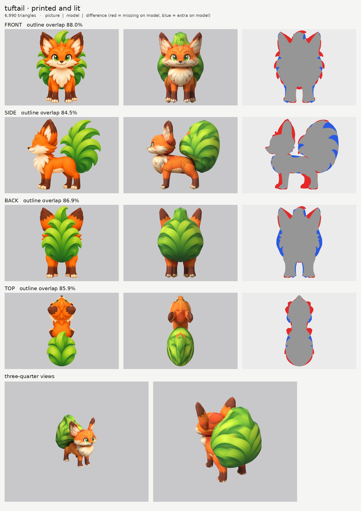
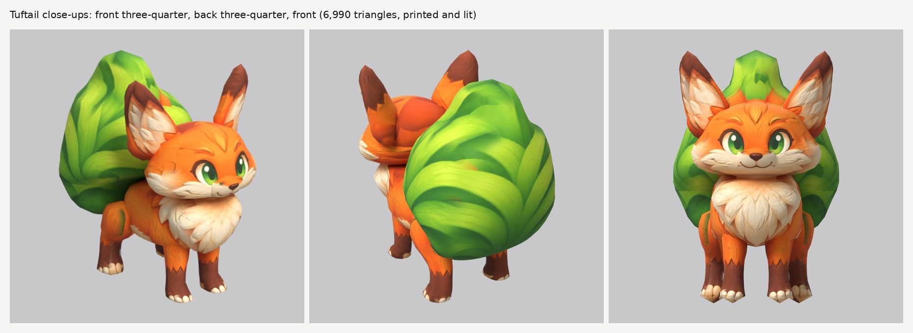

# Tuftail: small-model-only route

**Result:** a 6,990-triangle game model (`tuftail.glb`, 2.5 MB) with one colour texture (2048), a soft-fur
normal map and an all-black glow map (nothing glows, so the orange fur is not lit up). From the front
three-quarter view it reads as the fox in the pictures: big green eyes, cream muzzle and cheeks with the
sly smile, tall ears with cream insides and dark-brown tips, the fluffy cream chest, orange body, brown
socks with cream toes, and the big grass tail rising behind.

The final game model's Blender file (the lead animates from it):
`/tmp/claude-0/-home-user-atoms-games-/95c47fc1-cd5e-5362-b776-c463cbad3789/scratchpad/chapter1/tuftail/out4/model.blend`

## Numbers

| | Front | Side | Back | Top |
| --- | --- | --- | --- | --- |
| Blockout (60,000 triangles), outline overlap (`blockout.jpg`) | 89.8% | 86.2% | 84.7% | 86.1% |
| Game model (6,990 triangles), outline overlap | 88.0% | 84.5% | 86.9% | 85.9% |

- **Texture seen by a picture:** 70.8%. The rest (the belly, the insides of the legs, the hidden base of
  the tail, the soles) is coloured from the nearest painted spot of the same part; the soles get a
  brown pad colour.
- **Parts (11 pieces):** `head`, `muzzle`, `ear` pair, `body`, `body_chest`, `front_leg` pair,
  `rear_leg` pair, `tail`. Budget: tail 1,748, head 1,470, ears 576 each, body 660, chest 400, rear
  legs 364 each, front legs 308 each, muzzle 216.
- **Skeleton words:** `head`, `muzzle`, `ear` ride the head; `body`, `body_chest` the body;
  `front_leg`, `rear_leg` mirrored pairs; `tail`. The tail is one piece (see below).
- **Glow:** 0% (black map, checked in `emissive.jpg` and on the lit board).
- **Size:** the pictures make it 0.55 m tall and 0.57 m long, not 0.9 m: the tail curls up over the back
  instead of reaching out behind. The model follows the pictures.
- **Time:** about 60 minutes of my own work (from 00:56; the last run finished at 02:29 while I worked
  on the others), 4 route runs (2 full, 2 that only re-printed the paint) and 2 blockouts, including about
  15 minutes setting up the tool copies for all four creatures. That is over the 30 to 40 minute budget:
  my first blockout used wrong leg and rump traces (I misread a zoomed crop's pixel numbers), and each
  board takes 4 to 7 minutes on the shared machine.

## Why the scores are under round 3's

- **Side (84.5%):** the side picture draws the far legs a step ahead of the near legs (a walking
  stance), but legs are mirrored pairs, so the model has one leg where the picture has two. That
  alone is the red block under the body. The ears are also a little narrower front-to-back than drawn
  (below), and the tail's outline is smooth while the picture's has notches between the grass clumps.
- **Front and back:** the front picture draws the tail 38 cm wide, the back picture 27 cm. The model
  takes 31 to 33 cm, so the front loses the outer leaf tips (red) and the back gains a blue fringe.
- **Top (86%):** the top picture is drawn half from the front (the eyes show) and its tail is a round
  bush; it is used only for the top of the body and the tail.

## What I did and the problems I hit

1. **Pictures checked.** Side faces left, top has the head at the top, front and back agree with the
   side. What the generator got wrong:
   - **The tail's width** (above): front 38 cm, back 27 cm, top about 38 cm. I used about 32 cm.
   - **The far legs** are drawn ahead of the near ones in the side picture.
   - **The ears face the camera in the front and the side pictures** (the cream inside shows in both).
     Each ear is a thick turned disc (`slab`, 5.5 cm) facing forward and outward, so both pictures land
     on its inside. The first try faced too far outward, so from the front three-quarter view the far
     ear was a thin spike; it is now limited to 8.5 cm front-to-back (`cap`), and both ears show their
     cream insides from the front three-quarter view.
2. **Ghost eye.** The side picture's eye, lashes and eyebrow are painted out of a print-only copy
   (`side_print_repaired.png`, with `tools/inpaint_view.py`); the eye now comes from the front picture only.
3. **The snout** is its own part (`muzzle`), so the head is not as wide as the cheeks at the nose.
4. **The tail** is one smooth z-sliced bush with the grass clumps painted on, as round 3 did for
   Mossback's bush and Fleecling's wool: tracing the clumps would make stacked rings. Its base sits on
   the rump. I kept it as one piece because a vertical split would leave a seam across the bush, and the
   animation system joins all tail pieces into one three-bone chain anyway.
5. **Wrong paint on the tail**, fixed with my print copy's options:
   - the back picture's narrower tail is read squeezed toward the centre (`view_warp`), so the wider
     model takes only grass paint, not the orange cheek tufts and haunches beside it;
   - the side picture's rump, the front picture's ears, crest and cheek tufts, and the top picture's
     body are switched off where they lie over the tail (`paint_box_skip`, `paint_ellipse_skip`);
   - each spot takes its colour from the most head-on picture (`paint_power` 5), so the clumps stay crisp.
6. **Ear paint on the head.** The side picture's ear covers the back of the head; its cream inside is
   switched off on the head there. **Grass on the haunches:** the back picture's tail covers the tops of
   the back legs, so the back picture is switched off on them above the hocks.
7. **Relief:** `fur_soft` on the fur, `none` on the muzzle and the tail (smooth grass blades).

## Changed tool copies (in `tools/`)

The round 3 Puffmunk set (`parts.py`/`build.py` with `slab`, `offset`, `n_scale`, `k_scale`;
`relief.py` with `fur_soft`; `emissive.py --off`; `board.py`; `inpaint_view.py` from Embroak), plus:
- `print_tex.py`: Puffmunk's copy (`paint_shift`, `side_far`, `paint_solid`) plus Mossback's
  `paint_ellipse_skip` and `view_warp`.
- `route_small.sh`: `LIT_SAMPLES` sets the lit board's render samples (24 by default).
- New: `mkparts.py` writes `parts.json`; `closeups.py` makes `closeups.jpg` from the lit board's renders.

Rebuild: `make_views.py WORK/views 0.55 front side back top`, then
`tools/inpaint_view.py views.json side "438,366,50,56" "437,277,38,16" "485,352,16,12" --grain 0 --sigma 14`,
then `tools/mkparts.py parts.json` and `PY=... bash tools/route_small.sh parts.json views.json OUT 7000 tuftail`.

## What still looks wrong

- **The tail is a smooth bush with painted clumps,** not separate grass clumps; its outline is an egg
  shape, and the top leaf tip of the pictures is only paint.
- **A small orange smudge** remains on the tail's back left side.
- **The legs have 11 to 13 sides,** so they are faceted up close.
- The side of the face shows the front picture's eye stretched round the corner (as in round 3).
- From straight behind, the back of the head is a plain orange dome (no picture sees it).

## Compared with round 3

The face and the front three-quarter view are as clean as round 3's best (Clovermouse, Puffmunk). The
outline scores are 2 to 6 points lower, mainly because of the far legs and the tail width the pictures
disagree on. The tail is the weak point, like Mossback's bush: it reads as a leafy bush, not as
chunky grass clumps.
