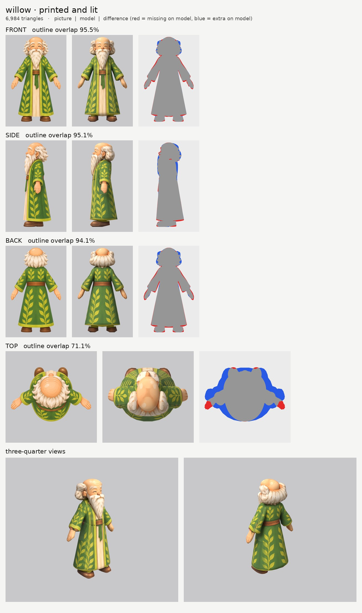
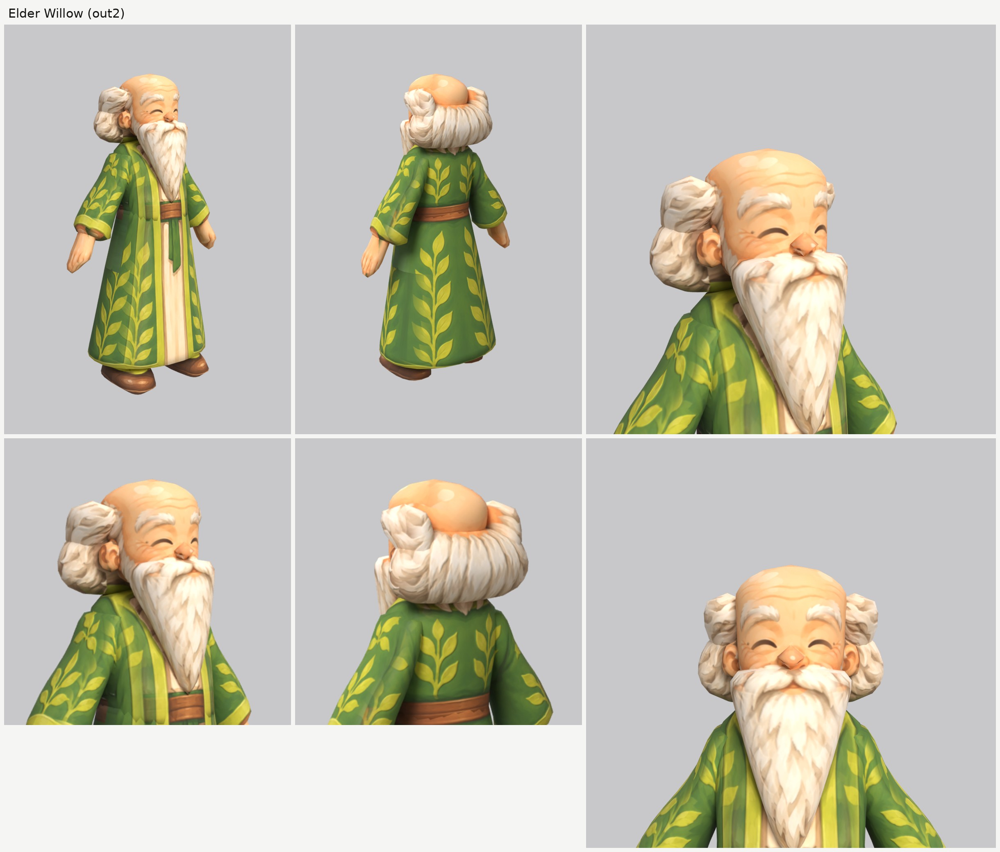

# Elder Willow (willow): small-model-only route (Opus 5.5)

**Result:** a 6,984-triangle game model (`willow.glb`, 2.8 MB) with one colour texture (2048), a normal
map (gentle grain on the robe, hair and beard, nothing on the skin) and an all-black glow map (nothing
glows). From the front and the front three-quarter view he reads as the elder on the sheet: the bald
dome with its forehead wrinkles, bushy white brows, the closed smiling eyes, round nose and rosy cheeks,
the long pointed white beard with its moustache, the fluffy white side hair, and the green robe with the
yellow leaf vines, lime trim and wide cuffs, open over the cream under-robe, with the brown sash and the
green sash tail. From behind: the bald crown above a ring of white hair, the leaf vines and the belt.

The final game model's Blender file (the lead animates from it):
`/tmp/claude-0/-home-user-atoms-games-/95c47fc1-cd5e-5362-b776-c463cbad3789/scratchpad/chapter1/willow/out2/model.blend`

## Numbers

| | Front | Side | Back | Top |
| --- | --- | --- | --- | --- |
| Blockout (60,000 triangles), outline overlap (`blockout.jpg`) | 96.3% | 96.1% | 94.9% | 70.6% |
| Game model (6,984 triangles), outline overlap | 95.5% | 95.1% | 94.1% | 71.1% |

- **Texture seen by a picture:** 59.6%. The rest (the inside of the sleeves and the robe's underside,
  the soles, the hidden leg stubs, the underside of the hair and beard) is coloured from the nearest
  painted spot of the same part.
- **Why the top number is low:** the top picture is another pose, seen at a slant (the arms out, the
  beard drawn behind the head). No part prints from it.
- **Parts (13 kinds, 19 pieces), all named for the two-legged skeleton:**

  | Skeleton job | Pieces |
  | --- | --- |
  | head | `head`, `nose`, `ear_L/R`, `hair`, `hair_puff_L/R`, `beard` (the moustache is part of the beard) |
  | neck | `neck` |
  | chest and spine | `torso` (the robe above the waist; the sash is paint on it) |
  | hips, swinging with the legs | `skirt_robe` (the robe below the waist) |
  | arm (shoulder to wrist, the wide sleeve and cuff included) | `arm_L`, `arm_R` |
  | hand | `hand_L`, `hand_R` |
  | leg (short hidden stubs under the robe) | `leg_L`, `leg_R` |
  | foot | `boot_L`, `boot_R` |

  Arms, hands, legs and boots are mirrored pairs. Each arm starts inside the torso at the shoulder.
  The legs are stubs from 34 cm up inside the robe down to the boots, so the walk has legs to move.
- **Triangle budget:** head, hair and beard 3,590 (51%: head 1,326, hair 858, beard 646, puffs 210
  each, ears 140 each, nose 60); skirt_robe 832, torso 550, arms 510 each, hands 198 each, boots 168
  each, legs 100 each, neck 60.
- **Time:** about 40 minutes by the clock (00:52 to about 01:33, with Oakley's tracing done while the
  route ran): 2 blockouts and 2 route runs.

## What I did and the problems I hit

1. **Pictures checked.** Front, side and back agree closely (the same height and scale to within 1%,
   the belt and sash at the same height). What the generator got wrong: the top picture is another pose
   (see above), and the sheet's walking staff is not in any of the views, so it is not modelled.
2. **Views on one scale:** `make_views.py ... 1.6`.
3. **Ghost eye:** the side picture's closed eye is painted out of a print-only copy of the side picture
   with skin colour only (`inpaint_skin.py`; the copy is `side_print_repaired.png`). The side picture's
   brow, nose and beard sit where the front picture's do, so they are kept.
4. **Traced like the heroes:** smooth hand-drawn outlines for every big part, so the robe's folds and
   the hair's curls don't become rings. The robe is split at the waist (`torso` + `skirt_robe`, as the
   brief asks). The belt, sash tail, lime trim and leaf vines are all paint.
5. **The head had a point on top.** The first blockout's dome came to a peak, because both outlines
   narrow to a point at the top. Now the outlines stay wide up to the crown and a large rounded end
   (`round_ends` 7.5 cm) makes the dome, which matches the picture's curve within a few pixels.
6. **The white hair** is a mane round the back and sides of the head plus a puff above each ear:
   - the mane is sliced upward; its front edge sits just behind the ears, so the face and ears stay
     clear, and its top stays low enough to leave the bald crown bare from behind;
   - each puff is its own small part (a mirrored pair) that reaches down into the mane so there's no
     gap, and stays above and behind the ear;
   - the first try's mane stuck out far behind the head (the side picture's thin curl tips); it now
     follows the main mass of the curls.
7. **Patchy hair.** At first the hair used the girl's `paint_color_skip: skin`, to keep the bald dome's
   colour off the hair. But the white hair's warm shading counts as "skin" by that rule, so most of the
   hair's shading was thrown away and filled in, which left tan blotches. Without it the hair prints
   cleanly white and fluffy. Don't use the skin skip on white or blond hair.
8. **The beard** is one part from under the nose to the point on the chest, with the moustache at its
   top. It covers the mouth, and the front picture's small smile prints on the beard just under the
   moustache, so it still shows.
9. **The side picture's arm and hand** hang in front of the robe. The side picture is switched off on
   the torso and the robe behind them (`paint_box_skip`), so the cuff and fingers don't print onto the
   robe.
10. **Relief:** none on the face, nose, ears and hands; a gentle `grain` on the robe, hair, beard and
    boots.
11. **Glow map:** all black. Checked: the exported glow texture is black.

## Changed tool copies (in `tools/`)

The heroes' set (see `../player-b/NOTES.md`), unchanged: `route_small.sh`, `parts.py` (with
`ring_ease`), `relief.py`, `print_tex.py` (with `paint_color_skip`, not used here), `build.py`,
`board.py`, `emissive.py`, `set_view_map.py`, `inpaint_skin.py`, `closeups.py`. New for Willow:
`mkparts.py` writes this `parts.json`; `redo_views.sh` rebuilds the views and the repaired side picture.

Rebuild (from the work folder): `bash tools/redo_views.sh`, then `python -I tools/mkparts.py parts.json`,
then `PY=... bash tools/route_small.sh parts.json views/views.json OUT 7000 willow`.

## What still looks wrong

- **The hair is a rounder, puffier ring than the picture's** loose curls, with the curls painted on.
  From behind it reads as a thick fluffy ring; the puffs above the ears are a little lumpy.
- **The back of the bald dome bulges** above the hair ring from the back three-quarter view (the side
  picture draws the dome that long), and a thin skin-coloured line shows where the back picture's dome
  meets the top of the hair ring.
- **The beard is a smooth wedge** with its strands painted on; from the side it's a little slab-like.
- **The hands are mittens** with painted fingers, as the brief asks.
- The leg stubs are hidden, so the walk will show only the boots moving under the robe's hem.

## Compared with the heroes

About as good, and easier: the face is as clean as theirs (no ghost features; from the front
three-quarter view it reads like the sheet), and the robe prints even more cleanly than their jackets,
because a long robe is one smooth shape and the three pictures agree very closely. The outline match is
higher than the heroes' (95.5 / 95.1 / 94.1% against about 92 / 89 / 89%). His hair is the weak spot,
as theirs was, but white fluffy hair hides it better than spiky dark hair.

## What the next people should know

- **A bald dome needs a big rounded end** (`round_ends` at the top of about the dome's radius), with
  outlines that stay wide up to the crown, or it comes to a point.
- **Don't use `paint_color_skip: skin` on white, grey or blond hair**: its shading reads as skin.
- **Long robes and dresses are easy:** one smooth `torso` above the waist, one `skirt…` below it, the
  trim and patterns as paint, and short hidden leg stubs.
- **A beard with its moustache can be one part** sliced upward; the mouth prints on it from the front.
