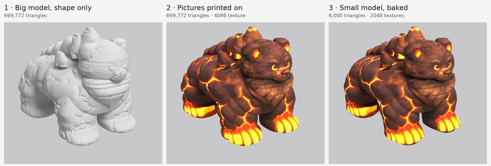
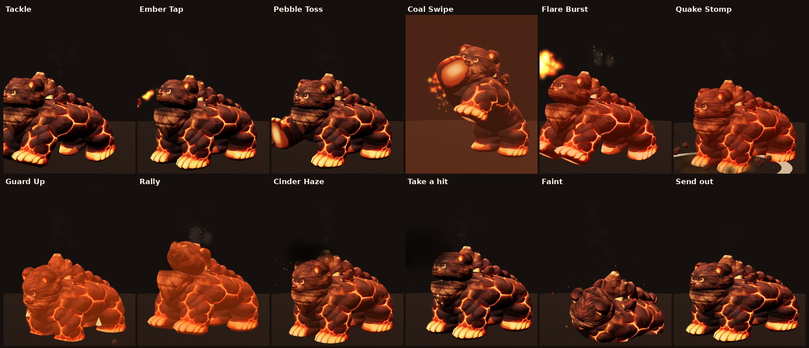

# Coalossus 3D model (paint-and-bake)

Built from the five pictures in `source/` with the Paint-and-Bake Modeling Method:
copy the shape from the pictures, model only the shape, print the pictures on as paint,
then bake that paint onto a light model for the game. Both models have a skeleton and the
creature's battle animations from the game.

| | Big model | Small model |
| --- | --- | --- |
| Triangles | **699,772** | **6,000** |
| Texture | 4096 colour + 2048 glow | 2048 colour + 2048 normal map + 1024 glow |
| Game file | `models/coalossus_full.glb`, 4.9 MB (meshopt-compressed) | `models/coalossus_small.glb`, 3.2 MB |
| Skeleton and animations | 18 bones, 14 animations | the same |
| Use | close-up screens (Field Guide page, catch/evolve scenes) | battles and the overworld |
| Size | 1.5 m wide × 2.4 m long × 1.8 m tall | same |

## Check-ins

Outline overlap is how much of the creature's outline in each picture the model covers.
The method's target is about 90% front and 85% side.

| Check-in | Front | Side | Back | Top | Picture |
| --- | --- | --- | --- | --- | --- |
| 0. Blockout (59,908 triangles) | 96.5% | 98.5% | 93.4% | 91.9% | `previews/0_blockout.jpg` |
| 1. Big model, shape only | 95.7% | 97.3% | 92.2% | 91.9% | `previews/1_big_blank.jpg` |
| 2. Big model, printed | 95.7% | 97.3% | 92.2% | 91.9% | `previews/2_big_printed_lit.jpg`, `previews/2b_big_printed_flat.jpg` |
| 3. Small model, baked | 95.9% | 96.8% | 93.2% | 93.1% | `previews/3_small_baked.jpg` |
| 4. Phone screen (390 × 844) | – | – | – | – | `previews/4_phone_big_and_small.jpg` |
| 5. Moves | – | – | – | – | `previews/5_moves.jpg` |

The back view scores lowest because the back picture draws the body a little narrower than the front
picture does. The method lets the front view win for widths, so the model follows the front.

**Printing:** 45% of the texture is seen directly by a picture. The rest is surfaces hidden inside other
parts (the tops of the legs inside the body, the base of the head) or underneath (the belly). Those take
their colour from the nearest painted spot on the same part. The soles of the paws get a molten-pad
gradient instead (`cap_fill` in `parts.json`), since they show whenever a paw lifts.

## Animations

They follow the 2D game's battle code (`06-battle.js`):
- **Physical moves** lunge.
- **Fire moves** throw embers.
- **Strong moves** charge up (the creature swells), then lunge, then burst.
- **Boosts** wobble, with rising arrows and a coloured glow.
- **A hit** flashes white three times and shakes.
- **Fainting** sinks and dissolves.

| Animation | Length | What happens | Game move |
| --- | --- | --- | --- |
| `idle` | 3.0 s, loops | Breathing, head bob, tail sway | – |
| `walk` | 1.1 s, loops | Diagonal-pair walk, body bob | – |
| `tackle` | 1.1 s | Crouch, lunge forward, back | Tackle (Normal) |
| `ember_tap` | 1.1 s | Small crouch, head thrust (embers from the mouth) | Ember Tap (Fire) |
| `pebble_toss` | 1.3 s | Right paw scoops and flings (rocks) | Pebble Toss (Earth) |
| `coal_swipe` | 1.7 s | Rears up, big swipe with the right paw (fire trail), drops down | Coal Swipe (signature) |
| `flare_burst` | 2.1 s | Charges low and swells, rears back, bursts forward roaring | Flare Burst (Fire, strong) |
| `quake_stomp` | 2.0 s | Rears up high, holds, slams the front paws (shockwave) | Quake Stomp (Earth, strong) |
| `guard_up` | 1.5 s | Hunkers down with legs braced | Guard Up (boost) |
| `rally` | 1.6 s | Chest out, roars to the sky | Rally (boost) |
| `cinder_haze` | 1.5 s | Shakes, vents blast ash and embers | Cinder Haze (Fire status) |
| `hit` | 0.7 s | Knocked back, shakes | when hit |
| `faint` | 1.8 s | Legs buckle, sinks and tips over (holds the last pose) | when it faints |
| `send_out` | 0.9 s | Pops in from the capture cube with a squash and stretch | sending it out |

**The effects aren't in the animation files.** Embers, rocks, rings, flashes, arrows and vent smoke
are added by the game at set times. `viewer.html` shows one way to do it: the `MOVES` list says what to
spawn and when, and the effect functions above it build each one.

**Skeleton:** 18 bones.
- **Body:** root, hips, spine, neck, head, tail.
- **Legs:** three per leg (`up`, `low`, `paw`). `fl_` is the front legs and `rl_` the rear legs; `L` is
  the creature's own left.
- **How parts follow the bones:** each part follows its bones by name. The legs blend at the knee and
  into the body at the top, and the body blends between hips and spine.

## How it was made

1. **Pictures to one scale.** The front, side and back are scaled to its 1.8 m height. The top view came
   back about 14% short, so it's stretched to the front's width and the side's length ("remap").
2. **Side picture repaired for printing.** The side picture shows the eye and ear on the side of the head.
   On the 3D model the eyes sit on the front of the face, so they would have printed a second pair of eyes
   onto the cheeks. A print-only copy of the side picture has the eye and ear painted over with fur from
   the same head (`repairs` in `parts.json`, `pipeline/repair_view.py`). The outlines aren't touched.
3. **Traced parts** (`parts.json`): 13 parts, 18 with the left/right twins. They are the body, head,
   muzzle, ears, mane, chest fur, three vents, shoulder crags, back ridge, tail, and front and back legs.
   Each part has an outline in two views and is sliced along its long axis. Each slice is a rounded shape
   exactly as wide as one outline and as deep as the other.
4. **Blockout and board.** These were fixed until the outlines matched.
5. **Big model, smooth**, at 700,000 triangles.
6. **Print.** Each picture paints the spots that face it and that nothing hides, and the most head-on
   picture counts most. The top picture is skipped on the legs, near the vents and over the ears.
7. **Relief from the paint.** Rock plates bulge about 1 cm, lava cracks sink about 2 cm, fur tufts move
   about ±1 cm, the eyes get a slight dome, and the vent mouths become craters.
8. **Small model** from the same parts at 6,000 triangles, weighted toward the head, muzzle and legs.
9. **Bake**, part by part: the colour and a normal map of the big model's surface.
10. **Glow map** from the lava-bright colours (cracks, eyes, inner ears, paws, vent mouths).
11. **Skeleton, skin weights and animations** (`pipeline/rig.py`), then export. Each model is one mesh
    with one material and one skeleton. The big file is meshopt-compressed.

## Files

| Path | What |
| --- | --- |
| `source/` | The five pictures from ChatGPT, plus its prompts and notes |
| `parts.json` | The traced parts: outlines, roundness, picture repairs, budgets |
| `build/atlas.json` | The shared texture layout (keep it, or the textures won't line up) |
| `build/checks.json` | All the numbers above |
| `models/` | The two game files, each with the skeleton and all 14 animations |
| `textures/` | The same textures as loose files |
| `previews/` | The boards, the phone screenshot and the moves |
| `viewer.html` | 3D viewer: big and small models, play every move, walk, paint on/off. Open it through a web server (for example GitHub Pages), not as a local file. |
| `rebuild.sh` | Every command, in order, to rebuild from the pictures |
| `../pipeline/` | The tools (Blender 5.2 as a Python module, numpy, scipy, Pillow) |

## Using the files in a game

- **three.js:** load with `GLTFLoader` and `loader.setMeshoptDecoder(MeshoptDecoder)` (needed for the
  big file). Play the clips with an `AnimationMixer`: `idle` and `walk` loop, everything else plays once.
- **The big file is meshopt-compressed.** Some tools can't read that. Run `rebuild.sh` and skip its last
  line to get an uncompressed copy.
- **Forward and up:** it faces +Z with Y up (the glTF standard), feet at y = 0, 1.8 m tall.

## Not done yet

- **Smoke from the vents** is left to the game as an effect (`viewer.html` shows one way to do it).
- **The underside and inner leg surfaces** aren't in any picture, so their colour is filled from nearby.
  Fine for normal camera angles.
- **The animations are keyed by hand in `pipeline/rig.py`**, with no feet locked to the ground. In walk
  and the rear-ups the feet slide a little.
