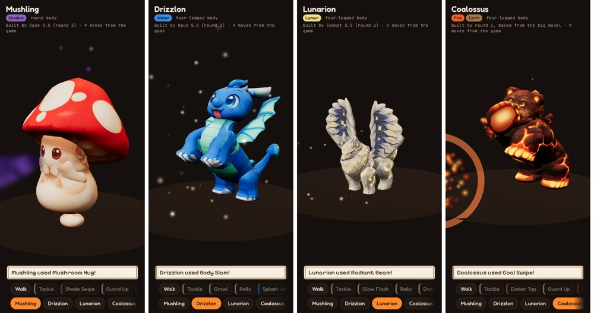

# The animation system

Built once and reused for every creature. It's the 3D version of how the 2D game animates battles:
every move uses a shared motion picked by the move's kind (`06-battle.js` `moveAnim`), and the effects
are picked by the move's type.

## How a creature gets animated

1. **A setup file, `rig.json`, next to its `parts.json`.** The plan is the body type (`quad` or
   `round` so far). Example: `{"plan": "quad", "wings": true}`. Part roles are optional: the tool reads
   them from the part names (legs, head, tail, wing, arm, foot, body...). Other options:
   - `"gait"`: how it walks.
     - `quad`: `"trot"` (default), `"plod"` (slow, short steps, for turtles) or `"hop"` (frogs).
     - `round`: `"waddle"` (default) or `"hop"` (a bunny hop, for creatures that sit up).
   - `"mouth": "head"` (`round` only): the face is on a separate head, not on the body as with Mushling.
     Effects then come from the head.
   - `"anchors": {"ember": "head_ember"}`: extra effect points at the centre of a part. The tool ties
     each one to the bone that part moves with. Embroak's ember glow comes from its tongue-tip bead this
     way.
   - **Tails on `round`:** a `round` creature with `tail` parts gets a three-bone tail that sways, wags and
     flicks (Clovermouse, Puffmunk).
2. **Run the tool:**
   `python -I pipeline/animate.py model.blend rig.json OUT.glb --albedo albedo.jpg --normal normal.png --emit emissive.jpg --preview PREVIEW_DIR --manifest manifest.json`
   1. It fits the body type's skeleton to where the parts actually are.
   2. It ties each part to its bones: legs blend at the knee, tails and wings along their length.
   3. It keys in every shared clip, scaled to the creature's size.
   4. It exports the game file and a manifest. The manifest holds the anchors for effects (mouth, chest,
      paws, tail tip, wing tips) and the clip lengths.
3. **The creature's moves come from the game data** (`game_data.json`, extracted by
   `extract_game_data.cjs` from the game's own data files). Each move is mapped to a clip with
   `motions.move_clip()`, following the 2D game's rules:

| Move | Clip | Effects (by the move's type) |
| --- | --- | --- |
| Status move on itself (Rally, Guard Up...) | `boost` (defence boosts: `boost_guard`) | Rising orange arrows, glow pulse, a swirl of its type |
| Status move on the foe (Growl, Soak, Dazzle...) | `status` | A stream of its type toward the foe, falling blue arrows there |
| Strong, or power 70+, physical (Normal or Earth) | `strong_physical`: rear up and slam | Charge, ground shockwave, screen flash, big burst |
| Strong, or power 70+, anything else | `strong_special`: charge, swell, burst | Charge, glow, a blast from the mouth, screen flash |
| Physical (Normal, Earth, signature moves that crit or hit several times) | `physical`: a lunge | A burst at the foe (rocks for Earth) |
| Anything else | `special`: a head-thrust stream | A stream from the mouth, a burst at the foe |

Every creature also gets `idle`, `walk`, `hit` (white flash three times and a shake), `faint` (it sinks
and dissolves into its type's colours) and `send_out` (it pops in with a squash). A creature can carry
extra clips named after a move id, like Coalossus's `coal_swipe`; those play instead of the shared clip.

**The effect for each type** comes from the game's own `TYPE_FX` and `TYPE_COLORS`:

| Type | Effect |
| --- | --- |
| Fire | Embers rising |
| Water | Droplets falling |
| Plant | Fluttering leaves |
| Earth | Thrown rocks and dust |
| Bolt | Jittery sparks |
| Frost | Drifting flakes |
| Shadow | Purple wisps |
| Lumen | Gold stars |
| Normal | White stars |

## Body types

The game tags every one of its 172 creatures with a body type (`look.body`):

| Body type | Creatures | Status |
| --- | --- | --- |
| `quad` (four-legged) | 47 | **Done**, with optional wings (Drizzlon, Lunarion, Coalossus) |
| `round` | 23 | **Done** (Mushling). Optional `wing` pairs buzz on top of every clip (Bumblop). |
| `bird` | 22 | **Done** (`"plan": "bird"`): two legs, wings spread like Scarecrowl's. Waddle, flap and lunge, leap and dive, wing wrap for guard. |
| `bug` | 19 | Uses `quad` with `mid_leg` pairs (they follow the front legs) and `"gait": "hop"` (Hopsprout) |
| `serpent` | 19 | To do |
| `ghost` | 13 | To do |
| `biped` (two-legged) | 12 | Skeleton **done** (built for people, below); two-legged creatures can use it too |
| `frog` | 7 | Uses `quad` with `"gait": "hop"` (Embroak) |
| `fish` | 6 | To do |
| `turtle` | 4 | Uses `quad` with `"gait": "plod"` (Mossback) |

## People (`"plan": "biped"`)

The heroes and every other person use a two-legged skeleton. The rest pose is the pictures' A-pose; most
clips first relax the arms down to the sides.

- **Bones:**
  - the trunk: hips, spine, chest, neck, head
  - each arm: upper arm, forearm, hand
  - each leg: thigh, shin, foot
  - a two-bone ponytail, if there is one
- **Part names:** the tool reads each part's job from words in its name (`BIPED_WORDS` in `animate.py`):
  - `ponytail` swings from the head
  - `hand`/`glove`, `foot`/`boot`/`shoe`
  - `arm` and `leg`: one part per limb, which bends at the elbow or knee by itself
  - `hips`/`belt`/`cube`, `neck`, `head`/`hair`/`face`
  - `backpack`/`collar` ride on the chest
  - `torso`/`jacket`/`vest`/`shirt` bend at the waist
- **Clips:** idle, walk, run, talk, wave, throw (a cube), cheer, lose and point.
- **Timed moments:** the manifest's `events` say when things happen, so the viewer or the game can hook
  in. For example, `throw` releases the cube from `hand_R` at 0.5 s.
- **Effect points:** `hand_L`, `hand_R`, `mouth`, `chest` and `head_top`.

**Adding a body type** is a one-time job:
- a skeleton fit in `animate.py` (`fit_<plan>` and `weights_<plan>`)
- its clips in `motions.py`, with the same clip names

After that, every creature of that type needs only its `rig.json`.

## Files

| File | What |
| --- | --- |
| `motions.py` | The shared clips for each body type, and the move-to-clip rules |
| `animate.py` | Fits the skeleton, sets the weights, keys the clips, exports the game file and the manifest |
| `game_data.json`, `extract_game_data.cjs` | Every move (type, tier, power, effects) and every creature's move list and body type, from the game |
| `../round2/animation/creature-battle-bay.html` | The battle viewer page: picks a creature, plays its moves, walk, hit, faint, send out, on the Meadow Path stage or the plain studio. The published copy loads its data files alongside it. |
| `battle_bay/pack_creature.py`, `battle_bay/split_glb.mjs` | Packs an animated creature into the viewer's data files: the model, its textures, its effect points and its moves from the game. |
