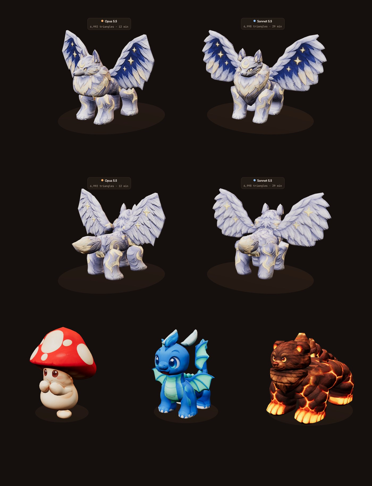

# Round 2: small-model-only test (Mushling, Drizzlon, Lunarion)

**The question:** with about 170 creatures, can we skip the 700,000-triangle model and build only the
~7,000-triangle game model, with the ChatGPT pictures printed straight onto it?

**The setup:**
- **Three creatures**, from simplest to hardest.
- **Two helper agents** with the same brief (`BRIEF.md`), the same tools and the same pictures. Neither
  saw the other's work.
  - **Opus 5.5 on high effort** built all three.
  - **Sonnet 5.5 on extra-high effort** built only the hardest one, Lunarion, so it could be compared.

*Top two rows: the two Lunarions under the same lights and camera, front and back three-quarter (Opus
left, Sonnet right). Bottom: Opus's Mushling and Drizzlon, then Coalossus (round 1) as the quality bar.*

## Results

| Model | Builder | Triangles | Outline overlap front / side / back / top | Texture seen by a picture | Time | File |
| --- | --- | --- | --- | --- | --- | --- |
| Mushling | Opus 5.5, high | 6,900 | 97.9 / 96.2 / 97.7 / 96.6% | 82.9% | about 22 min | `opus/mushling/mushling.glb` (0.6 MB) |
| Drizzlon | Opus 5.5, high | 6,926 | 93.3 / 87.8 / 91.9 / 80.9% | 67.0% | about 15 min | `opus/drizzlon/drizzlon.glb` (0.7 MB) |
| Lunarion | Opus 5.5, high | 6,992 | 92.2 / 87.5 / 91.2 / 57.0% | 66.3% | about 12 min | `opus/lunarion/lunarion.glb` (5.3 MB) |
| Lunarion | Sonnet 5.5, extra-high | 6,998 | 92.2 / 89.0 / 90.4 / 61.6% | 68.1% | about 29 min | `sonnet/lunarion/lunarion.glb` (5.3 MB) |
| Coalossus (round 1, for reference) | lead, baked from the big model | 6,000 | 95.9 / 96.8 / 93.2 / 93.1% | – | – | `../coalossus/models/coalossus_small.glb` |

**About the low top scores:**
- **Lunarion:** the top picture draws the body about 30% narrower than the front and back pictures do.
- **Drizzlon:** the top picture draws the head about 40% too big.
- **What the builders did:** the method lets the front picture win for widths and the side picture for
  depths, so both builders followed those, as the rules say.

## Verdict

- **Skipping the big model works.** On Coalossus the two routes look the same
  (`coalossus_route_compare.jpg`). The simple creature, Mushling, is as good as Coalossus with no big
  model at all.
- **What limits quality now is the shape, not the paint.** For the harder creatures, the limits are thin
  parts (fin ears, horns, wings), fur, and pictures that disagree with each other. Most of the builders'
  effort went into finding which picture painted the wrong thing onto which part, and switching it off.
- **Drizzlon is close to Coalossus from the front.** From behind it falls short: the head is a plain
  dome, the fin ears are flat blades and the blue is blotchy.
- **Lunarion is below Coalossus for both builders. Sonnet's is the better of the two.**
  - Sonnet's wings keep their feathered, scalloped outline, its body is leaner and more wolf-like, and
    its face is cleaner.
  - Opus's wings read as flat boards with a straight outer edge, and its mane is a barrel.
  - The outline numbers are almost identical. The difference is in how the shapes were drawn.
  - Sonnet spent about 29 minutes on Lunarion alone. Opus spent about 12, as its third creature of three.

## Worth adding to the shared tools next

The builders' improvements, all copies in their `tools/` folders:
- **Frame the board's three-quarter views by the creature's size**, so a 0.6 m Mushling isn't tiny
  (Opus's `board.py`).
- **A glow rule for pale gold** that doesn't light up a red cap (both builders' `emissive.py`).
- **Paint a feature out of a print-only picture** using the colour around it (Opus's `inpaint_view.py`).
- **Spots that land in different places in each picture** get printed whole, once, from the most
  head-on picture (Opus's `print_tex.py`).
- **More rows or columns per part** (`n_scale`, `k_scale`), for thin wings (Sonnet's `build.py` and
  `parts.py`).
- **An easy way to switch a picture off for one part, or one area of a part.** Today that's
  `paint_skip` and `paint_box_skip`, set by hand.

## Files

- `source/<creature>/`: the five pictures per creature.
- `picture-request.html`: the prompts and reference sprites that made them.
- `BRIEF.md`: the brief both helpers got.
- `opus/<creature>/` and `sonnet/lunarion/`, each holding:
  - the game file (`.glb`)
  - `parts.json` and `views.json`
  - the boards (`board_blank.jpg`, `board_printed.jpg`, `blockout.jpg`)
  - `NOTES.md`
  - `tools/` (changed tool copies)

## Animation (added after the test)

Mushling, Drizzlon and Sonnet's Lunarion are animated with the shared animation system
(`../pipeline/ANIMATION.md`). Each creature's real moves come from the game data, plus walk, hit, faint
and send-out:
- `opus/mushling/mushling_animated.glb`
- `opus/drizzlon/drizzlon_animated.glb`
- `sonnet/lunarion/lunarion_animated.glb`

Pose sheets are in `animation/`.
