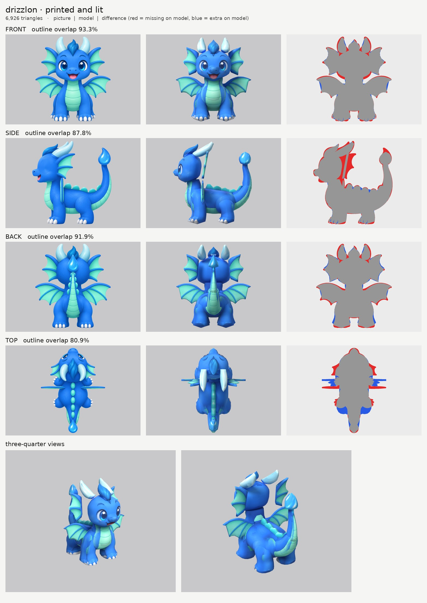

# Drizzlon: small-model-only route (opus)

**Result:** a 6,926-triangle game model (`drizzlon.glb`, 0.7 MB) with one colour texture (2048) and a
normal map. It has no glow map content, since nothing on Drizzlon should glow. From the front and
three-quarter views it reads well: big eyes, open smile with tongue, snout, swept-back horns, fin ears,
flat fin wings with their ribs and scalloped edges, belly plates, spines, the upright tail and the droplet.
`closeups.jpg` has the three-quarter views and a close crop of the face.

## Numbers

| | Front | Side | Back | Top |
| --- | --- | --- | --- | --- |
| Blockout (60,000 triangles), outline overlap | 95.0% | 90.0% | 93.4% | 81.2% |
| Game model (6,926 triangles), outline overlap | 93.3% | 87.8% | 91.9% | 80.9% |

- **Texture seen by a picture:** 67.0%. The rest is the undersides (belly, chin, inside the legs), the
  surfaces where parts meet and the head's surfaces where I switched pictures off (below). They are
  coloured from the nearest painted spot on the same part.
- **Parts:** 15 (19 counting left and right): torso, neck, head, snout, tuft, horns, fin ears, wings,
  front legs, back legs, spines, low tail, upright tail, droplet.
- **Time:** about 15 minutes by the clock (3 route runs plus 3 blockouts), plus a few minutes for these notes.

## Why the side and top scores are lower

- **Top (81%): the top picture is badly out of proportion.** Its head is drawn about 40% too big and
  everything behind it is squeezed (the front legs come out 7 cm too far back, the wings 7 cm too far
  forward, the horns twice as wide). I used it only where it agrees with the other views, stretched per
  part (`remap`), and switched it off for painting the head, snout, tuft, horns, legs, wings and spines.
- **Side (88%): the fin ears.** In the pictures each fin ear is a fan seen face-on from the front, the
  side and the top, which is impossible for a flat fin. I built them as flat fans facing forward, leaning
  back a little, so from the side they show as a thin edge, and the side picture's fan shape counts as
  "missing". The chest bulge is also a little short at the front.

## What I did and the problems I hit

1. **Pictures checked.** Side faces left, top has the head at the top. The back picture draws the rear
   claws on the heels (they point forward in the side view); the back picture is skipped on the rear
   paws there, so the heels stay blue.
2. **Wings** are sliced side to side, with the front view giving their full shape. That keeps the
   scalloped bottom edge between the ribs, which slicing upward would fill in. Their thickness comes from
   an outline I drew in the top view at the depth the side view shows (the top picture puts them in the
   wrong place).
3. **Horns** sweep back at about 30 degrees, so they are sliced front to back. The top picture draws them
   twice as wide as the front picture does, so their width comes from a drawn outline that matches the
   front picture. The first try with the top picture made them flat leaves.
4. **Snout** is sliced front to back with a rounded tip, so it reads as a muzzle, not a duck bill.
5. **The tail** is three parts: the low curve out of the rump, the upright part, and the droplet. A
   single part would fill in the curl.
6. **Ghost paint on the back of the head (the main fix).** Three pictures printed the wrong things there:
   - the back picture's droplet and upright tail (they sit in front of the head in that picture);
   - the top picture's oversized horns;
   - the side picture's fin-ear ribs (the model's fin is thin, so the head behind it is visible from the
     side), which came out as horizontal stripes.
   Each is switched off on the head, neck and tuft with `paint_skip` and `paint_box_skip`.
7. **Ghost eye.** The side picture's eye and eyebrow sit further back than the front picture's eye lands
   on the model, so they would print a second eye. They are painted out of a print-only copy of the side
   picture (`side_print_repaired.png`, made with `tools/inpaint_view.py`).
8. **Shelf at the shoulders.** The front-leg tops stuck out of the narrow front of the torso as flat
   ledges. The leg tops are now domed (`round_ends`) and the neck runs down into the chest.

## Changed tool copies (in `tools/`)

They are the same copies as Mushling's: `board.py` (frames the three-quarter views by size),
`print_tex.py` (spots option, not used here), `emissive.py` (stricter glow rule, so blue and teal never
glow), `inpaint_view.py` (print-only paint-over), and `route_small.sh` (uses them).

Rebuild: `make_views.py ... 0.75`, then
`tools/inpaint_view.py views.json side "447,335,54,72" "462,232,44,22" --grain 0 --sigma 14`, then
`tools/inpaint_view.py views.json side "500,247,12,12" --grain 0 --sigma 10`, then
`PY=... bash tools/route_small.sh parts.json views.json OUT 7000 drizzlon`.

## What still looks wrong

- The fin ears are flat fans. From the side they show as thin blades, not the fans the side picture draws.
- The blue has lighter and darker patches on the body and legs, where pictures with slightly different
  shading meet.
- The back of the head is a plain blue dome. No picture shows it, so its colour is filled from nearby.
- The horn tips are a little blunt, and the droplet is low-poly (120 triangles).
- With 7,000 triangles spread over 19 parts, the small parts (tuft, droplet, horns) are visibly faceted
  on their outlines.
