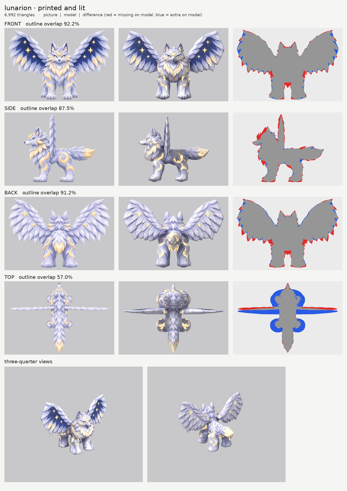

# Lunarion: small-model-only route (opus)

**Result:** a 6,992-triangle game model (`lunarion.glb`, 5.3 MB) with colour (2048), a normal map
(2048, fur relief) and a glow map. The crescent crest, eyes, wing stars and gold markings glow softly.
From the front and the three-quarter views it reads as Lunarion:
- the wolf face with its crest and gold eyes;
- the big raised wings, navy night sky with gold stars on the front and silver feathers with stars on
  the back;
- the gold flame markings on the legs and flanks;
- the fluffy tail with its gold tip.

`closeups.jpg` has the three-quarter views and a close crop of the face.

## Numbers

| | Front | Side | Back | Top |
| --- | --- | --- | --- | --- |
| Blockout (60,000 triangles), outline overlap | 93.3% | 89.0% | 92.3% | 56.9% |
| Game model (6,992 triangles), outline overlap | 92.2% | 87.5% | 91.2% | 57.0% |

- **Texture seen by a picture:** 66.3%. The rest is the belly, the insides of the legs, the hidden roots of
  the wings and legs, and the head surfaces where the side picture is switched off (below). They are
  coloured from the nearest painted spot on the same part.
- **Parts:** 9 (13 counting left and right): torso, mane, head, muzzle, ears, wings, front legs, back
  legs, tail. Budget: each wing 1,000, head 1,008, mane 980, each leg about 420, tail 312, muzzle 180,
  each ear 140.
- **Glow** covers 13% of the texture: the pale gold. The shared glow tool would have caught none of this
  pastel gold, so my copy adds a "moon-gold" rule for Lunarion.
- **File size:** 5.3 MB, mostly the normal map (4.3 MB as PNG, because the fur relief is busy). The
  Coalossus small file is 3.2 MB. Saving the normal map as a JPEG or 1024 would cut it a lot.
- **Time:** about 12 minutes by the clock (16:12 to 16:24, 2 route runs and 3 blockouts), plus these notes.

## Why the top score is low (57%)

The top picture does not agree with the front picture about widths. Relative to the wings, it draws the
body, mane and paws about 30% narrower than the front picture does. Its wings also sit 11 cm further
forward than in the side picture. The method lets the front view win for widths and the side view win for
depths, so the model follows those. The top picture is still used to paint the back, and is switched off
for the legs and wings.

## What I did and the problems I hit

1. **Pictures checked.** Side faces left, top has the head at the top, and the wings are flat and face
   forward. The side picture shows the crescent crest standing up off the forehead; it is only painted
   on (from the front it lies flat on the forehead).
2. **Wings** are sliced side to side: the front view gives the full V shape with its feather tips, and an
   outline I drew in the top view gives the thickness. That outline follows the side picture's edge:
   26 cm at the root, thinning to 4 cm at the tip.
3. **Stacked rings from the spiky fur.** The fur outline is all spikes, and every spike turned into a ring
   around the mane, legs, head and tail. At this creature's scale a spike is 20 to 40 pixels, so
   `smooth` had to go up to 16 to 24 (it was 8 to 14 at first, which still showed bands).
4. **Ears were nubs.** My first head outline was wide at the top and swallowed the ears. The head outline
   now stops between them.
5. **Ghost fur on the face.** In the side picture the neck ruff and the ear sit over the back and top of
   the head. They printed see-through gold locks and a navy ear patch onto the round head. That part of
   the side picture is switched off for the head (`paint_box_skip`). The side picture's eye is painted
   out of a print-only copy (`side_print_repaired.png`).
6. **Glow:** `tools/emissive.py` keeps the stricter rule (no glow on plain colours) plus a pale-gold rule,
   so the crest, eyes, stars and markings glow.
7. **Relief** is `fur` everywhere except the muzzle, which gives the feathers and locks some light and
   shade in the normal map.

## Changed tool copies (in `tools/`)

- `board.py`: frames the three-quarter views by the creature's size.
- `print_tex.py`: spots option (not used here).
- `emissive.py`: stricter glow rule plus Lunarion's moon-gold rule.
- `inpaint_view.py`: print-only paint-over.
- `route_small.sh`: uses the copies above.

Rebuild: `make_views.py ... 2.6`, then `tools/inpaint_view.py views.json side "382,376,24,24" --grain 0 --sigma 10`,
then `PY=... bash tools/route_small.sh parts.json views.json OUT 7000 lunarion`.

## What still looks wrong

- **The wings look like thick boards from the three-quarter view.** Their outer edge is almost a straight
  vertical cut, and the 26 cm thickness the side picture shows reads as a slab at the root.
- **The cheeks** still show some overlapping gold locks at a slant. That is the front picture's spiky
  cheek ruff printed onto the side of the round head.
- **The mane is a big round barrel.** The front picture's chest is 1.25 m wide, and from above it looks
  heavier than the picture.
- **The silhouettes are faceted.** 7,000 triangles over a creature this big, with two large wings, leaves
  about 400 per leg, so the leg and tail outlines are angular up close.
- The crest is flat paint, not the raised crescent the side picture shows.
