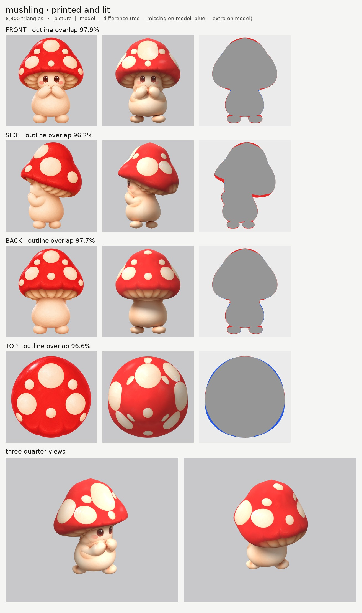

# Mushling: small-model-only route (opus)

**Result:** a 6,900-triangle game model (`mushling.glb`, 0.6 MB) with one colour texture (2048), a
normal map and a glow map. It looks right: clean red cap with whole cream spots, the face reads from the
front and three-quarter views, both hands are held up to the mouth, and the gills show under the cap.
`closeups.jpg` has the three-quarter views and a close crop of the face.

## Numbers

| | Front | Side | Back | Top |
| --- | --- | --- | --- | --- |
| Blockout (60,000 triangles), outline overlap | 98.4% | 96.9% | 98.0% | 96.4% |
| Game model (6,900 triangles), outline overlap | 97.9% | 96.2% | 97.7% | 96.6% |

- **Texture seen by a picture:** 82.9%. The rest is the underside of the cap, the soles and the insides
  of the arms, coloured from the nearest painted spot on the same part.
- **Parts:** 6 (cap, body, arm pair, left foot, right foot). Budget split: cap 2,928, body 2,400, each
  arm 408, each foot 378.
- **Time:** about 22 minutes by the clock (15:38 to 16:00), including 4 route runs and 5 blockouts.

## What I did and the problems I hit

1. **Pictures checked.** Side faces left, top has the head at the top. Two things the generator got
   "wrong", both kept because the model can follow them:
   - The cap is tilted backwards in the side view (its front rim is 15 cm higher than its back rim).
     The cap's outline in the side view follows that slant, so the model's cap tilts back too.
   - The side view draws the feet one in front of the other, while the front and back views draw them
     side by side. I made the feet two separate single parts (`lfoot`, `rfoot`) placed so they match
     all three views: the left foot a little forward, the right foot a little back.
2. **Arms.** The arm runs diagonally (hand at the mouth, elbow at the side and further back), and a
   part sliced straight up fills that diagonal in as a box. I traced the arm sliced front-to-back
   instead, using the side view for its height and a drawn outline in the top view for how far out it
   goes (the cap hides the arms from above, so that outline is drawn by hand with `nomask`).
3. **Ghost spots on the cap (the main problem).** The four pictures each put the cap's spots in
   different places. Printing blends the pictures where they overlap, so the first print had dozens of
   see-through half spots. Fix, in a changed copy of the printing tool (`tools/print_tex.py`, new
   `decals` option on the cap):
   - the red is printed from copies of the pictures with the spots painted out;
   - then every spot is put back **whole, from one picture only**: the picture that sees it most head-on.
     A spot from another picture that would land on or next to a spot already placed is dropped, and
     spots a picture sees only at a slant are not used.
   Result: 13 clean spots instead of a blur of 34 overlapping ones.
4. **Ghost eye and double blush.** The side picture's eye and cheek printed onto the sides of the face,
   next to the real eyes. I painted them out of a print-only copy of the side picture with smooth skin
   (`tools/inpaint_view.py`; the copy is `side_print_repaired.png`). The outline is untouched.
5. **The red cap glowed.** The shared glow tool keeps bright reddish colours, which caught the cap and
   the cheeks. A copy (`tools/emissive.py`) uses a stricter "lava/gold" rule; Mushling now has no glow.
6. **Faceted feet.** At first each foot had 180 triangles and looked like a diamond. `lo_weight` 4 gives
   them about 380 each.
7. **Relief** is `none` on every part (smooth skin and a glossy cap), so the normal map is flat. That
   suits this creature.

## Changed tool copies (in `tools/`)

- `board.py`: frames the three-quarter views by the creature's own size (the shared one is set for a
  1.8 m creature, so a 0.6 m Mushling came out tiny).
- `print_tex.py`: the `decals` option above, plus an optional per-part `paint_power`.
- `emissive.py`: stricter glow rule (plain red and pink no longer glow; orange and gold still do).
- `inpaint_view.py`: new; paints over ellipses in a print-only copy of a picture with the surrounding colour.
- `route_small.sh`: the shared route, but using the copies above.

Rebuild: `make_views.py ... 0.6`, then `tools/inpaint_view.py views.json side "377,622,40,70" "440,686,62,42" --grain 0 --sigma 14`,
then `PY=... bash tools/route_small.sh parts.json views.json OUT 7000 mushling`.

## What still looks wrong

- A faint second outline of the forearm is painted on the belly just under the real forearm. It comes
  from the front picture's shadow under the arm and shows from the three-quarter view.
- The big crown spot is stretched a little where the cap curves away from the front picture.
- The spots no longer match any one picture exactly; they are a consistent set taken from all of them.
- The feet stand one slightly ahead of the other (that is what the side picture shows).
