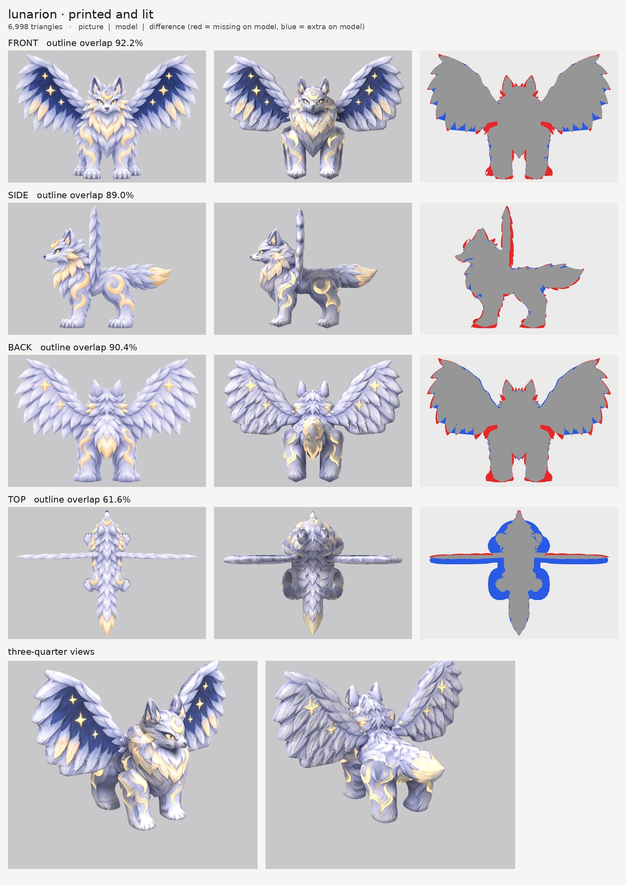

# Lunarion, small-model-only route (builder: sonnet)

The legendary winged silver wolf, built straight at about 7,000 triangles with the paint-and-bake method, no big
model. The ChatGPT pictures are printed onto the game model and its normal map is made from the paint.

## The result in numbers

| | Triangles | Front | Side | Back | Top |
| --- | --- | --- | --- | --- | --- |
| Blockout (shape check, 59,642 triangles) | 59,642 | 92.9% | 90.6% | 91.2% | 61.0% |
| **Game model (shape only and printed, same shape)** | **6,998** | **92.2%** | **89.0%** | **90.4%** | **61.6%** |

- Outline overlap is how much of the picture's outline the model covers. The method's target is about 90% front and
  85% side. Front, side and back are met. The top view is not (see "What still looks wrong").
- **68.1% of the texture is painted straight by a picture.** The rest (inside the legs, the belly, the underside of
  the wings, the soles) takes its colour from the nearest painted spot on the same part. The soles of the paws get a
  grey-lilac pad gradient (`cap_fill`).
- The glow map covers 5.3% of the texture: the gold crescent crest, the stars, the eyes, and (more softly) the gold
  swirl markings and the gold tail tip.
- Size: 3.8 m wide (wingtip to wingtip) x 2.7 m long x 2.6 m tall. File: 5.3 MB (colour 2048, normal map 2048, glow
  1024). It faces +Z with Y up, feet on y = 0. The compressed GLB writers (meshopt, Draco) are not installed in this
  Blender module, so the file is not compressed; Coalossus' 3.2 MB would be reachable with a compression pass.
- 9 traced parts, 13 with twins: torso, head, muzzle, ruff (neck mane and chest fur), ears, wings, front legs, rear
  legs, tail.

## What I did, step by step

1. **Checked the pictures.** The side view faces left, the top view has the head at the top, and the wings are flat
   and face forward as asked. Things the picture generator got wrong (the model follows the rule "front wins widths,
   side wins depths"):
   - The **body is about 30% narrower in the top picture** than in the front and back pictures. Front and back both
     show shoulders and hips about 1.28 m wide (legs plus fur); the top picture shows a 0.65 to 0.85 m body.
     Leg spacing agrees between all views.
   - The **wing sits 0.1 m further back in the side picture** (centre 0.25 m behind the middle) than in the top
     picture (0.37 m). I followed the side picture and made the wing thinner (0.17 m), which is between the two.
   - The pictures are 3% off each other in scale, and the size came out 3.8 m wingspan and 2.75 m long, against the
     3.4 m and 2.6 m asked for. I kept the pictures' own proportions (height stays 2.6 m).
   - Front and back each draw a second, outer pair of paws peeking out beside the legs, and they contradict each
     other (the front says they are the hind paws, the back says the front paws; the top shows both pairs at the
     same sideways spot). I modelled one pair of legs per end, from the inner paws.
2. **Put the views on one scale** (`pipeline/make_views.py`, height 2.6 m to the wingtips).
3. **Traced the parts** into `parts.json` (written by `tools/gen_parts.py`, so the outlines are easy to edit).
   - The wings use `axis: z`: the front picture gives the whole wing, the side picture gives the thin edge.
   - Legs use `axis: z` as well (front or back picture for width, side for depth).
   - Torso, head, muzzle and tail use `axis: y` (side and top pictures).
   - The wing's lower and upper inner edges follow the real slanted edges of the feathers (a flat bottom made a big
     blue wedge under the wings on the first board).
4. **Blockout and board** (`blockout.jpg`), fixed until front, side and back were above target, then looked hard at
   the three-quarter renders.
5. **Small-model route** (`tools/route_small.sh`, 7,000 triangles), four full runs of about 2.5 to 3.5 minutes each.
6. **Review and fix** (below), stopped when the face, the wings and the three-quarter views looked right.

## Problems I hit and how I fixed them

| Problem | Fix |
| --- | --- |
| **Double pupils and a ghost crescent** on the face: the side picture's eye and crescent printed on the cheeks and forehead next to the front picture's | `paint_box_skip` for the side picture over the eye and crest, on the head and muzzle. Now one clean pair of eyes and one crescent |
| **Hip swirl printed twice** on the torso: the top picture's swirl landed on the torso, which I made wider than that picture | `paint_box_skip` for the top picture over the swirl markings on the torso |
| **Nothing glowed** (glow map was 0.0%): the stock tool looks for lava orange, and Lunarion's gold is pale | Changed copy of `emissive.py` keeps gold: strongly for the crescent, stars and eyes, softly for the swirl markings |
| Top picture is much narrower than front and back | Torso widened beyond the top picture (`nomask` for the top outline) so it joins the legs; front and back win. Top overlap pays for it |
| Wing silhouette too smooth and blocky (only 19 rows) | Changed copy of the build tool with `n_scale` and `k_scale`: wings get 36 rows and fewer columns, same triangle budget |
| Paw soles rounded off and shoulders cut (domed end on the wrong end of the leg) | `round_ends` moved to the hidden top of the leg; the sole stays flat and gets `cap_fill` |
| Gap between the front legs (the chest fur hangs down between them) | The ruff gets a V tip down to the knees |
| Tail looked like a thin beak from behind | Tail top outline widened so the picture's own outline decides the shape |
| Wing slab looked too thick and floated from the body | Wing thickness capped at 0.17 m; inner root runs under the ruff and shoulders |

## Files

| Path | What |
| --- | --- |
| `lunarion.glb` | The game model: one mesh, one material, colour + normal + glow |
| `board_printed.jpg`, `board_blank.jpg`, `blockout.jpg` | Boards: printed and lit, shape only (both the 7,000-triangle model), and the 60,000-triangle blockout |
| `previews/` | Close-up of the face, the three-quarter renders, each view of the printed model, the texture map showing which picture painted what, the numbers as json |
| `parts.json`, `views.json`, `views/` | The traced parts and the pictures on one scale (the `original` entries point at `round2/source/lunarion/`) |
| `textures/`, `atlas.json` | The three textures as loose files and the texture layout |
| `tools/` | **Changed copies of shared tools** (nothing in `pipeline/` was touched): `emissive.py` (gold glow), `build.py` + `parts.py` (per-part `k_scale` and `n_scale`), `route_small.sh` (uses those), and `gen_parts.py` (writes `parts.json`) |
| `rebuild.sh` | Every command in order |

## What still looks wrong

- **Top view overlap is only 61.6%.** The model follows the front and back pictures, so its legs and neck mane stick
  out sideways beyond the narrower body the top picture draws. From above, the model looks wider and stubbier than the
  picture. I chose this on purpose; the alternative was legs that look tiny from the front.
- **The body reads as smooth tubes.** Torso and legs are simple round shapes with fur only painted on, with no tufts on
  the silhouette (speckled red and blue at the edges of the difference pictures). The wings' outline is smooth where
  the picture has scalloped feather tips, and the clay board shows faint horizontal ribbing across the wings that
  mostly disappears once printed.
- **The neck mane (ruff) looks like a collar block** around the head from the front, and the cheek tufts behind the
  head are painted only by the front picture, so they look slightly smeared and glassy.
- **Where parts meet** there are faint seams (a thin dark line at the hip, a rim where the ruff meets the legs). The
  undersides and the inner left leg (no picture sees them) show soft banding.
- The outer pair of paws drawn beside the legs in the front and back pictures is not modelled (red at the feet);
  toes and claws are paint only.
- The gold tail tip glows quite hard, because all the gold is glowing.
- Wing thickness is the same all along its width (the top picture shows it tapering to a point).
- No skeleton or animation this round.

## How long it took

About 30 minutes by the machine clock, from reading the brief to the last file, including four full runs of the
route (2.5 to 3.5 minutes each while the other builder was also rendering). The first printed result was already
close; the rest was fixing the face, the glow and the wing detail.

## Honest comparison with the Coalossus small model

Close, but a notch below. The face, the printed wings (navy sky, stars, gold tips) and the glow are as good as
Coalossus' lava cracks, and the three-quarter views read clearly as a winged wolf. What is weaker: Coalossus is a rock
creature, so its chunky plates and lava cracks give strong bumps and crisp edges at 6,000 triangles, while a fur
creature drawn as soft paint on smooth tubes looks softer and lumpier. Its outlines also match better (96/97/93/93%
against 92/89/90/62%), mostly because Lunarion's pictures disagree with each other more (body width in the top
picture, wing position) and because 3.8 m of thin feathered wings is hard to hold at 7,000 triangles.
