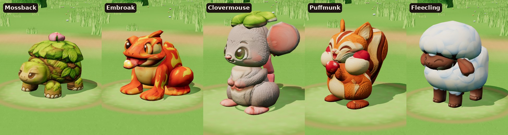

# Round 3: five chapter 1 creatures

These are the two other starters and three Meadow Path creatures. All five were built with the
small-model-only paint-and-bake route, animated with the shared animation system, and added to the
Creature Battle Bay on its new Meadow Path stage.

## Results

| Creature | Triangles | Outline overlap front / side / back / top | Texture seen by a picture | Walk | Build time |
| --- | --- | --- | --- | --- | --- |
| Mossback | 6,934 | 91.1 / 90.9 / 91.1 / 87.4% | 49% (a third is hidden under the bush) | slow plod | about 28 min |
| Embroak | 6,992 | 90.1 / 93.4 / 89.3 / 85.9% | 49% | frog hop | about 25 min |
| Fleecling | 6,988 | 93.5 / 94.8 / 90.2 / 85.7% | 62% | trot | about 25 min, with one fix |
| Clovermouse | 6,988 | 94.1 / 90.6 / 91.2 / 58.0% | 73% | bunny hop | about 70 min, with one fix |
| Puffmunk | 6,984 | 94.2 / 94.1 / 91.7 / 89.6% | 71% | bunny hop | about 35 min |

**Clovermouse's top score is low** because its top picture shows a different pose: lying stretched out,
with its face showing. That picture was used only to paint the clover.

**Glow:**
- **Embroak:** only its ember bead glows, plus a faint glow on the yellow flame markings.
- **The other four:** nothing glows. The shared glow rule would have lit up Embroak's and Puffmunk's
  orange skin and fur, so the builders switched it off.

**Each one, in a line:**
- **Mossback:** a sleepy face, moss and shell plates, toenails, and the flower on a leafy bush. The bush
  is a smooth dome with the leaves painted on.
- **Embroak:** the flame markings, the tongue and the glowing ember. The eyes are their own domes, so
  each eye has one pupil.
- **Fleecling:** smooth cloud wool with the puffs painted on, floppy ears, and the face framed by the
  head wool. The head wool was sent back once because it looked like a mushroom hat; it's now a round
  puff.
- **Clovermouse:** the best face of the five. It was sent back once for a boxy head and a floating
  clover; the head is now domed and the clover sits on it.
- **Puffmunk:** the best outline match of the five, with stuffed cheeks, berries and a striped tail.
  Its paint is a little busier than the others'.

## Usage

Two helpers built the five, working at the same time:
- **Helper 1:** Mossback, Embroak and Fleecling, plus the Fleecling fix.
- **Helper 2:** Clovermouse and Puffmunk, plus the Clovermouse fix.

| | Tokens | Per creature |
| --- | --- | --- |
| Helper 1 (3 creatures + 1 fix) | 529,000 | about 176,000 |
| Helper 2 (2 creatures + 1 fix) | 586,000 | about 293,000 |
| **Both** | **1,115,000** | **about 223,000** |

That's more than round 2's Opus helper, which used about 129,000 per creature. Why:
- **The brief:** this round asked for the best model, not a test.
- **Two fixes:** two creatures went back for a fix.
- **Disagreeing pictures:** they took the most work. Examples are Clovermouse's top view, Embroak's
  tongue, Mossback's flower and Puffmunk's cheek berries.
- **New tool options:** the builders added several (below).

The lead's own work isn't counted: checking, animation, the viewer and the meadow.

## The animation system grew

- **Turtles and frogs** use the four-legged skeleton, with a slow plod (Mossback) or a hop (Embroak).
- **Creatures that sit up** (Clovermouse, Puffmunk) use the round plan, plus:
  - a three-bone tail that sways, wags and flicks
  - the face on the head
  - a bunny-hop walk
- **Extra effect points at a part's centre:** Embroak's ember glow comes from its tongue-tip bead.
- **Settings:** each creature's `rig.json` holds them. See `../pipeline/ANIMATION.md`.

Pose sheets are in `animation/`.

## Worth adding to the shared tools next

The builders' new options, all copies in each creature's `tools/` folder:
- **A black glow map unless a part asks for glow,** with a "flame" rule (Embroak).
- **`slab`:** a thin, turned disc, for ears seen at an angle (Clovermouse, Puffmunk).
- **`droop`:** bends a flat part's sides down like a hat brim (Clovermouse's clover).
- **`paint_shift`:** moves one picture's paint on one part, when pictures disagree about where something
  is (Mossback's flower).
- **`side_far`:** stops a picture from printing onto the far side of a thin part.
- **`paint_solid`:** paints a part one solid colour (Puffmunk's cheek berries).
- **Gentler reliefs:**
  - `grain`: fine detail with no cracks (Mossback)
  - `fur_soft`: doesn't carve eye outlines (Clovermouse, Puffmunk)

## Files

- `source/<creature>/`: the five pictures per creature.
- `picture-request.html`, `make_picture_request.py`: the prompts and reference sprites.
- `BRIEF.md`: the helpers' brief.
- `<creature>/`, each holding:
  - the game model (`<creature>.glb`)
  - the animated model (`<creature>_animated.glb`)
  - the textures, `parts.json`, `views.json` and `rig.json`
  - the boards and `closeups.jpg`
  - `animation_manifest.json`
  - `NOTES.md`
  - `tools/`
- `animation/`: pose sheets.
- The battle viewer: `../round2/animation/creature-battle-bay.html`. The tool that packs a creature for
  it is `../pipeline/battle_bay/pack_creature.py`.
