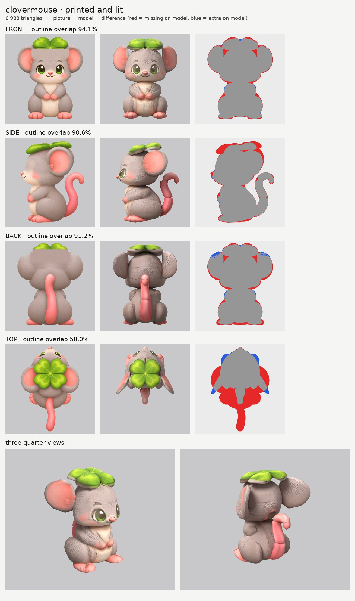
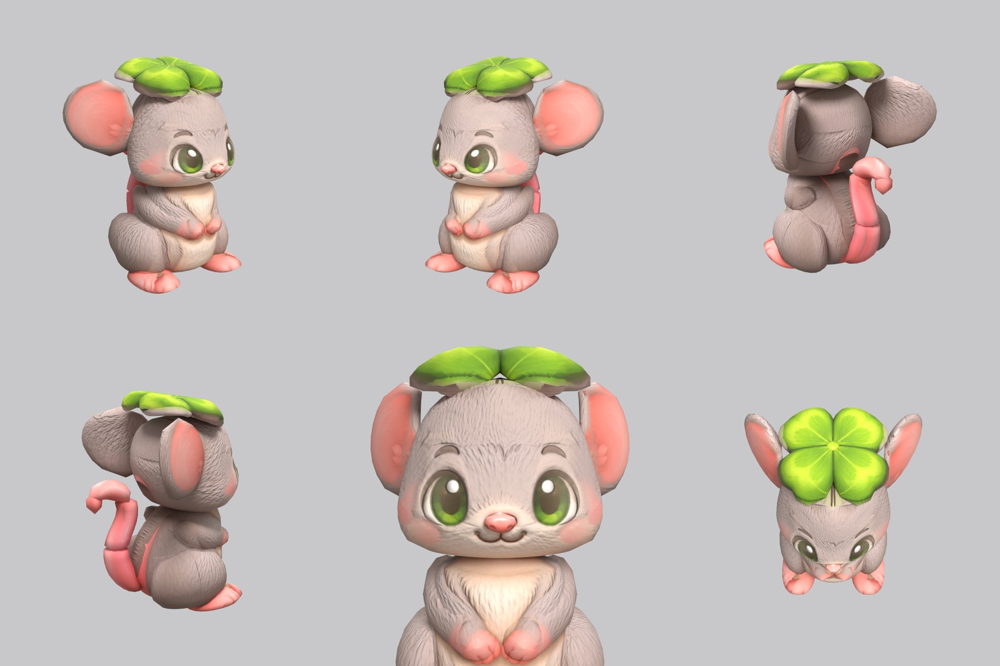
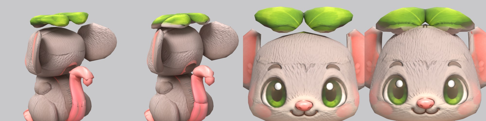

# Clovermouse: small-model-only route (Opus 5.5)

**Result:** a 6,988-triangle game model (`clovermouse.glb`, 3.1 MB) with one colour texture (2048), a
normal map (soft fur) and an all-black glow map (nothing glows). It looks right from the front and the
three-quarter views: big green eyes, pink nose and smile, round pink-lined ears, paws together at the
chest, cream belly, pink feet, and a four-leaf clover hat whose leaves read clearly from above. The
pink tail rises behind in an S and hooks over at the top.

The final game model's Blender file (the lead animates from it):
`/tmp/claude-0/-home-user-atoms-games-/95c47fc1-cd5e-5362-b776-c463cbad3789/scratchpad/round3/clovermouse/out10/model.blend`

## Numbers

| | Front | Side | Back | Top |
| --- | --- | --- | --- | --- |
| Blockout (60,000 triangles), outline overlap (`blockout.jpg`) | 95.5% | 92.4% | 92.4% | 58.5% |
| Game model (6,988 triangles), outline overlap | 94.1% | 90.6% | 91.2% | 58.0% |
| (before the shape fix below: game model) | 92.4% | 89.6% | 89.4% | 57.1% |

- **Texture seen by a picture:** 72.9% (76.2% before the shape fix; more of the head top is now tucked under the hat). The rest (the hidden side of the arms, the underside of the
  clover, the soles, the inside of the ears) is coloured from the nearest painted spot of the same part.
- **Why the top number is low:** the top picture draws a different pose. It shows the mouse lying
  stretched out, seen from above at a slant: the face and eyes are visible, the feet stick out behind
  the body and the tail lies flat on the ground. The model follows the front, side and back pictures,
  which all agree on the sitting pose. The top picture is used only to paint the clover.
- **Parts (17 pieces):** body, body_haunch pair, head, muzzle (the nose), ear pair, cap_clover pair,
  arm pair, foot pair, tail_a, tail_b, tail_c, tail_d. Budget: head 1,764, body 924, haunches 396
  each, clover halves 420 each, ears 360 each, arms 360 each, feet 240 each, nose 130, tail 618 in
  four pieces.
- **Animation check:** `pipeline/animate.py` with `{"plan": "round", "mouth": "head"}` rigs it with
  12 bones (body, head, two-bone arms, feet, three tail bones) and all 12 clips without complaint.
  Every part name has the right word: `body*` body; `head`, `muzzle`, `ear`, `cap_clover` head;
  `arm`, `foot`; `tail_*`.
- **Time:** about 55 minutes by the clock (19:38 to about 20:30, plus a 5-minute final re-run), 7
  route runs and 4 blockouts; then about 20 minutes for the shape fix below (3 more route runs).

## Shape fix (after review)

The coordinator asked for three shape fixes, keeping the face and paint. Before and after
(three-quarter back view and face view; left of each pair is before):

- **The head was boxy** (square top corners from the front, a box-like back). The head's top is
  hidden under the hat in every picture, and its back is hidden behind the ear in the side picture,
  so I was free to round both: the head outlines are now domed on top (both views) and round at the
  back, and the slices are rounder (`n` 1.7 instead of 2). The face area of both outlines is
  unchanged, so the face prints exactly as before. It now reads as a round dome from the front.
- **The clover floated** (daylight between hat and head from the front). The head's dome now rises
  into the underside of the hat, the hat is 4 mm lower, its two halves overlap by 2 cm at the centre
  line (no gap between them), and its sides bend down like a hat brim over the round head (new
  `droop` option in `tools/parts.py`). It now sits on the head with no daylight.
- **Ears and tail (the cheap part):** the ears are 3 cm thick instead of 2.2 cm, so edge-on they read
  as soft discs, not paddles; the hidden ends inside the tail-hook joins taper off so they don't poke
  out. The hook is a little smoother but still has a visible bend at each join.
- **Paint kept:** the green leaf paint the front and back pictures would have put on the newly raised
  head top is switched off there (`paint_box_skip`), and the painted-over fur under the hat now blends
  in more softly (wider feather), so the seam on the forehead and the back of the head is fainter.
- **Numbers:** outline overlap went up (front 92.4 to 94.1%, side 89.6 to 90.6%, back 89.4 to
  91.2%), because the rounder head fills the space the pictures' hat and ears cover. The animation
  check still gives 12 bones and all 12 clips.

## What I did and the problems I hit

1. **Pictures checked.** Side faces left, top has the head at the top, the front and back agree with
   the side. What the generator got wrong:
   - **The clover hat is drawn face-on in the front and back pictures**, as if seen from above, but
     the side picture shows it as a flat hat lying on the head. A flat hat can't be both. I followed
     the side and top pictures (a flat hat), so from straight in front the model shows the clover's
     rim, not its face. From above and from three-quarter views it is a proper four-leaf clover.
   - **The side picture draws the clover 30% longer** (front to back) than the front and top pictures
     do. I kept it round, as the front and top pictures show four equal heart-shaped leaves.
   - **The ears are drawn as full discs from the front and from the side.** A thin disc can't face
     both ways, so each ear is a thin disc turned about 55 degrees (facing forward and outward), which
     matches both outlines.
   - **The side picture's face is about 2 cm higher** than the front picture's (eye, nose, mouth),
     and its paws about 1 cm higher.
   - **The top picture is a different pose** (see above), and drawn far longer than the side.
2. **A notch in the side outline.** The forehead fur in the side picture is so pale that the outline
   finder took it for background and cut a bite out of the forehead. I added it back to the side
   outline (`tools/fix_mask.py`, new; the repaired outline is `side_mask_repaired.png`).
3. **Top picture scale.** `make_views` stretches the top picture to the side's length, but because its
   tail lies flat, that stretch put the clover 5 cm too far forward. I set the top picture's scale to
   the same as its width (`tools/set_view_map.py`, new), which lines its nose and clover centre up
   with the side picture to within a millimetre.
4. **Green leaves printed on the forehead (and the back of the head).** Because the front and back
   pictures draw the clover face-on, its lower leaves cover the forehead and the back of the head in
   those pictures. First I switched those pictures off there, but the gap then filled with streaks.
   The fix: print-only copies of the front and back pictures where everything below the hat's rim is
   painted over with the surrounding fur colour and fur grain (`tools/fill_under.py`, new; the
   copies are `front_print_repaired.png` and `back_print_repaired.png`). The eyebrows are protected.
5. **Ghost eye.** The side picture's eye (2 cm higher than the front picture's) would have printed a
   second eye on each side of the face. I painted the eye and eyebrow out of a print-only copy of the
   side picture (Opus's round-2 `inpaint_view.py`; the copy is `side_print_repaired.png`).
6. **Arms buried in the body.** At first the arms sat inside the body, so only the paws showed. I made
   the body narrower under the arms and gave the hips their own pair of parts (`body_haunch`), so the
   arms lie on the chest like in the pictures and the body has no step at the hips.
7. **Paws 1 cm too high.** The arms follow the side picture, which draws the paws 1 cm higher than the
   front picture; the front picture's pink paws would then have printed on the belly. The arms are
   moved down 1 cm (new `offset` option) and the side picture is read 1 cm higher for the arms only
   (new `paint_shift` option), so both pictures land on the arms.
8. **The S-curved tail** is four pieces: two sliced upward along the rising part, one sliced
   front-to-back along the hook, and one sliced upward for the tip that hangs down.
9. **Pink on the backs of the ears.** The far side's copy of the side picture printed the pink inside
   of one ear onto the back of the other ear, where it sticks out behind the head. New `side_far`
   switch: a left/right pair is not printed by the side picture seen from the opposite side.
10. **Carved face.** The shared `fur` relief turned every painted line (eye outlines, eyebrows, the
    mouth, the edge of the blush) into a deep groove, so the face looked engraved. New relief
    `fur_soft`: gentler fur tufts, and no relief on pink or green paint or across strong outlines.
    The clover, nose, feet and tail have no relief (smooth skin and leaves).
11. **Glow map:** all black (`emissive.py --off`). Checked: the exported glow texture is black.

## Changed tool copies (in `tools/`)

- `route_small.sh`: the shared route, using the copies below; the glow map is black unless asked.
- `parts.py` and `build.py`: Sonnet's round-2 copies (`n_scale`, `k_scale`) plus two new options:
  `slab` (a thin disc turned at an angle, for the ears) and `offset` (move a finished part).
- `print_tex.py`: Opus's round-2 copy plus `paint_shift` (read a picture shifted for one part) and
  camera names / `side_far` in `paint_skip`.
- `relief.py`: the shared one plus the `fur_soft` kind.
- `board.py`: Opus's round-2 copy (frames the three-quarter views by size).
- `emissive.py`: `--off` writes a black glow map.
- New: `fix_mask.py` (add a piece back to an outline), `set_view_map.py` (set a picture's scale),
  `fill_under.py` (paint fur over a hat drawn face-on), `inpaint_view.py` (Opus round 2).
- `mkparts.py` writes `parts.json`; `redo_views.sh` rebuilds the repaired picture copies.

Rebuild: `make_views.py WORK/views 0.45 front side back top`, then
`set_view_map.py views.json top sy=2283.24 vc=440`, then `bash tools/redo_views.sh` (from the work
folder), then `PY=... bash tools/route_small.sh parts.json views/views.json OUT 7000 clovermouse`.

## What still looks wrong

- **From straight in front the clover is a thin green rim**, not the big four-leaf face of the front
  picture (the pictures disagree; see above). From above and at three-quarter angles it is right.
- **The back of the head is still a little flat** from a three-quarter back view (the cheeks give
  the front outline straight sides), though the top and back are now domed.
- **The ears are still discs**, 3 cm thick; there is no cupped rim.
- A faint line remains on the forehead and the back of the head where the painted-over fur meets
  the real fur (softer than before).
- The tail is smooth and pink but its hook still shows a bend at each of the joins between its four
  pieces.
- The top outline overlap is low (57%) because the top picture shows another pose.

## Compared with Coalossus and Mushling

From the front and three-quarter views it is close to Mushling: clean face, clean colours, no ghost
features, and the clover reads well from the usual game camera (above and in front). After the shape fix the
head reads round and the hat sits on it, so it is close to Mushling in shape as well; it is still a
touch below Coalossus because the hat can't match the front picture (the pictures disagree about the
hat and the ears).
