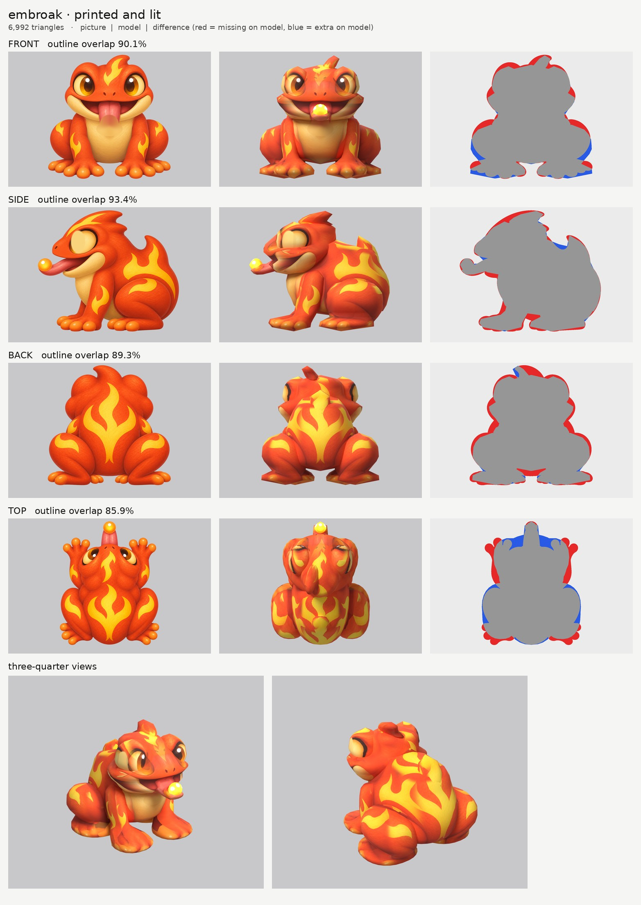

# Embroak: small-model-only route

**Result:** a 6,992-triangle game model (`embroak.glb`, 0.7 MB) with one colour texture (2048), a
normal map (flat: smooth skin) and a glow map. **Only the ember bead glows strongly; the yellow flame
markings glow very faintly; nothing else glows** (orange skin, eyes, belly, toe pads are black in
`emissive.jpg`). It reads as the frog in the pictures: big bulging eyes with one pupil each, wide grin,
tongue out with the glowing bead, head crest, flame fin on the back, folded back legs and spread toes.
`closeups.jpg` has the two three-quarter views and the face.

## Numbers

| | Front | Side | Back | Top |
| --- | --- | --- | --- | --- |
| Blockout (60,000 triangles), outline overlap | 90.2% | 95.3% | 90.8% | 85.9% |
| Game model (6,992 triangles), outline overlap | 90.1% | 93.4% | 89.3% | 85.9% |

- **Texture seen by a picture:** 48.9%. I made the blend between pictures sharper on the body and legs
  (below), and that counts surfaces seen only at a slant as "not seen". With the normal setting the
  same model scored 66%. The rest is the undersides, the inside of the legs and surfaces hidden inside
  other parts, coloured from the nearest painted spot on the same part.
- **Glow:** strong on 0.4% of the texture (the bead), faint on 6% (the yellow flames, at 8% strength).
- **Parts:** 9 (12 counting left and right): `head`, `head_eye` pair, `head_crest`, `head_tongue`,
  `head_ember`, `body`, `body_fin`, `front_leg` pair, `rear_leg` pair (each rear leg is the folded thigh
  and its foot in one piece). Budget: head 1,470, each eye 396, each rear leg 696, each front leg 646,
  body 1,008, tongue 420, ember 224, crest 204, fin 154.
- **Time:** about 25 minutes by the clock (20:10 to 20:35), with 4 blockouts and 5 route runs, plus the notes.

## Why front and back are a little under 92%

- **The head is narrow at eye height on purpose,** so the eyes can bulge out of it. The pictures' head
  outline there is the eyes plus a skin rim, so the gaps between eye and cheek count as missing.
- **Top (86%):** the top picture draws the head narrower and the front feet further forward and out than
  the front and side pictures. Front wins widths, side wins depths.

## What I did and the problems I hit

1. **Pictures checked.** Side faces left, top has the head at the top. Things the generator got wrong:
   - **The tongue.** The side and top pictures show it sticking straight forward at mouth height. The
     front picture draws it hanging down over the chest, with the bead 4 cm lower. A forward tongue
     can't look like that from the front. The model follows the side and top. The hanging part is painted
     out of a print-only copy of the front picture (`front_print_repaired.png`), so it doesn't print a
     ghost tongue on the chest. The bead isn't printed from the front at all.
   - **The eyes look at the camera in every picture.** They look forward in the front, forward-and-up in
     the top, and forward again in the side, but at a different spot on the eyeball. Printing all of them
     gave two or three pupils per eye. Now the pupil comes from the front picture only:
     - the side picture's pupil is painted over with the white of the eye in a print-only copy
       (`side_print_repaired.png`), so from the side you see the eye white with the pupil at its front edge;
     - the top picture isn't printed on the eyes.
   - The crest's tip curls to the creature's left in both front and back pictures (they agree), so the
     crest is a single off-centre part (`kind: one`) that keeps the curl.
   - The side picture's yellow stripe above the eye isn't in the front or top pictures. It would print
     on both sides of the head, so it is switched off on the head (`paint_ellipse_skip`). The front and
     top pictures give the forehead flame.
2. **Buried eyes (the main shape fix).** At first the eyes were small balls inside a wide head, so the
   head's skin covered them and the eye paint landed on the snout. Now the head is narrow at eye height,
   and each eye is a big dome (eyeball plus eyelid bump) that sticks out at the top corners, as in the
   front picture.
3. **Neck and fin.** The body's outline in the front picture started too low, so the body stopped short
   of the fin and the fin floated. The body now reaches up under the head to the fin.
4. **Ghost flames.** Where the side and back pictures meet (the rump), their different flame patterns
   blended into a yellow smear. A sharper blend (`paint_power` 8 on body, fin and legs) makes each spot
   take its colour from the most head-on picture. The flames are crisp now, with a soft seam where the
   two patterns meet.
5. **Glow** (my `tools/emissive.py`): a black map, except the parts that ask for glow in `parts.json`:
   - the bead: all of it, full strength;
   - head, crest, body, fin and legs: only saturated yellow flame paint, at 8%.
   The rule leaves out the pale cream belly and jaw (too much blue) and the orange skin and toe pads (too
   little green).
6. **Relief: `none` on every part** (smooth skin, as the brief says). The normal map is flat.
7. **Small parts** (eyes, bead, tongue, crest) got more triangles with `lo_weight` so they aren't faceted.

## Changed tool copies (in `tools/`)

The same set as Mossback's (see `../mossback/NOTES.md`), plus:
- `emissive.py`: a new `flame` rule (saturated yellow only).
- `inpaint_view.py`: ellipses written `x:...` are kept but not used as the surrounding colour, and
  `--flat r,g,b` fills with one colour (used for the eye white).

Rebuild: `make_views.py WORK/views 0.45 front side back top`, then
`tools/inpaint_view.py views.json front "766,548,70,68" "767,585,98,55" "x:767,440,95,75" "x:767,400,190,40" --grain 0 --sigma 28`,
then `tools/inpaint_view.py views.json side "529,262,52,84" --flat 250,212,125 --grain 0`, then
`PY=... bash tools/route_small.sh parts.json views.json OUT 7000 embroak`.

## What still looks wrong

- From the exact side, the eye is a plain cream eye white with the pupil only at its front edge (the
  side picture's own pupil was painted out). There's a faint lighter oval where it was painted over.
- From straight above, the tops of the eyes show dark eyelid arcs, not the top picture's pupils.
- The toes are paint on flat foot paddles; the round toe pads are not modelled.
- The flame pattern has a soft seam on the rump where the side and back pictures meet.
- The head's outline is a bit boxy at the cheeks from the front.
