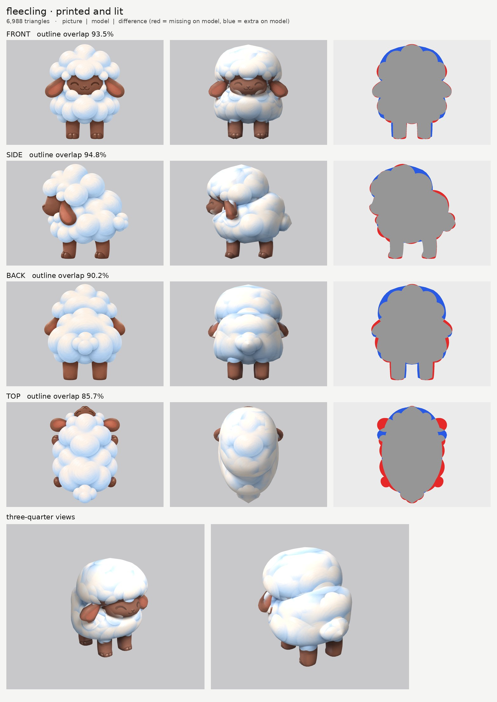

# Fleecling: small-model-only route

**Result:** a 6,988-triangle game model (`fleecling.glb`, 0.6 MB) with one colour texture (2048) and a
normal map. The glow map is all black: nothing on Fleecling glows. It reads as the lamb in the pictures:
a soft white cloud body with a round wool puff on its head, a dark brown face with closed happy eyes and smile, big floppy
ears, four brown legs with hooves and the puff tail. `closeups.jpg` has the two three-quarter views and the face.

## Numbers

| | Front | Side | Back | Top |
| --- | --- | --- | --- | --- |
| Blockout (60,000 triangles), outline overlap | 93.6% | 95.3% | 90.2% | 85.9% |
| Game model (6,988 triangles), outline overlap | 93.5% | 94.8% | 90.2% | 85.7% |

Before the cap fix (below) the game model scored 95.0 / 95.8 / 90.9 / 85.9%. The rounder cap fills less
of the picture's top corners and side puffs, so front and side dropped a little.

- **Texture seen by a picture:** 61.6% (67.3% before the cap fix: more of the cap now sits hidden inside
  the body). The rest is the undersides (belly, under the cap), the insides
  of the legs and ears and surfaces hidden inside other parts, coloured from the nearest painted spot on
  the same part. The hoof soles get a dark brown fill.
- **Parts:** 7 (10 counting left and right): `head` (the face), `head_tuft` (the wool cap), `ear` pair,
  `body` (the wool), `tail`, `front_leg` pair, `rear_leg` pair. Budget: cap 1,944, body 1,768, face 1,012,
  each ear 352, each leg 320, tail 280.
- **Glow:** 0% (black map, checked in `emissive.jpg` and on the lit board).
- **Time:** about 17 minutes by the clock (20:35 to 20:52), with 5 blockouts and 5 route runs, plus the
  notes; then about 10 minutes for the cap fix (20:53 to 21:03: 4 blockouts and 1 route run).

## Why back and top are lower

- **Back (90%):** the back picture draws the ears sticking out wider and the wool cap narrower than the
  front picture. The front picture wins for widths.
- **Top (86%):** the top picture draws the legs and ears poking out at the sides further than the front
  picture does, and the cap narrower.

## What I did and the problems I hit

1. **Pictures checked.** Side faces left, top has the head at the top. Things the generator got wrong:
   - **The ears face the camera in every picture** (the pink inside shows from the front, the side and
     above), which a flat ear can't do. Each ear is its own hanging flap, slanting out and down as in the
     front picture, 7.5 cm thick. It shows pink from the front and side and brown from behind.
   - The side picture draws the ear tip hanging 5 cm lower than the front picture. I used the middle.
   - The back legs sit about 1.5 cm further apart in the back picture than the front legs in the front
     picture, so they peek out beside the front legs from the front (thin blue strips on the board).
2. **Cloud puffs.** Following the bumpy puff outline would make stacked rings, so the cap and the body
   are smooth outlines used as drawn (`nomask`), and the paint carries the puffs.
3. **The ears were buried in the wool** at first (only their tips showed). The wool body is now a little
   narrower behind the ears, so the ears hang on the outside of the wool as in the pictures.
4. **Ghost ears and a ghost face on the wool.** The pictures draw the ears and face over the wool. The
   wool gets no paint from those areas:
   - the front, side and back pictures' ear areas are switched off on the body and cap
     (`paint_ellipse_skip`);
   - the top picture's face and ears are switched off on the cap (`paint_box_skip`).
   Before this, there were brown streaks across the chest and brown patches on the cap.
5. **Doubled eyes.** The side picture's closed eye and smile would print beside the front picture's on
   the side of the face. They are painted out of a print-only copy (`side_print_repaired.png`). The top
   picture isn't printed on the face.
6. **The cap fix (asked for after review).** The wool cap read like a separate mushroom hat: a flat
   bottom with a sharp overhanging rim, a pointed top, and a crease where it sat on the body. Now:
   - **The underside is domed and hidden.** The cap's outline goes down inside the face and body, and its
     bottom 10 cm curve inwards (`round_ends` start 0.10). There is no flat shelf, and the curve happens
     inside the body.
   - **The top is round.** Both outlines are broad at the top and the top 4 cm are domed, instead of two
     narrowing outlines meeting in a point.
   - **The cap is a little narrower** (21 cm each side instead of 22). It no longer overhangs the body at
     the back.
   - **The body's top tapers up into the cap,** so the cap and body overlap more and the crease between
     them is a soft groove, not a ledge.
   - **The front of the cap comes down more steeply behind the face,** so it frames the face like the
     pictures' wool instead of overhanging it.
   The face, ears, legs, tail and all paint settings are unchanged.
7. **Relief: `none` on every part.** I tried a gentle `fur` (half strength) on the wool too. It added a
   stringy texture and a few dark crack-like lines; `none` was softer and more cloud-like, so I kept `none`.

## Changed tool copies (in `tools/`)

The same set as Embroak's (see `../mossback/NOTES.md` and `../embroak/NOTES.md`); no new changes for Fleecling.

Rebuild: `make_views.py WORK/views 0.6 front side back top`, then
`tools/inpaint_view.py views.json side "447,422,44,28" "380,476,34,18" --grain 0 --sigma 12`, then
`PY=... bash tools/route_small.sh parts.json views.json OUT 7000 fleecling`.

## What still looks wrong

- A soft groove still shows where the round head puff meets the body at the back. The pictures have a
  puff boundary there too.
- The cloud puffs are paint only; the outline is smooth, not bumpy.
- A white patch of the front picture's wool fringe sits on the top of the face, and the lower cheek has a
  white chin puff painted on it. Both read as wool.
- The legs have 16 sides, so they are slightly faceted up close.
