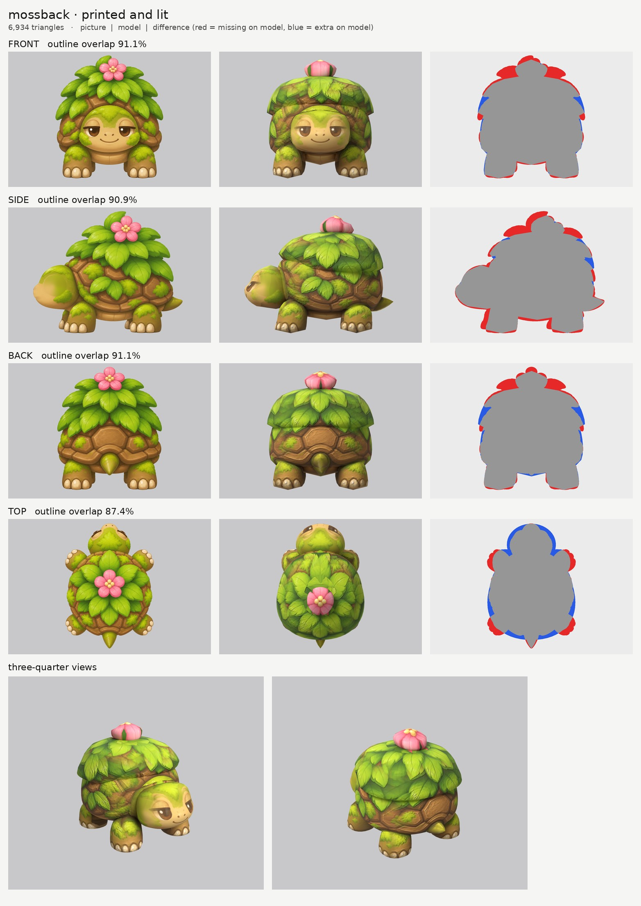

# Mossback: small-model-only route

**Result:** a 6,934-triangle game model (`mossback.glb`, 3.2 MB) with one colour texture (2048) and a
normal map. The glow map is all black: nothing on Mossback glows. It reads well from every side: sleepy
face with one clean pair of eyes, moss patches, shell plates, a leafy bush with the pink flower on top,
toenails on all four feet and the stubby tail. `closeups.jpg` has the two three-quarter views and the face.

## Numbers

| | Front | Side | Back | Top |
| --- | --- | --- | --- | --- |
| Blockout (60,000 triangles), outline overlap | 91.7% | 91.7% | 91.2% | 87.3% |
| Game model (6,934 triangles), outline overlap | 91.1% | 90.9% | 91.1% | 87.4% |

- **Texture seen by a picture:** 49.1%. That sounds low, but about a third of the texture is surface
  that is hidden inside other parts (the top of the shell under the bush, the bottom of the bush inside
  the shell, the back of the head and the leg tops inside the shell). Those spots are coloured from the
  nearest painted spot on the same part and never show.
- **Parts:** 8 (10 counting left and right): `body_shell`, `body_belly`, `body_bush`, `body_flower`,
  `head`, `front_leg` pair, `rear_leg` pair, `tail`. Budget: shell 1,512, head 1,666, bush 1,232,
  flower 368, each front leg 506, each rear leg 378, belly 216, tail 140.
- **Glow:** 0% (black map, checked in `emissive.jpg` and on the lit board).
- **Time:** about 28 minutes by the clock (19:41 to 20:09), with 5 blockouts and 6 route runs, plus the notes.

## Why the scores are a little under the 92 / 88 aim (front and back) but fine for the side

- **I smoothed the bush on purpose.** The pictures draw the bush as tiers of leaf tips. Following them
  made stacked rings (the blockout looked like a soft-serve ice cream), so the bush outline is one smooth
  dome and the paint carries the leaves. The notches between leaf tips now count as "missing" or "extra"
  (the red and blue fringes at the top of the front and back views).
- **Top (87%):** the top picture draws the legs splayed further out and the body narrower than the front
  picture. The front picture wins for widths, as the method says.

## What I did and the problems I hit

1. **Pictures checked.** Side faces left, top has the head at the top. Things the generator got wrong:
   - **The flower and bush sit in different places in the side and top pictures.** The side picture (and
     the character sheet) puts the flower about 7 cm behind the middle of the shell; the top picture puts
     it dead centre. The side picture wins for front-to-back positions, so the model follows it.
   - **The back and top pictures draw the rear toenails pointing backwards**; the side picture draws them
     pointing forwards. I kept both sets of paint: the rear feet have nails front and back, which reads
     like a tortoise's round foot from every angle.
   - The flower is drawn facing the camera in every view (an impossible flat flower), so I built it as a
     rounded blossom.
2. **The top picture is moved for the bush and flower** (new `view_warp` option in my `tools/print_tex.py`):
   the top picture's bush is stretched front-to-back to where the side picture puts it, and its flower is
   moved back 8.5 cm onto the 3D flower. Without this the top would print a second, ghost flower on the
   bush in front of the real one.
3. **Ghost flowers from the other pictures.** The front, side and back pictures also draw the flower over
   the leaves around it. On the bush, those picture areas are switched off (new `paint_ellipse_skip`
   option), and the flower itself is printed from the top picture only, so it has one yellow centre.
4. **Ghost eye.** The side picture's eye, nostril and smile would print onto the side of the head next to
   the front picture's eye. They are painted out of a print-only copy of the side picture
   (`side_print_repaired.png`, made with `tools/inpaint_view.py`; the outline is untouched). The first try
   left a black dot in the middle of the eye (the blur was too narrow to reach the centre); a wider blur fixed it.
5. **Bush shape (most of the time).** Four tries:
   - tiered outline: stacked rings;
   - smooth outline sliced top to bottom with a slanted bottom: a lid with a thin shelf at the back;
   - sliced front to back: a lumpy pillow;
   - **kept:** sliced top to bottom with a flat bottom hidden inside the shell, a domed top under the
     flower, and outlines used as drawn, without trimming to the picture's bumpy outline (`nomask`).
   The shell got the same treatment, which removed rings on its sides.
6. **Relief: `grain` on the shell, bush and legs, `none` on the head, belly, flower and tail.** I tried
   both kinds the brief named:
   - `rock` drew a few sunken dents where bright leaf colours were mistaken for lava, and scratchy crack
     lines across the shell plates;
   - `none` was clean but flat.
   I added a gentle `grain` kind to my copy of `relief.py`: rock's fine grain without any cracks. It
   gives the plate edges, leaf veins and moss a soft bump. It was the softest of the three, with no crack
   lines, so I kept it.

## Changed tool copies (in `tools/`)

- `print_tex.py` (from round 2 Opus): new per-part `view_warp` (sample a picture somewhere else for one
  part) and `paint_ellipse_skip` (switch a picture off inside ellipses, for round things like flowers).
- `relief.py`: new relief kind `grain` and per-part `relief_gain`.
- `emissive.py`: rewritten. The glow map is black unless a part in `parts.json` asks for glow.
- `board.py`, `inpaint_view.py` (round 2 Opus), `parts.py`, `build.py` (round 2 Sonnet, `n_scale` and
  `k_scale`), `route_small.sh` (uses all of the above). Paths changed for the new folder.

Rebuild: `make_views.py WORK/views 0.5 front side back top`, then
`tools/inpaint_view.py views.json side "354,590,86,80" --grain 0 --sigma 30`, then
`tools/inpaint_view.py views.json side "214,613,17,22" "228,673,42,22" --grain 0 --sigma 10`, then
`PY=... bash tools/route_small.sh parts.json views.json OUT 7000 mossback`.

## What still looks wrong

- **The bush reads a bit like a leafy hat with a rim.** Its lower edge sticks out past the shell at the
  back and sides (the leaves overhang there in the pictures), and that edge is a clean line.
- **The flower is a rounded blossom, not a flat five-petal flower.** The petals are paint only, and its
  sides show stretched petals.
- Leaves on the top of the bush just in front of the flower are a little smeared (the area where the
  ghost flower was switched off is filled from the side and front pictures).
- A faint ring of the old eye socket remains on the side of the head.
- The legs have 21 to 23 sides, so their outline is slightly faceted up close.
