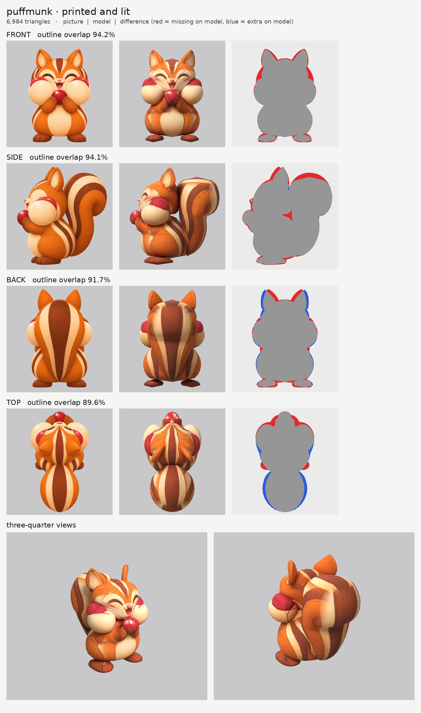
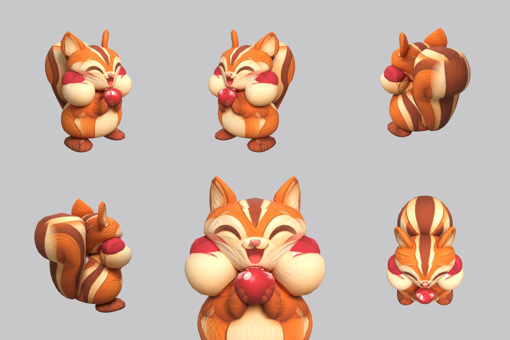

# Puffmunk: small-model-only route (Opus 5.5)

**Result:** a 6,984-triangle game model (`puffmunk.glb`, 4.3 MB) with one colour texture (2048), a
normal map (soft fur) and an all-black glow map (nothing glows, so the orange fur is not lit up). It
reads as the picture: happy closed eyes, open mouth, huge cream cheeks with red berries poking out of
their tops, a red berry held at the mouth in both brown paws, the striped back and sides, brown feet
and a big striped tail curling up behind.

The final game model's Blender file (the lead animates from it):
`/tmp/claude-0/-home-user-atoms-games-/95c47fc1-cd5e-5362-b776-c463cbad3789/scratchpad/round3/puffmunk/out7/model.blend`

## Numbers

| | Front | Side | Back | Top |
| --- | --- | --- | --- | --- |
| Blockout (60,000 triangles), outline overlap (`blockout.jpg`) | 95.3% | 95.3% | 92.3% | 89.7% |
| Game model (6,984 triangles), outline overlap | 94.2% | 94.1% | 91.7% | 89.6% |

- **Texture seen by a picture:** 71.4%. The rest (the hidden inner sides of the cheeks and arms, the
  front of the tail against the back, the soles) is coloured from the nearest painted spot of the same
  part.
- **Parts (15 pieces):** body, head, muzzle (the nose), head_cheek pair, head_cheek_berry pair, ear
  pair, head_berry, arm pair, foot pair, tail. Budget: head 1,376, tail 1,288, body 936, cheeks 520
  each, cheek berries 304 each, held berry 272, ears 252 each, feet 230 each, arms 220 each, nose 60.
- **Animation check:** `pipeline/animate.py` with `{"plan": "round", "mouth": "head"}` rigs it with
  12 bones (body, head, two-bone arms, feet, three tail bones) and all 12 clips. Part words:
  `body`; `head`, `head_cheek`, `head_cheek_berry`, `head_berry`, `muzzle`, `ear` all move with the
  head; `arm`, `foot`; `tail`.
- **The tail is one piece, not three.** It's a solid blob in every picture (no open curl), so slicing
  it upward in one piece already follows it. Three overlapping pieces left visible seams across the
  tail. The animation system joins all tail parts into one chain anyway and splits that chain into
  three bones itself (`animate.py` `fit_round`: it puts every tail part's points together before
  fitting `tail1`-`tail3`), so one piece bends the same way.
- **Time:** about 35 minutes by the clock (20:27 to 21:02), 7 route runs and 3 blockouts.

## What I did and the problems I hit

1. **Pictures checked.** Side faces left, top has the head at the top, the front and back agree with
   the side. What the generator got wrong:
   - **The red berries in the cheeks are in three different places:** on the top outer edge of each
     cheek (front picture), on the top back (side picture), on the inner back (top picture).
   - **The side picture's eye sits 2 cm behind** where the front picture's eye lands on the head.
   - **The top picture is drawn half lying down**: you can see the face and the feet stick out behind
     the body. Its tail, cheeks and head stripes still line up well enough to paint the top.
   - **The tail is very wide from behind** (23 cm, as wide as the cheeks) and peeks out behind the head
     in the front picture. I kept the width the back picture gives.
2. **Ghost eye.** I painted the side picture's closed eye out of a print-only copy (Opus's round-2
   `inpaint_view.py`, a chain of small patches along the curve; the copy is `side_print_repaired.png`).
   The top picture is not used on the face (`paint_box_skip`).
3. **Cheeks hidden inside the head.** At first the head was a full circle in the front view, so it
   swallowed the tops of the cheeks and their red berries printed onto the head as thin red streaks.
   The head now narrows below the eyes (that part is hidden behind the cheeks in the front picture
   anyway), so the cheeks stand out in front of it.
4. **The red berries in the cheeks.** Because each picture puts them somewhere else, printing them
   gave pale pink smears. They are now their own pair of red balls tucked into the top back of each
   cheek (`head_cheek_berry`), outlined from the red crescents in the front and side pictures, and
   coloured one red that the pictures only lighten and darken a little (new `paint_solid` option).
5. **Arms like flat bananas.** Sliced upward, the forearm (which runs from the elbow, low and back,
   up to the paw at the berry) came out as a flat slab. The arms are now sliced front-to-back with a
   drawn outline from above (the top picture can't see them under the cheeks), like Mushling's arms.
6. **Patchy stripes on the body sides.** The front, side and back pictures put the side stripes in
   different places, which printed as broken stripes. The front and back pictures are switched off on
   the body's outer sides there, and the body uses a sharper "most head-on picture wins" rule
   (`paint_power` 5), so the side picture's diagonal stripes come through whole. The tail uses the
   same rule.
7. **Relief.** The shared `fur` relief carved every painted line. `fur_soft` (new) gives gentle fur
   tufts and no relief on red and pink paint (berries, nose, tongue) or across the borders between
   colour blocks (stripes, eye patches). The berry and nose have no relief.
8. **Glow map:** all black (`emissive.py --off`). Checked: the exported glow texture is black, and the
   lit board shows no glowing orange.

## Changed tool copies (in `tools/`)

The same set as Clovermouse's (`route_small.sh`, `parts.py`/`build.py` with `slab` and `offset`,
`print_tex.py`, `relief.py`, `board.py`, `emissive.py --off`, `inpaint_view.py`, `fix_mask.py`,
`fill_under.py`, `set_view_map.py`), with two differences:
- `print_tex.py` adds `paint_solid` (one colour for a part, shaded a little by the pictures).
- `relief.py`'s `fur_soft` tells "not fur" by colour family (red, pink, green), because Clovermouse's
  version used low saturation, which suits grey fur but switched off all of Puffmunk's orange fur.

`mkparts.py` writes `parts.json`; `redo_views.sh` rebuilds the repaired side picture.
Rebuild: `make_views.py WORK/views 0.45 front side back top`, then `bash tools/redo_views.sh` (from the
work folder), then `PY=... bash tools/route_small.sh parts.json views/views.json OUT 7000 puffmunk`.

## What still looks wrong

- **The cheek berries are a bit faceted** (304 triangles each, in solid red, so the flat faces show
  in close-ups).
- **A thin pink line** runs along the top of each cream cheek, where the front picture's red crescent
  lands on the cheek's top.
- **The white highlights painted on the cheeks** in the pictures print as small white marks.
- **The ears are thin cards** turned 45 degrees (the pictures show the inside of the ear from the
  front and from the side), so from some angles one ear is seen edge-on as a spike.
- The tail's stripes change direction where the side picture's spiral meets the back picture's
  straight stripes, so from behind at an angle the tail is a little patchy.
- The tail is as wide as the back picture says (23 cm), wider than in the character sheet's hero view.

## Compared with Coalossus and Mushling

The outline match is the best of my two (94% front and side) and the face and cheeks read well from
the front and three-quarter views. The paint is busier than Mushling's: the stripes and the cheek
berries are drawn differently in each picture, and where two pictures meet on the tail and body sides
you can see it. Below Coalossus and Mushling in clean paint, close to them in shape.
